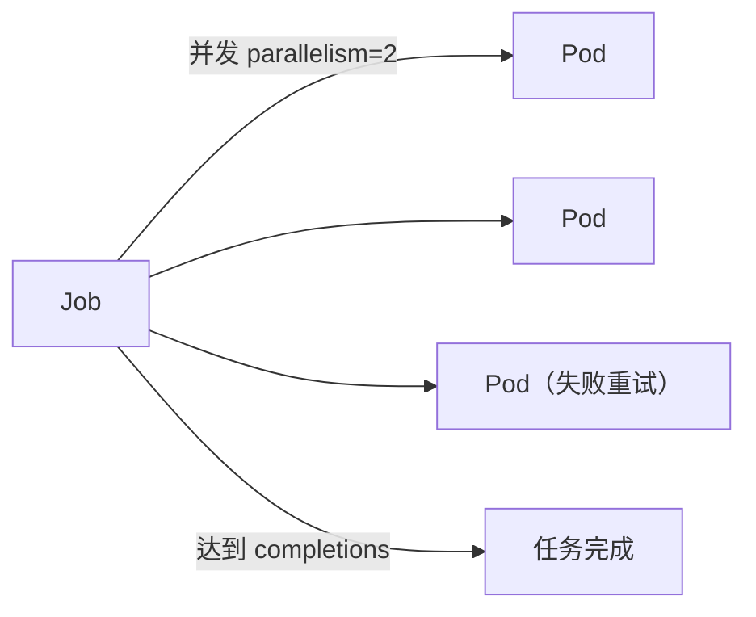
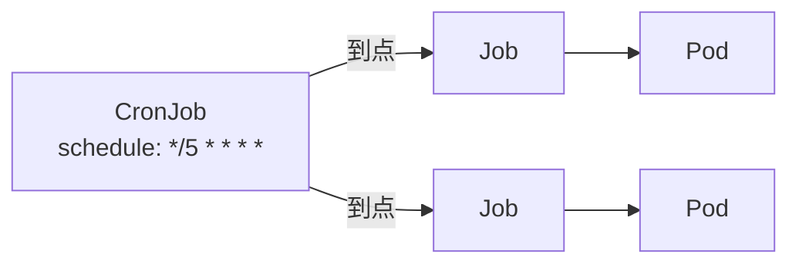

---
tags:
  - k8s
  - workload
created: 2026-11-01
status: 已整理
---

# Job 与 CronJob

Deployment 这类是「一直跑」的常驻服务；Job / CronJob 是**「跑完即停」**的批处理工作负载。

## Job：一次性任务

关键参数：

- **completions**：总共要成功完成几次（如 5 次备份）。
- **parallelism**：并发跑几个 Pod。
- **backoffLimit**：失败重试上限（默认 6），超了 Job 标记失败。
- **activeDeadlineSeconds**：最长运行时间，超时强制停。

> ⚠️ Job 的 Pod `restartPolicy` 只能是 **`Never`** 或 **`OnFailure`**，不能 `Always`——否则跑完又重启，违背批处理语义。

完成判定：成功数 ≥ `completions`（不设 completions 时，至少有一个 Pod 成功即完成）。

## CronJob：定时任务

- `schedule`：标准 **cron 表达式**（分 时 日 月 周）。
- `jobTemplate`：每次触发生成的 Job 模板。

### 三个要注意的点

| 问题 | 参数 | 说明 |
|---|---|---|
| 任务重叠 | `concurrencyPolicy` | `Allow`（默认）/ `Forbid`（上次没跑完不新建）/ `Replace`（停掉旧的再建新的） |
| 错过执行 | `startingDeadlineSeconds` | 错过这么久就不再补跑 |
| 历史堆积 | `successfulJobsHistoryLimit` / `failedJobsHistoryLimit` | 保留多少历史 Job，默认 3/1 |

> ⚠️ **时区**：CronJob 默认按 kube-controller-manager 的时区（通常 UTC）。K8s 1.25+ 支持 `timeZone` 字段，建议显式指定（如 `Asia/Shanghai`），免得半夜被吵醒。

## 相关

- Pod 重启策略 → [[Pod 生命周期与探针]]
- 控制器机制 → [[控制器与 Reconcile 循环]]
