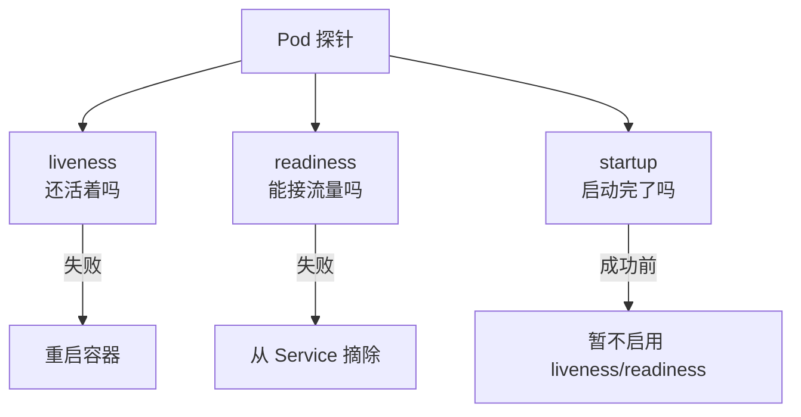
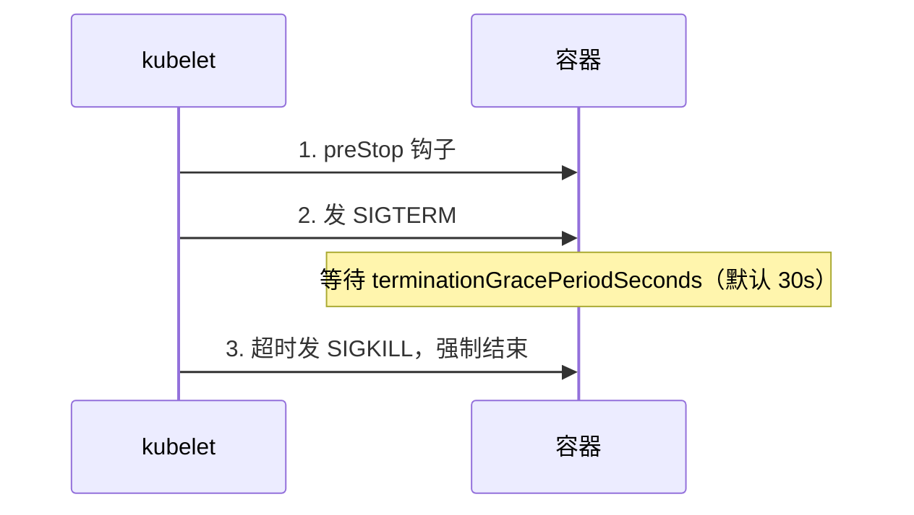

---
tags:
  - k8s
  - workload
created: 2026-11-01
status: 已整理
---

# Pod 生命周期与探针

Pod 的生命周期由 **phase 状态机 + 探针 + 重启策略 + 钩子**共同决定。理解探针是写出「能在 K8s 上平稳运行的应用」的关键。

## 探针三种类型

| 探针 | 失败后果 | 解决什么问题 |
|---|---|---|
| **liveness** | 重启容器 | 进程死锁/假死，但端口还在 |
| **readiness** | 从 Service 端点摘除 | 应用活着但还没准备好接流量（如还在加载） |
| **startup** | 失败也重启，但**成功前禁用** liveness/readiness | 慢启动应用，避免被 liveness 误杀 |

> 📌 **readiness 失败不重启**——它只控制「要不要把流量导过来」，容器本身不动。

## 探针检查方式

- `httpGet`：HTTP 请求，2xx/3xx 视为成功。
- `tcpSocket`：TCP 连接建立即成功。
- `exec`：在容器内执行命令，退出码 0 成功。
- `gRPC`：调用 gRPC 健康检查（K8s 1.24+ 稳定）。

> 经验：readiness 用应用自己的 `/ready` 端点；liveness 用 `/health` 或简单 TCP 探测；慢启动应用务必配 startup。

## 重启策略（restartPolicy）

- **Always**（默认）：容器退出就重启——Pod 默认行为。
- **OnFailure**：只在非 0 退出时重启。
- **Never**：不重启。

> [[Job]] 要求 `Never` 或 `OnFailure`，不能 `Always`（跑完就重启不符合「批处理」语义）。

## 容器关闭流程

> ⚠️ 应用必须**捕获 SIGTERM 优雅退出**：停止收新请求、处理完在途请求再退。否则 30s 后被强杀，丢数据。配合 `preStop` 钩子可以做「先摘流量、再退出」。

## 相关

- Pod 结构 → [[Pod]]
- 谁执行探针 → [[Kubelet]]
- PDB 保护优雅退出 → [[Pod 中断预算 PDB]]
