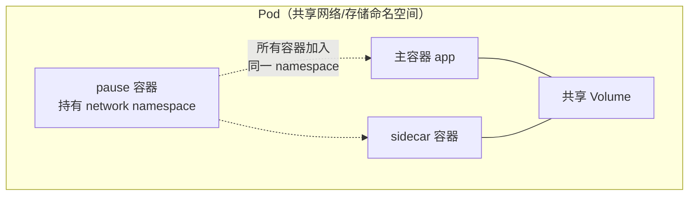
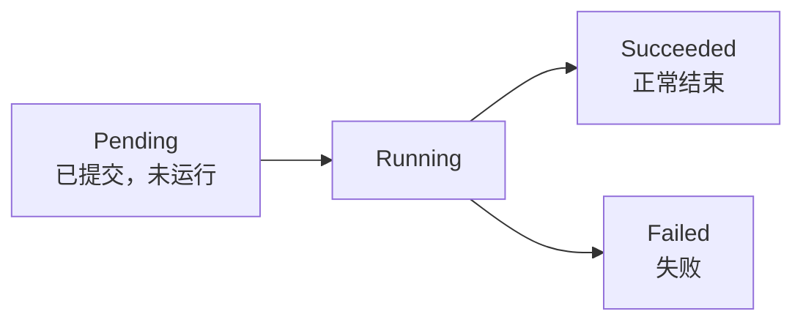

---
tags:
  - k8s
  - workload
created: 2026-11-01
status: 已整理
---

# Pod

Pod 是 K8s **最小的调度和运行单元**。注意——最小单元是 Pod 不是容器：一个 Pod 里可以跑多个紧耦合的容器。

## Pod 里有什么

**Pod 内所有容器共享**：

- **网络命名空间**：同一个 IP、同一组端口空间，容器间用 `localhost` 互通。
- **存储卷**：Pod 定义的 Volume 所有容器都能挂载。
- **IPC**：可用进程间通信。

> 那个 `pause` 容器是 K8s 偷偷加的「基础设施容器」，它的唯一作用是**持有 network namespace**，让 Pod 里其他容器死后重启还能接回原来的网络空间。

## 为什么不直接调度容器

容器组合是常见模式：主应用 + 日志 sidecar + 配置 sidecar。把一组紧耦合容器放进一个 Pod，它们天然共享网络和存储，调度上也作为一个整体（同生共死）。所以 Pod 这层抽象就是为了**容器组合**而存在的。

## Pod 是短暂的

> ⚠️ **Pod 不会自愈**。节点故障或被删除后，Pod 本身不会重建——重建它的是上层控制器（Deployment、StatefulSet 等）。

Pod 的 `phase` 字段标记生命周期阶段：

- **Pending**：已写入 etcd，等调度或拉镜像。
- **Running**：至少一个容器在跑。
- **Succeeded / Failed**：所有容器都结束（成功/失败）。
- **Unknown**：通常因为节点失联，apiserver 拿不到状态。

## 相关

- 生命周期与探针 → [[Pod 生命周期与探针]]
- 容器编排模式 → [[Init Container 与 Sidecar]]
- 谁来重建 Pod → [[Deployment]]、[[StatefulSet]]
