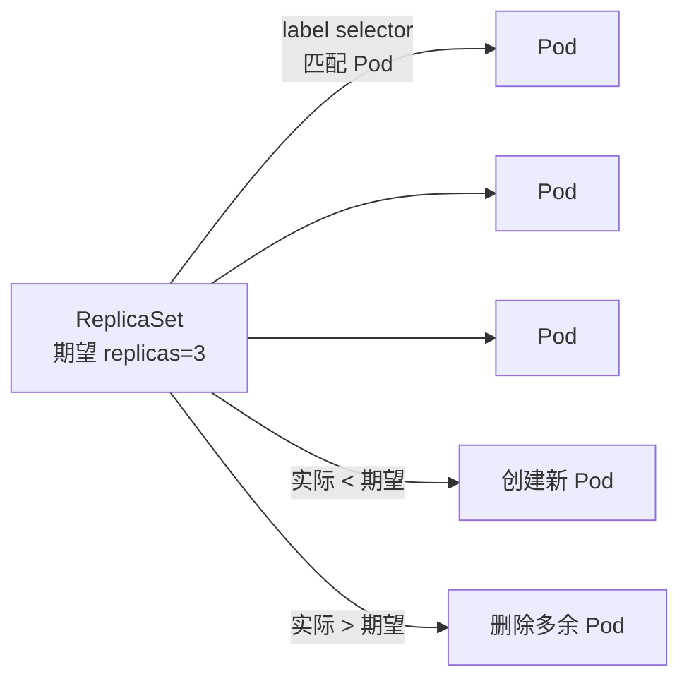

---
tags:
  - k8s
  - workload
created: 2026-11-01
status: 已整理
---

# ReplicaSet 与 ReplicationController

两者职责一样：**保证一组 Pod 的期望副本数**——少了补、多了删。ReplicaSet（RS）是 ReplicationController（RC）的升级版，RC 已废弃。

## 工作原理

- RS 定义 `replicas`（期望数）+ `selector`（用 label 找 Pod）+ `template`（Pod 模板）。
- 控制器循环不断比对「期望 vs 实际」，差就补/删。

## RC vs RS 的区别

| | ReplicationController | ReplicaSet |
|---|---|---|
| selector | 只支持**等值**（`env=prod`） | 支持**集合**（`env in (prod,staging)`） |
| 状态 | 已废弃 | 是 [[Deployment]] 的底层 |
| 直接使用 | 不推荐 | 生产基本不直接用 |

> 📌 **不要直接用 RS**——用 Deployment。Deployment 包了 RS，并额外提供滚动更新和回滚。RS 只是 Deployment 的实现细节。

## 相关

- 谁在用 RS → [[Deployment]]
- RS 的内部循环 → [[控制器与 Reconcile 循环]]
