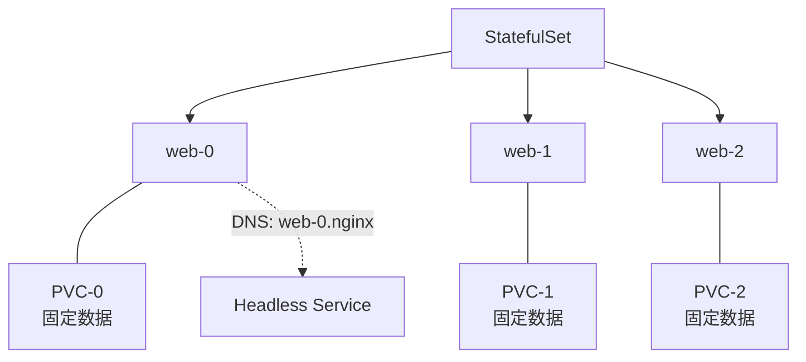
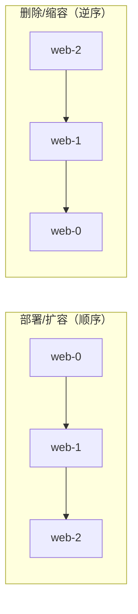

---
tags:
  - k8s
  - workload
created: 2026-11-01
status: 已整理
---

# StatefulSet

StatefulSet 给**有状态应用**（数据库、消息队列等）用：提供**稳定的网络标识 + 稳定的存储 + 有序的启停**。Deployment 做不到这三点。

## 三大特征

1. **稳定网络标识**：Pod 名固定为 `<statefulset>-<序号>`（web-0、web-1…），配合 **Headless Service**（`clusterIP: None`），每个 Pod 有独立 DNS（`web-0.nginx`），客户端能直连特定 Pod。
2. **稳定存储**：通过 `volumeClaimTemplates`，每个 Pod 绑定**自己的 PVC**。Pod 重启后接回原来的数据卷，不会丢数据。
3. **有序启停**：

- 默认 `podManagementPolicy: OrderedReady`：必须前一个就绪才创建下一个。
- 改成 `Parallel` 可并行创建（但网络标识和存储仍稳定）。

## Deployment vs StatefulSet

| | Deployment | StatefulSet |
|---|---|---|
| Pod 名 | 随机后缀 | 固定有序号 |
| 存储 | 共享/无状态 | 每个 Pod 独立 PVC |
| 启停 | 并行 | 有序（默认） |
| 适用 | Web/API 等无状态 | 数据库、主从集群 |

> ⚠️ **不要用 StatefulSet 跑无状态应用**——它有序的特性是开销，无状态用 Deployment 更简单。

## 相关

- 无状态对应物 → [[Deployment]]
- Headless Service → [[Service]]
- 存储 → [[PV 与 PVC]]
