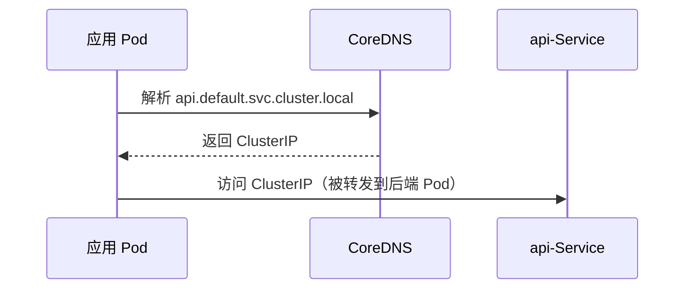
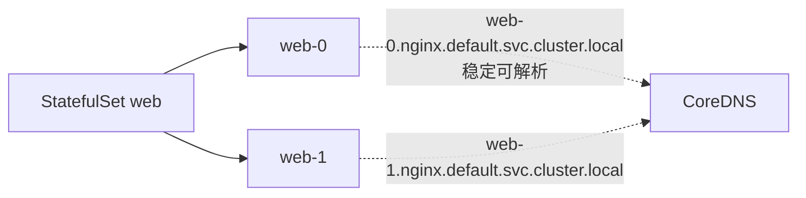

---
tags:
  - k8s
  - network
created: 2026-11-01
status: 已整理
---

# CoreDNS 与服务发现

K8s 集群内置 DNS（CoreDNS），**服务发现**靠它完成：把 Service 名解析成 ClusterIP，应用直接用服务名访问，不用记 IP。

## 解析流程



## DNS 命名规则

```
<service>.<namespace>.svc.cluster.local
<pod-name>.<service>.<namespace>.svc.cluster.local   # 仅 StatefulSet
```

- **同 namespace**：直接用 `api` 即可解析（有搜索域补全）。
- **跨 namespace**：用全名 `api.prod.svc.cluster.local`。

## Pod 级 DNS（StatefulSet 专用）



> 普通 Pod 也有 DNS（`<pod-ip>.<namespace>.pod.cluster.local`，IP 里的 `.` 换成 `-`），但 Pod 重建 IP 变了就没意义了。只有 **StatefulSet 的 Pod**（稳定名 + Headless Service）DNS 才真正可用。

## CoreDNS 本身是个 Pod

CoreDNS 以 Deployment 形式跑在 `kube-system` 命名空间，配置在 ConfigMap 里。每个 Pod 启动时会自动把 CoreDNS 的 ClusterIP 写进 `/etc/resolv.conf`，所以应用开箱就能用服务名。

## 相关

- Service → [[Service]]
- StatefulSet 稳定标识 → [[StatefulSet]]
