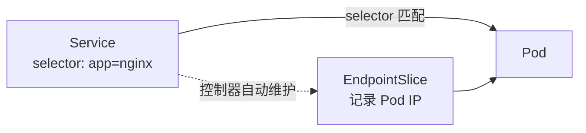
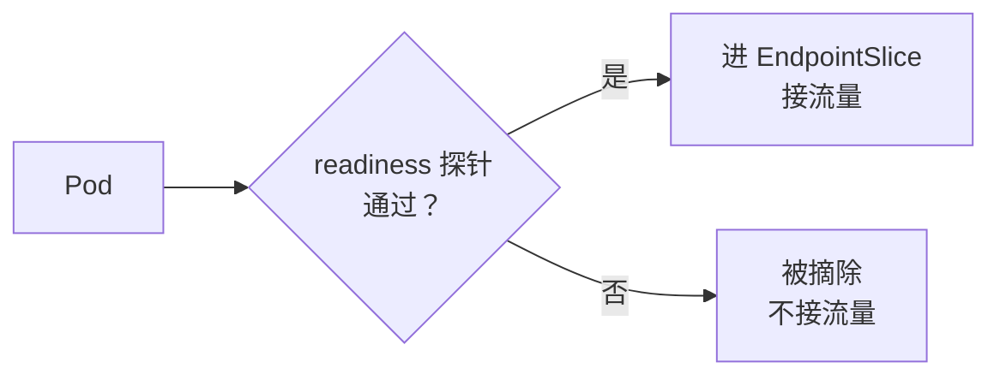

---
tags:
  - k8s
  - network
created: 2026-11-01
status: 已整理
---

# Endpoint 与 EndpointSlice

Service 用 selector 选 Pod，但「后端到底是哪些 Pod、IP 是多少」这个事实由 **Endpoint / EndpointSlice** 记录。它是 Service 和 Pod 之间的「电话簿」。

## 三者关系

- Service 定义了 `selector`，**EndpointSlice 控制器**自动把匹配且就绪的 Pod IP 写进 EndpointSlice。
- Service 的 ClusterIP 流量，最终由 kube-proxy 按 EndpointSlice 里的 IP 列表转发。

## Endpoint vs EndpointSlice

| | Endpoints（旧） | EndpointSlice（新，默认） |
|---|---|---|
| 结构 | 一个对象装所有后端 | **分片**，每片最多 100 个端点 |
| 规模 | 大集群时单个对象过大、更新成本高 | 增量更新，支持万级 Pod |
| 多协议 | 不支持 | 支持 IPv4/IPv6/FQDN |
| 状态 | 旧资源，仍兼容 | 1.21+ 成为默认 |

> 📌 现代 K8s 默认用 EndpointSlice，Endpoints 只是兼容遗留。新东西一律按 EndpointSlice 理解。

## readiness 决定「在不在列表里」

> 这就是 [[Pod 生命周期与探针]] 里 readiness 探针的实际作用——它直接决定 Pod 进不进 Service 的后端列表。

## 手动 Endpoint（无 selector 的 Service）

Service 不写 selector，再手动创建 Endpoint 指向外部 IP——就能把**集群外的服务**（如托管数据库）包装成一个 K8s Service，集群内像访问本地服务一样访问它。

## 相关

- Service → [[Service]]
- 谁维护 EndpointSlice → [[Controller Manager]]
- 进出列表的依据 → [[Pod 生命周期与探针]]
