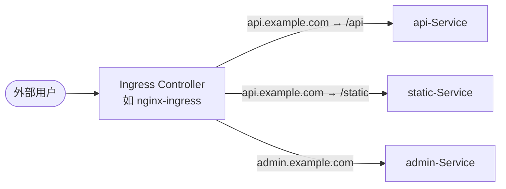
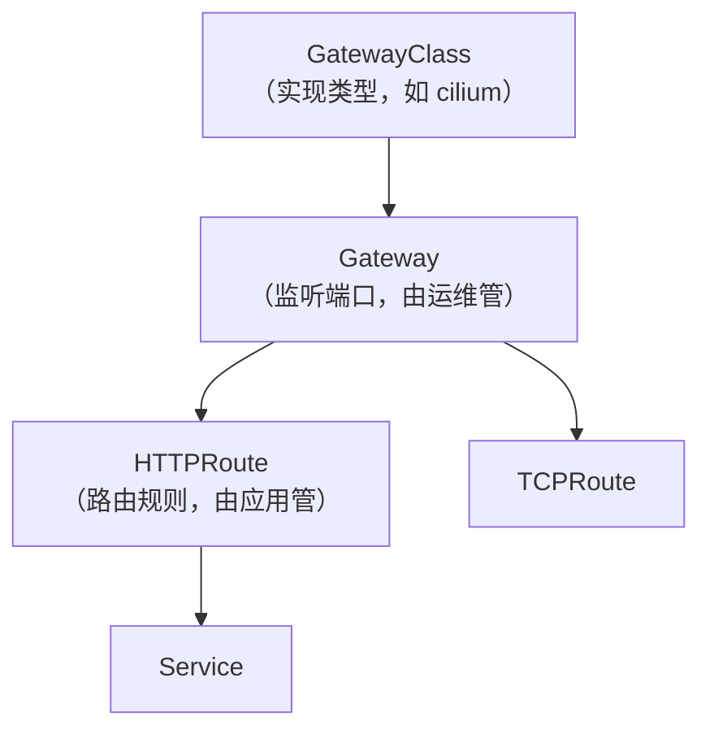

---
tags:
  - k8s
  - network
created: 2026-11-01
status: 已整理
---

# Ingress 与 Gateway API

Service（ClusterIP/NodePort）是四层（IP+端口）暴露；**Ingress / Gateway API** 提供**七层（HTTP 域名/路径）路由**——一个入口按域名或路径分发到不同 Service。

## Ingress：当前主流

- **Ingress 是资源**（声明路由规则），**Ingress Controller 是实现**（真正干活的进程，如 nginx-ingress、traefik）。K8s 不自带 Controller，需自己装。
- Ingress 只支持 **HTTP/HTTPS**。

## Ingress 的局限

- 只能 HTTP/HTTPS，不能 TCP/UDP/gRPC 路由。
- 角色耦合：集群管理员和应用开发者都在同一个 Ingress 资源上改，权限难分。

## Gateway API：继任者

Gateway API 用**多个资源 + 角色分离**解决 Ingress 的局限：

| 资源 | 谁管 | 干什么 |
|---|---|---|
| **GatewayClass** | 平台 | 声明用哪种实现（Cilium、Envoy…） |
| **Gateway** | 运维 | 监听哪些端口/协议 |
| **HTTPRoute / TCPRoute** | 应用 | 路由到自己的 Service |

> 📌 Gateway API 更通用（HTTP/TCP/gRPC 都能路由）、角色清晰，是 Ingress 的官方继任方向。新项目建议直接用，老项目继续用 Ingress 也没问题。

## 相关

- 四层入口 → [[Service]]
- 流量切分（金丝雀）→ [[发布策略]]
