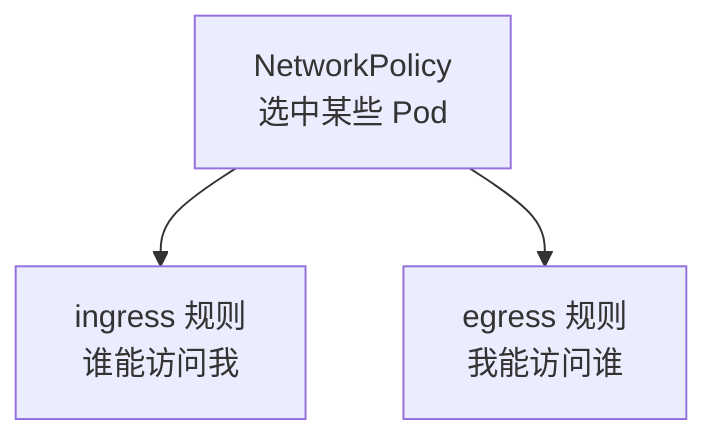
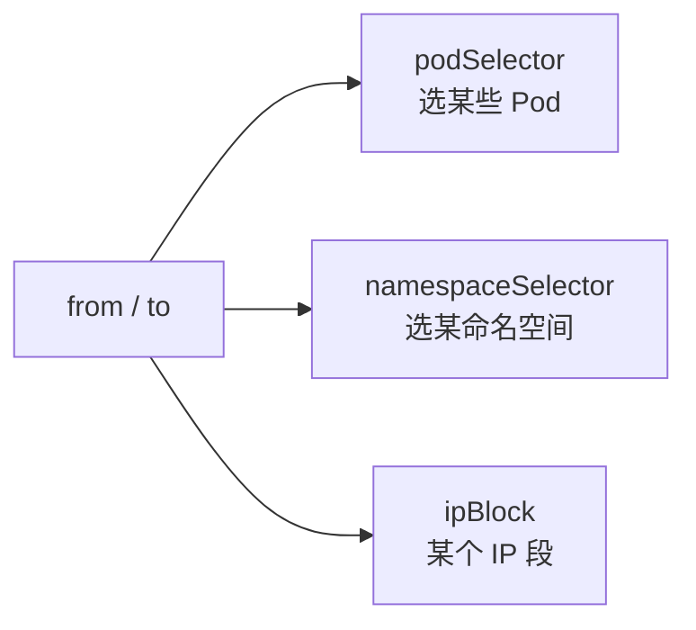

---
tags:
  - k8s
  - network
created: 2026-11-01
status: 已整理
---

# NetworkPolicy

K8s 默认**所有 Pod 之间网络全通**。NetworkPolicy 用来给 Pod 加**网络访问控制**（类似云平台的安全组）。

## 两种方向

- **ingress**：定义「哪些来源可以访问被选中的 Pod」。
- **egress**：定义「被选中的 Pod 可以访问哪些目标」。

> ⚠️ **一旦某 Pod 被 NetworkPolicy 选中**，对它来说该方向就变成 **默认拒绝**，只有规则里明确允许的才通。没被选中的 Pod 仍全通。

## 规则里怎么描述「来源/目标」

可以组合：比如「只允许带 `app=frontend` 标签的 Pod，且来自 `prod` 命名空间」访问。

## 常见模式

- **默认 deny all**：选 Pod + ingress/egress 都留空 → 全部禁止，再按需开白名单。
- **数据库只允许应用访问**：选 db Pod，ingress from app Pod。

## ⚠️ 依赖 CNI 支持

NetworkPolicy 是 K8s API，但**执行靠 CNI 插件**：

| CNI | 是否支持 NetworkPolicy |
|---|---|
| Calico | ✅ |
| Cilium | ✅ |
| Flannel | ❌（需额外组件） |

> 选 CNI 时如果需要网络隔离，必须选支持 NetworkPolicy 的。

## 相关

- Pod 网络 → [[网络模型与 CNI]]
- 命名空间隔离 → [[Namespace]]
