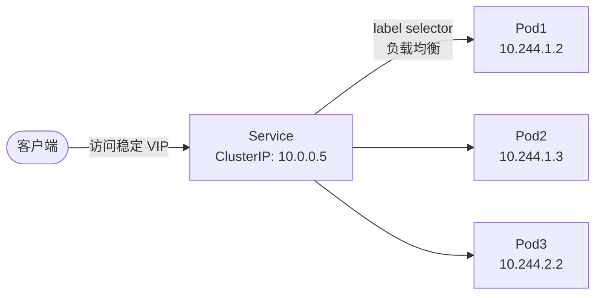
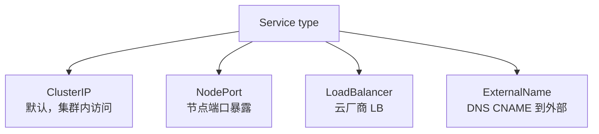

---
tags:
  - k8s
  - network
created: 2026-11-01
status: 已整理
---

# Service

Pod IP 是易变的（重建就变），Service 提供**稳定的访问入口**——一个不变的虚拟 IP（ClusterIP），背后负载均衡到一组 Pod。

## 它解决什么

- Service 用 **label selector** 找到后端 Pod，实际转发规则由 [[Kube-proxy]] 在每个节点维护（iptables/IPVS）。
- 后端 Pod 列表存在 [[Endpoint 与 EndpointSlice]] 里，Pod 漂移/扩缩时自动更新。

## 四种类型

| 类型 | 暴露范围 | 说明 |
|---|---|---|
| **ClusterIP** | 集群内 | 默认；只在集群内可访问的虚拟 IP |
| **NodePort** | 集群外（节点 IP:端口） | 在每个节点开一个端口（默认 30000–32767） |
| **LoadBalancer** | 公网 | 调云 API 建一个真正的云 LB（→ [[Cloud Controller Manager]]） |
| **ExternalName** | 外部服务 | 返回 DNS CNAME，不代理流量，用于把外部服务包装成 K8s Service |

> 类型是层层叠加的：LoadBalancer 自动包含 NodePort，NodePort 自动包含 ClusterIP。

## Headless Service

设 `clusterIP: None` 就是 Headless Service——**没有虚拟 IP**，DNS 直接返回后端 Pod IP 列表。客户端自己选 Pod 直连。[[StatefulSet]] 必须配 Headless Service，这样每个 Pod 才有稳定 DNS。

## 相关

- 后端列表如何维护 → [[Endpoint 与 EndpointSlice]]
- 转发规则由谁写 → [[Kube-proxy]]
- 七层入口 → [[Ingress 与 Gateway API]]
