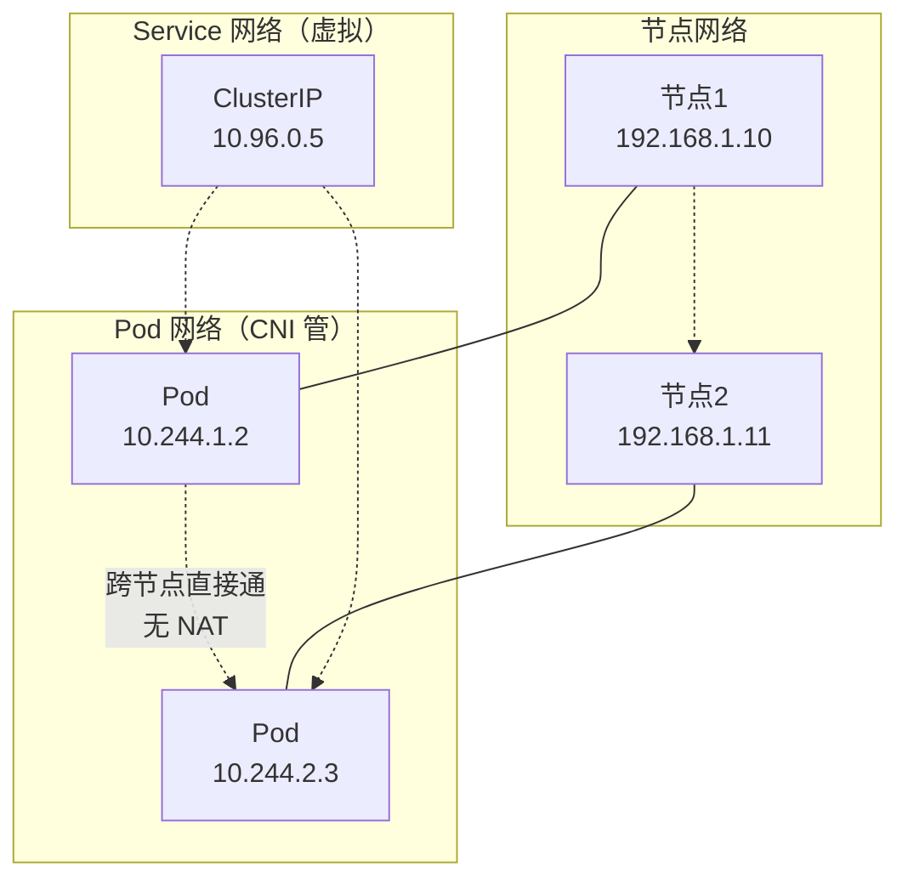
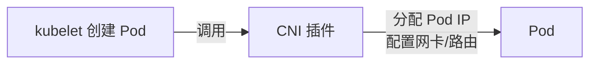

---
tags:
  - k8s
  - network
created: 2026-11-01
status: 已整理
---

# 网络模型与 CNI

K8s 网络的核心模型很简洁：**每个 Pod 一个独立 IP，Pod 间直接通信无需 NAT**。实现这套模型的就是 CNI（Container Network Interface）插件。

## K8s 网络的三层

- **节点网络**：机器之间真实互通的底层网络。
- **Pod 网络**：CNI 给每个 Pod 分配的 IP 段，跨节点也要能直接通。
- **Service 网络**：虚拟 IP，只在规则里存在，由 kube-proxy 转发到 Pod。

## K8s 网络模型的四条要求

1. Pod 间跨节点通信**无需 NAT**。
2. 节点上的代理（如 kubelet）能和本节点所有 Pod 通信。
3. 容器内看到的自己 IP，和别的容器看它的 IP 一致（无 NAT 转换）。
4. Service 提供稳定虚拟 IP。

## CNI：谁来给 Pod 配网络

常见 CNI：

| CNI | 跨节点方案 | 特点 |
|---|---|---|
| **Flannel** | VXLAN 隧道 | 简单易用，功能基础 |
| **Calico** | BGP 路由 | 性能好，支持 [[NetworkPolicy]] |
| **Cilium** | eBPF | 性能最佳，可观测性强，支持 NetworkPolicy + L7 |

> 跨节点 Pod 通信的两种主流方式：**覆盖网络**（VXLAN 隧道，封装解封装有开销）和**路由**（BGP/原生路由，性能更好）。

## 相关

- Service 虚拟 IP → [[Service]]
- 网络隔离 → [[NetworkPolicy]]
- kubelet 如何调 CNI → [[Kubelet]]
