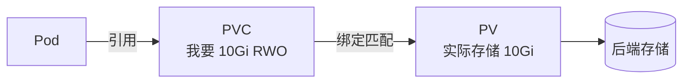
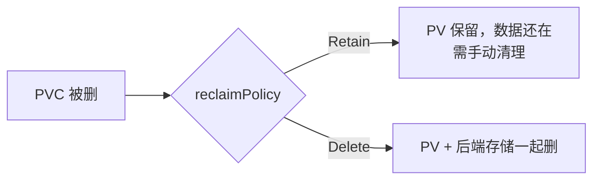

---
tags:
  - k8s
  - storage
created: 2026-11-01
status: 已整理
---

# PV 与 PVC

Pod 重建数据要能留下，靠**持久卷**。PV/PVC 把「实际存储」和「用户需求」分离，让应用不用关心底层存储细节。

## 三个角色

- **PV（PersistentVolume）**：集群级资源，代表**一块实际的存储**，通常由管理员或 StorageClass 创建。
- **PVC（PersistentVolumeClaim）**：用户级资源，声明「我要多大、什么访问模式」。
- **绑定**：控制器把 PVC 和匹配的 PV 绑定，Pod 引用 PVC 就能用这块存储。

> 📌 心智：**PVC 是「我要什么」，PV 是「实际有什么」**。应用只写 PVC，不碰 PV。

## 访问模式（accessModes）

| 模式 | 缩写 | 含义 |
|---|---|---|
| ReadWriteOnce | RWO | 单节点读写（最常见） |
| ReadOnlyMany | ROX | 多节点只读 |
| ReadWriteMany | RWX | 多节点读写（需 NFS 等支持） |

> ⚠️ 访问模式描述的是**访问能力**，不是性能。RWX 必须存储后端支持（如 NFS、CephFS），云盘通常只支持 RWO。

## 回收策略（reclaimPolicy）

- **Retain**：PV 保留（数据不丢），管理员手动决定怎么处理。
- **Delete**：连后端存储一起删（动态供给常用）。
- Recycle：已废弃。

## 相关

- 动态建 PV → [[StorageClass 与动态供给]]
- StatefulSet 用 PVC 模板 → [[StatefulSet]]
- 卷接口 → [[Volume 与存储接口]]
