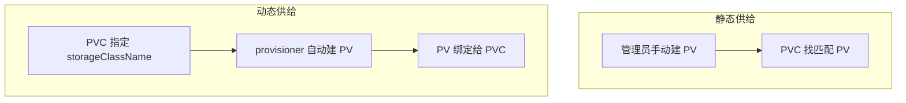
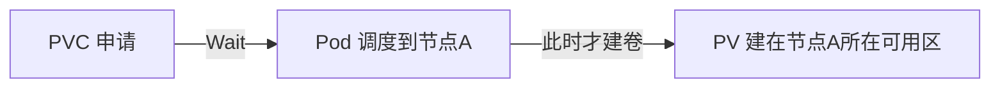

---
tags:
  - k8s
  - storage
created: 2026-11-01
status: 已整理
---

# StorageClass 与动态供给

静态供给（管理员手动建一堆 PV 等人来用）太繁琐。**StorageClass + 动态供给**让「PVC 一申请，PV 自动建」。

## 静态 vs 动态

## StorageClass 是什么

StorageClass 描述**一种存储「产品规格」**：

- `provisioner`：用哪个 CSI 驱动建卷（如 `ebs.csi.aws.com`）。
- `parameters`：规格参数（如磁盘类型 `gp3`、IOPS）。
- `volumeBindingMode`：`Immediate`（立刻建）/ `WaitForFirstConsumer`（等 Pod 调度好再建，保证卷和 Pod 在同一拓扑域）。
- `reclaimPolicy`：动态建出的 PV 默认 `Delete`。

> 可以设一个**默认 StorageClass**（标注 `storageclass.kubernetes.io/is-default-class`）。PVC 不写 sc 名时自动用它。

## 为什么需要 WaitForFirstConsumer

云盘通常和可用区绑定。如果 PVC 一申请就建卷，可能建在 A 区，结果 Pod 调度到 B 区——卷挂不上。`WaitForFirstConsumer` 让卷等 Pod 调度好再建，保证拓扑一致。

## 相关

- PV/PVC → [[PV 与 PVC]]
- CSI 驱动 → [[Volume 与存储接口]]
