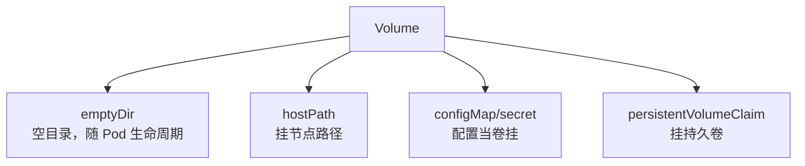
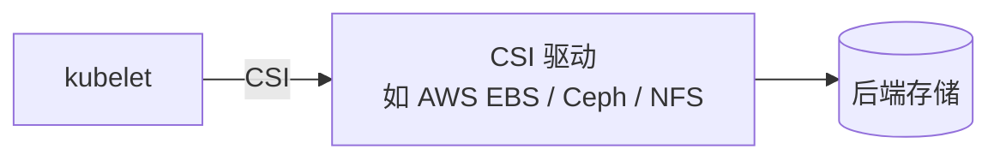

---
tags:
  - k8s
  - storage
created: 2026-11-01
status: 已整理
---

# Volume 与存储接口

Pod 本身是易逝的，但很多应用要存数据。K8s 的 **Volume** 解决「Pod 里怎么挂存储」；**CSI** 解决「K8s 怎么对接各种存储而不绑定实现」。

## Volume 类型一览

| 类型 | 生命周期 | 用途 |
|---|---|---|
| **emptyDir** | 随 Pod（Pod 删了就没） | 临时缓存、容器间共享文件 |
| **hostPath** | 在节点磁盘上 | 慎用！挂节点路径，安全风险大 |
| **configMap / secret** | 随引用的对象 | 把配置/密钥以文件形式挂进容器 |
| **persistentVolumeClaim** | 独立于 Pod | 持久数据（→ [[PV 与 PVC]]） |

> ⚠️ emptyDir 默认存在节点磁盘；设 `medium: Memory` 就是 tmpfs（内存），快但占内存。

## CSI：存储的统一接口

CSI（Container Storage Interface）是 K8s 调用存储的**标准接口**，三大能力：

1. **Provision**：创建/删除卷。
2. **Attach / Detach**：把卷挂到节点（控制器侧）。
3. **Mount / Unmount**：把卷挂进容器（节点侧）。

> 📌 早期的卷类型（如 `awsElasticBlockStore`）写死在 K8s 代码里（in-tree），维护负担重。现在都迁移到 **CSI 驱动**，K8s 核心只认 CSI，各存储厂商自己实现驱动——和 [[Container Runtime]] 的 CRI 思路一致：**接口抽象解耦实现**。

## 相关

- 持久卷 → [[PV 与 PVC]]
- 动态建卷 → [[StorageClass 与动态供给]]
- kubelet 调用接口 → [[Kubelet]]
