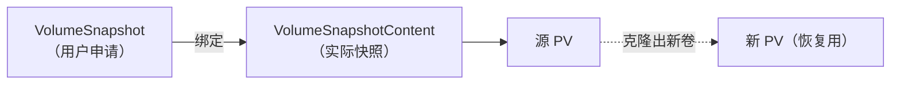
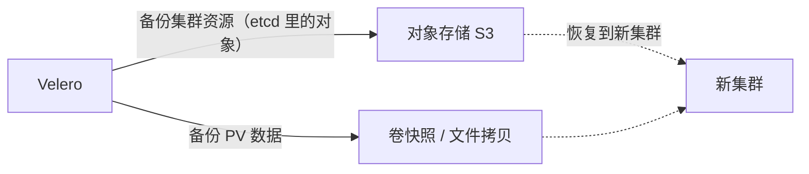

---
tags:
  - k8s
  - storage
created: 2026-11-01
status: 已整理
---

# 快照与备份

存储要能「回滚到某个时间点」。K8s 有两个层面：**VolumeSnapshot**（卷级快照）和 **Velero**（集群级备份）。

## VolumeSnapshot：卷级快照

资源关系和 PV/PVC 一一对应：

| 快照侧 | 对应存储侧 |
|---|---|
| VolumeSnapshotClass | StorageClass |
| VolumeSnapshotContent | PV |
| VolumeSnapshot | PVC |

- 依赖 **CSI 快照能力**（CSI 驱动要支持 snapshot）。
- 用途：备份某个卷、从快照克隆新卷、灾难恢复。

## Velero：集群级备份

Velero 备份的是**整个集群的状态**：

- 把 etcd 里的资源对象（Deployment、Service…）导出存到对象存储。
- PV 数据通过卷快照（CSI）或文件级拷贝备份。
- 可跨集群恢复（灾备、迁移）。

## 两者区别

| | VolumeSnapshot | Velero |
|---|---|---|
| 范围 | 单个卷 | 整个集群（资源 + 卷） |
| 层级 | 存储 | 集群运维 |
| 跨集群 | 不直接支持 | 支持 |

> 📌 VolumeSnapshot 管「这块盘的某个时间点」；Velero 管「整个集群能不能在别处复活」。生产环境两者都用：Velero 做整体灾备，VolumeSnapshot 做单卷回滚。

## 相关

- 持久卷 → [[PV 与 PVC]]
- 集群级灾备 → [[备份与恢复]]
