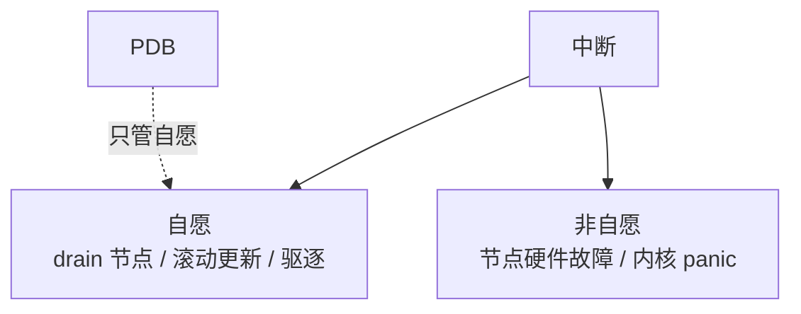
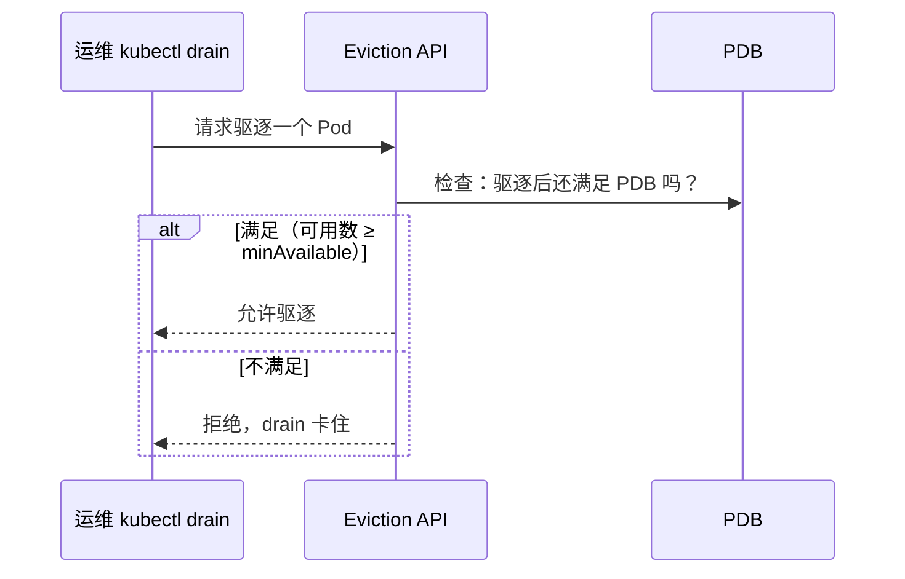

---
tags:
  - k8s
  - scheduling
created: 2026-11-01
status: 已整理
---

# Pod 中断预算 PDB

PDB（PodDisruptionBudget）保证**自愿中断时，应用至少有 N 个 Pod 还活着**——防止一次维护把某应用打挂。

## 自愿 vs 非自愿中断

> PDB **只管自愿中断**。节点突然宕机这种非自愿的，PDB 拦不住——那要靠副本数和 [[拓扑分布约束]]。

## PDB 怎么起作用

PDB 用 `minAvailable` 或 `maxUnavailable` 之一（互斥）：

- `minAvailable: 2`：至少保持 2 个可用。
- `maxUnavailable: 1`：最多同时中断 1 个。

## 配合场景

- [[Deployment]] 滚动更新：更新会先建新 Pod 再删旧 Pod，PDB 保证更新期间可用副本数。
- [[集群升级与节点维护]] drain 节点：PDB 防止一次摘太多 Pod。
- [[优先级与抢占]] 抢占：抢占受害者也受 PDB 保护。

## 相关

- 滚动更新保护 → [[Deployment]]
- 维护时触发 → [[集群升级与节点维护]]
- 抢占时受 PDB 限制 → [[优先级与抢占]]
