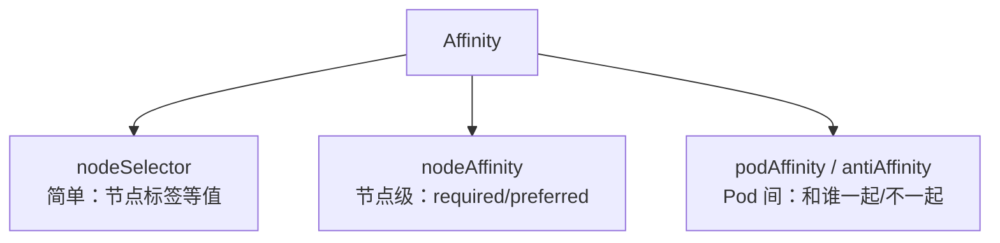
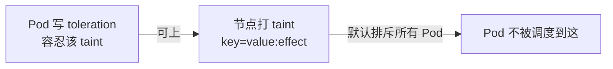

---
tags:
  - k8s
  - scheduling
created: 2026-11-01
status: 已整理
---

# 亲和性污点与容忍

控制「Pod 想去哪些节点、不想去哪些节点」。分两套机制：**亲和性（Affinity）**正向表达偏好，**污点/容忍（Taint/Toleration）**反向排斥。

## 亲和性三种

| 类型 | 作用于 | 强度 |
|---|---|---|
| **nodeSelector** | 节点标签 | 硬性（必须匹配） |
| **nodeAffinity** | 节点标签 | `required`（硬）/ `preferred`（软，带权重） |
| **podAffinity / antiAffinity** | 已有 Pod 的标签 | required / preferred |

典型用法：

- `nodeAffinity required`：把数据库 Pod 调到带 `disk=ssd` 的节点。
- `podAntiAffinity required`：同一应用的副本**分散到不同节点**，避免单节点故障全挂。

## 污点与容忍（Taint / Toleration）

污点的三种 effect：

- **NoSchedule**：不调度新 Pod 上来（已在这的不动）。
- **PreferNoSchedule**：尽量不调度（软）。
- **NoExecute**：把不容忍的 Pod **直接驱逐**。

典型用法：

- master 节点打 `node-role.kubernetes.io/control-plane:NoSchedule`，业务 Pod 上不来。
- 节点出问题打 `node.kubernetes.io/not-ready:NoExecute`，Pod 被驱逐。

> 📌 亲和性是「Pod 表达想去哪」；污点是「节点表达排斥谁」。两者常配合：用污点划大类（master 不跑业务），用亲和性精细定向（业务指定 zone）。

## 相关

- 调度流程 → [[调度流程与算法]]
- 跨域分布 → [[拓扑分布约束]]
