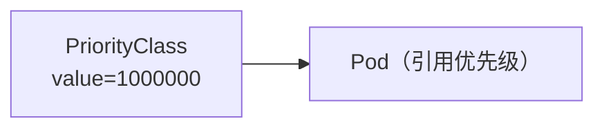
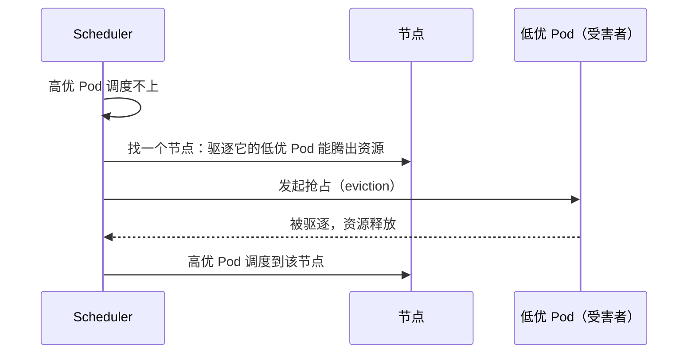

---
tags:
  - k8s
  - scheduling
created: 2026-11-01
status: 已整理
---

# 优先级与抢占

当集群资源不够、高优 Pod 调度不上时，调度器会**驱逐（抢占）一些低优 Pod**给高优 Pod 腾位置。

## PriorityClass：给 Pod 定优先级

- `PriorityClass` 是集群级资源，定义一个整数优先级（越大越优先）。
- Pod 在 `priorityClassName` 里引用。
- 系统内置两个：`system-cluster-critical`、`system-node-critical`（给关键组件，如 kube-proxy、CNI）。

## 抢占流程

## 抢占的约束

- 只抢**优先级更低**的 Pod。
- 抢占受 [[Pod 中断预算 PDB]] 约束——如果驱逐受害者会违反它的 PDB，调度器尽量避开。
- 抢占有「优雅期」：受害者先收到 SIGTERM（给 gracePeriod 退出），高优 Pod 才会被真正调度上去。

> ⚠️ 抢占用得不好会引发「抢占风暴」（被驱逐的低优 Pod 又重新调度，再抢占别人）。务必配合 PDB 和合理的优先级梯度。

## 相关

- 调度流程 → [[调度流程与算法]]
- 抢占受害者保护 → [[Pod 中断预算 PDB]]
