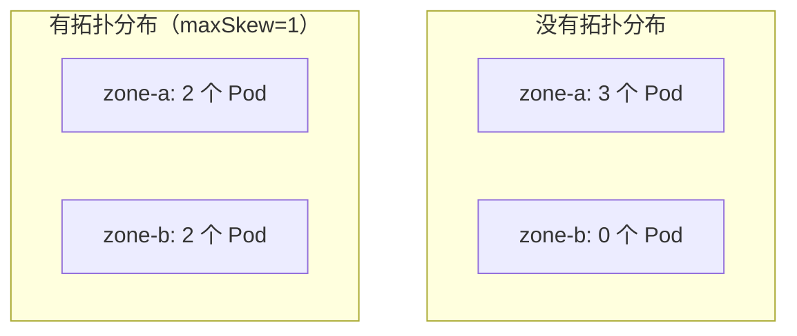

---
tags:
  - k8s
  - scheduling
created: 2026-11-01
status: 已整理
---

# 拓扑分布约束

`topologySpreadConstraints` 让 Pod **跨故障域（zone/rack/节点）均匀分布**，避免一个应用的副本全堆在一个域里——单域故障就全挂。

## 它做什么

关键参数：

- **maxSkew**：各域之间数量差的最大容忍值（如 `1` 表示最多差 1 个）。
- **topologyKey**：按什么拓扑域分布（如 `topology.kubernetes.io/zone`、`kubernetes.io/hostname`）。
- **whenUnsatisfiable**：不满足时怎么办——`DoNotSchedule`（硬性，不调度）/ `ScheduleAnyway`（软性，尽量分）。
- **labelSelector**：要分布的是哪些 Pod（本应用的）。

## 和 podAntiAffinity 的区别

| | podAntiAffinity | topologySpreadConstraints |
|---|---|---|
| 目标 | 别和某些 Pod 在一起 | 各域数量均衡 |
| 粒度 | 二元（在/不在） | 可控的「差值」 |

> podAntiAffinity 只能说「别去已有同 Pod 的节点」，太粗；拓扑分布能精确控制「各域最多差几个」，更灵活。生产里**跨可用区高可用**首选拓扑分布。

## 相关

- 调度流程 → [[调度流程与算法]]
- 故障域与高可用 → [[亲和性污点与容忍]]
