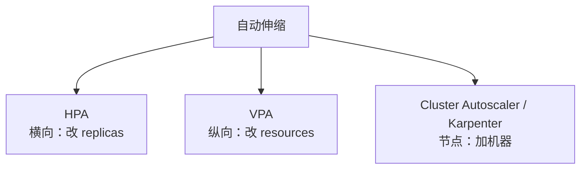
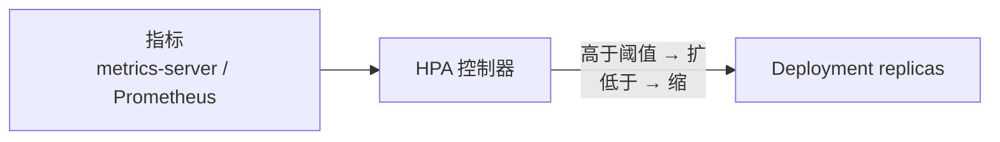

---
tags:
  - k8s
  - scheduling
created: 2026-11-01
status: 已整理
---

# 自动伸缩 HPA 与 VPA

K8s 有三个方向的伸缩：**横向（Pod 数）**、**纵向（Pod 资源）**、**节点（机器数）**。

## 三者对比

| | 调什么 | 触发依据 |
|---|---|---|
| **HPA** | Deployment/RS 的 `replicas` | CPU/内存/自定义指标 |
| **VPA** | Pod 的 `resources.requests` | 历史/实时资源用量 |
| **Cluster Autoscaler** | 节点数 | 有 Pod 因资源不足 Pending |

## HPA（最常用）

- 依赖**指标来源**：CPU/内存需 metrics-server；自定义指标需 Prometheus Adapter。
- HPA（autoscaling/v2）支持多指标、最小/最大副本数、稳定窗口（防抖）。

> ⚠️ HPA 用 CPU/内存时，**Pod 必须设 `resources.requests`**——HPA 算的是「实际用量占 request 的比例」，没 request 就没法算。

## VPA

- 调整 Pod 的 requests（让 Pod 拿到更合适的资源量）。
- 默认模式 `Recreate`：改资源要**重建 Pod**。
- K8s 1.27+ 引入 InPlacePodVerticalScaling，支持**原地改**（不重启）。

> ⚠️ HPA 和 VPA **不能同时管 CPU/内存**——会打架。一般横向用 HPA，纵向只管那些无法横向扩的有状态应用。

## 相关

- 资源配额与 QoS → [[资源配额与 QoS]]
- 指标来源 → [[Metrics 与 Prometheus]]
- 节点伸缩 → [[集群搭建 kubeadm]]
