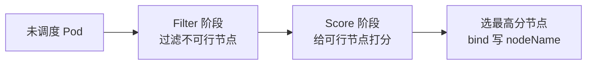
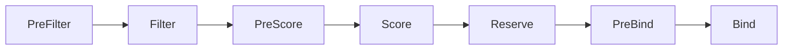

---
tags:
  - k8s
  - scheduling
created: 2026-11-01
status: 已整理
---

# 调度流程与算法

[[Scheduler]] 组件那一篇讲了「调度器只写 nodeName」；这篇讲**它怎么挑节点**——调度算法本身。组件和算法分开看更清楚。

## 两阶段

## Filter（过滤）

排除不满足硬性条件的节点。常见插件：

- **PodFitsResources**：节点剩余资源够不够 Pod 的 requests。
- **NodeUnschedulable**：节点是否被标记 `unschedulable`（比如 cordoned）。
- **NodeSelector / NodeAffinity**：标签是否匹配。
- **TaintToleration**：Pod 是否容忍节点的污点。
- **VolumeZone / VolumeTopology**：卷和节点的拓扑是否一致。

## Score（打分）

对通过 Filter 的节点打分排序。常见插件：

- **NodeResourcesBalancedAllocation**：CPU/内存越均衡分越高。
- **ImageLocality**：节点已缓存镜像加分（拉得快）。
- **PodTopologySpread**：跨域分布越均匀分越高（→ [[拓扑分布约束]]）。
- **InterPodAffinity**：符合 Pod 亲和/反亲和加分。

## Scheduling Framework

现代调度器是**插件化的框架**，把整个流程拆成扩展点：

每个扩展点都能插入自定义插件，实现专属调度策略（如 GPU 调度、批处理调度），不用改 K8s 核心。

## 相关

- 调度器组件 → [[Scheduler]]
- 过滤依据 → [[亲和性污点与容忍]]、[[拓扑分布约束]]
- 资源判定基础 → [[资源配额与 QoS]]
