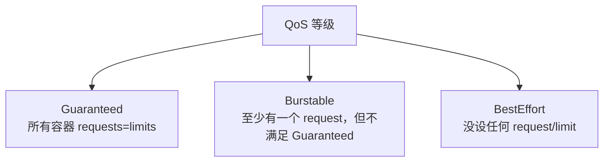
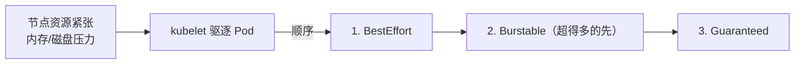

---
tags:
  - k8s
  - scheduling
created: 2026-11-01
status: 已整理
---

# 资源配额与 QoS

每个 Pod 应该设 `resources.requests`（保障量）和 `limits`（上限）。这两个值决定了 Pod 的 **QoS 等级**，进而决定节点压力时**谁先被驱逐**。

## requests vs limits

- **requests**：调度依据，节点要满足这么多才让 Pod 上来。
- **limits**：运行上限，超了会被限流（CPU）或杀（内存 OOM）。

## QoS 三等级

| 等级 | 判定 | 节点压力时 |
|---|---|---|
| **Guaranteed** | 所有容器 CPU+内存 requests==limits | 最后被驱逐 |
| **Burstable** | 有 requests 但不等于 limits | 中间 |
| **BestEffort** | 完全没设 | **最先被驱逐** |

> 📌 想让关键 Pod 最稳，就把它设成 **Guaranteed**（requests 和 limits 设成一样的值）。

## 节点压力驱逐

## 命名空间级配额

- **ResourceQuota**：限制一个 namespace 能用多少 CPU/内存/存储/Pod 数。
- **LimitRange**：给 namespace 设默认 request/limit 和单 Pod 上限（没设 resources 的 Pod 用默认值）。

> 用途：多租户/多团队共享集群时，用 ResourceQuota + LimitRange 给每方划资源边界。

## 相关

- 调度判资源 → [[调度流程与算法]]
- HPA 依赖 requests → [[自动伸缩 HPA 与 VPA]]
