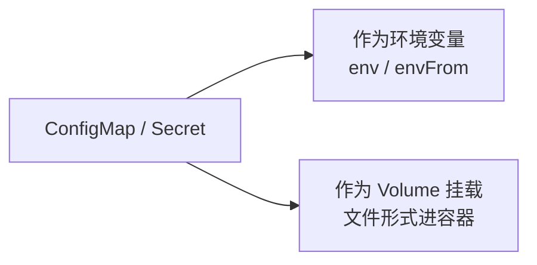

---
tags:
  - k8s
  - security
created: 2026-11-01
status: 已整理
---

# ConfigMap 与 Secret

把配置和敏感数据从镜像里抽出来，用 K8s 资源管理，应用只引用。ConfigMap 存普通配置，Secret 存敏感数据。

## 两种注入方式

- **环境变量**：`envFrom` 一次性灌入所有 key，或 `valueFrom` 单个引用。
- **Volume 挂载**：把每个 key 变成一个文件挂进容器（应用读文件即可）。

> 📌 **Volume 方式支持热更新**（ConfigMap 改了，挂载的文件会更新，应用需自己 reload）；环境变量方式 Pod 启动后就不变了。需要动态配置的优先用 Volume。

## Secret ≠ 加密

> ⚠️ **Secret 默认只是 base64 编码，不是加密！** base64 谁都能解码，别以为放进 Secret 就安全了。

要真正加密，需开启 **etcd 静态加密**（`EncryptionConfiguration`），让 Secret 在 etcd 里以密文存储。

## Secret 常见类型

| 类型 | 用途 |
|---|---|
| `Opaque` | 通用键值（最常用） |
| `kubernetes.io/dockerconfigjson` | 拉私有镜像的认证 |
| `kubernetes.io/tls` | TLS 证书+私钥（给 Ingress） |
| `kubernetes.io/service-account-token` | SA token（自动创建） |

## 相关

- Pod 引用方式 → [[Pod]]
- 镜像拉取认证 → [[镜像仓库与 Harbor]]
- 加密存储 → [[证书管理与 TLS]]
