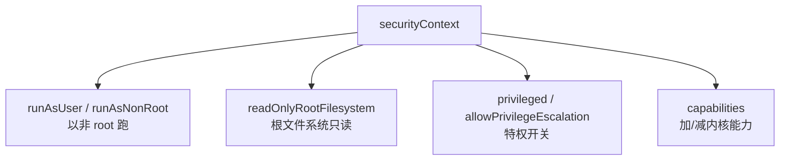
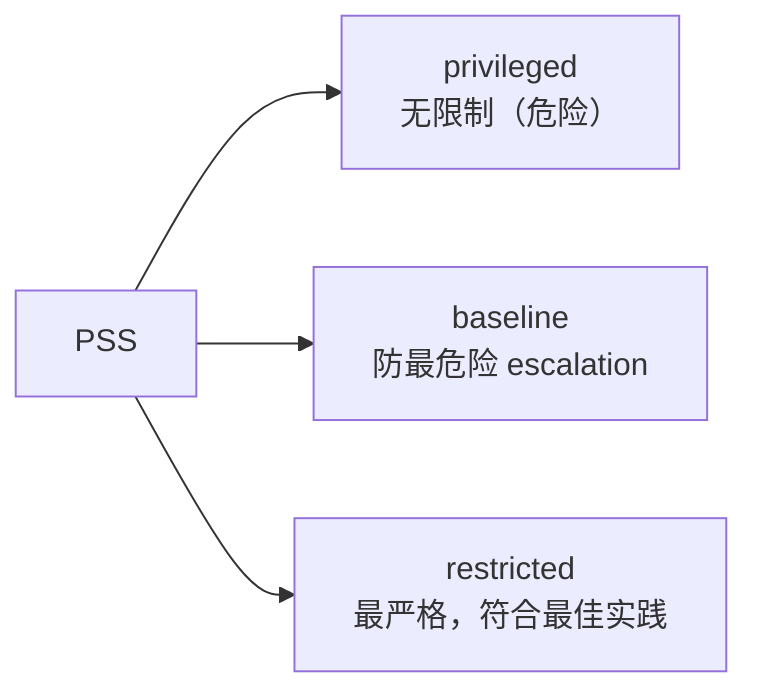
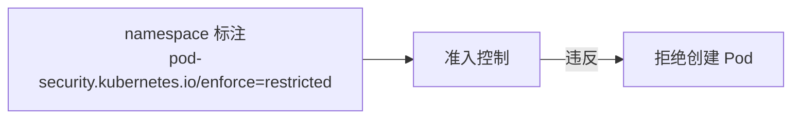

---
tags:
  - k8s
  - security
created: 2026-11-01
status: 已整理
---

# Pod 安全与 SecurityContext

控制「Pod 能做多危险的事」——能不能用 root、能不能特权、能不能改内核能力。靠 **securityContext**（细粒度）和 **Pod Security Standards**（命名空间级策略）两套。

## securityContext：容器/Pod 级设置

关键实践（最小权限）：

- `runAsNonRoot: true`——禁止 root 运行。
- `readOnlyRootFilesystem: true`——根目录只读，写入只到挂载的卷。
- `drop: [ALL]` 再按需 `add`——砍掉所有内核能力，只留必需的。

## Pod Security Standards（PSS）

命名空间级的三档安全策略：

| 等级 | 限制 |
|---|---|
| **privileged** | 基本不限（只在必要时用，如 CNI） |
| **baseline** | 禁止特权、禁止 hostPath 滥用等 |
| **restricted** | 必须 non-root、只读根 FS、砍 capabilities 等 |

## Pod Security Admission（替代 PSP）

- 在 namespace 上标注 `enforce/audit/warn=<级别>`。
- `enforce` 违反直接拒绝；`audit` 记日志；`warn` 返回警告。
- 这是 K8s 1.25 GA 的官方方案，**取代了已废弃的 PodSecurityPolicy（PSP）**。

## 相关

- 鉴权模型 → [[RBAC 与 ServiceAccount]]
- 准入机制 → [[准入控制 Admission]]
