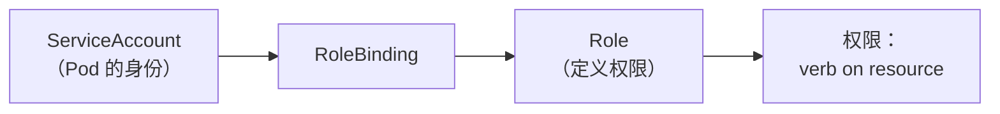
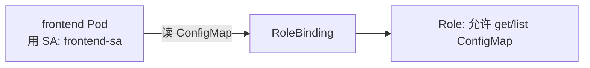

---
tags:
  - k8s
  - security
created: 2026-11-01
status: 已整理
---

# RBAC 与 ServiceAccount

K8s 的权限模型：**ServiceAccount（身份）+ Role（权限）+ Binding（绑定）**。谁（SA）能对什么资源做什么操作。

## 三个角色

- **ServiceAccount**：Pod 的身份。每个 Pod 引用一个 SA，调 apiserver 时用它认证。每个 namespace 有个默认 SA（`default`）。
- **Role / ClusterRole**：定义权限——`get/list/create/delete` 等动词对哪些资源。
  - `Role`：**命名空间级**（只管本 ns 的资源）。
  - `ClusterRole`：**集群级**（管集群范围资源，如 nodes；也可用于跨 ns）。
- **RoleBinding / ClusterRoleBinding**：把 Role 绑给某个 SA/用户。
  - `RoleBinding`：绑 `Role`（本 ns）或 `ClusterRole`（限定到本 ns）。
  - `ClusterRoleBinding`：绑 `ClusterRole`（全集群生效）。

## 一个例子

> 📌 **最小权限原则**：给每个应用建专属 SA，只绑它真正需要的权限，别用 `default` SA 跑生产应用。

## 相关

- 准入/鉴权流程 → [[API Server 请求处理流程]]
- Pod 身份 → [[Pod]]
