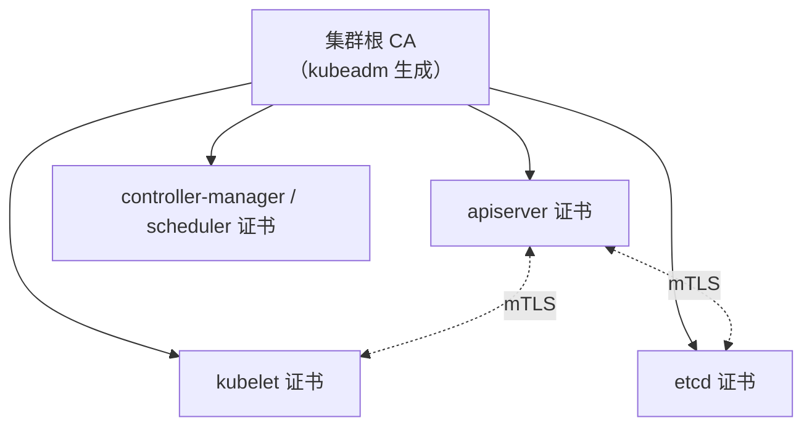
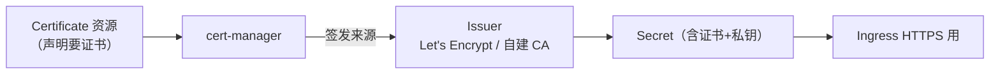

---
tags:
  - k8s
  - security
created: 2026-11-01
status: 已整理
---

# 证书管理与 TLS

K8s 控制平面组件之间用 **mTLS（双向 TLS）**通信。理解证书体系是排障和给 Ingress 配 HTTPS 的基础。

## 集群证书信任关系

- 集群有一个**根 CA**，所有组件证书都由它签发。
- apiserver ↔ kubelet、apiserver ↔ etcd 都是双向 TLS。
- kubelet 默认开启**证书轮转**（`rotateCertificates`），快过期时自动换新，不用人工续。

## 证书过期 = 集群挂

> ⚠️ 控制平面证书默认有效期 1 年。**过期后组件无法通信，整个集群停摆**。kubeadm 提供 `kubeadm certs check-expiration` 和 `kubeadm certs renew` 维护。

## cert-manager：自动签发证书

- cert-manager 是第三方控制器，自动签发和续期证书。
- 给 [[Ingress 与 Gateway API]] 配 HTTPS 几乎是标配。
- 支持公网证书（Let's Encrypt，ACME）和内部证书（自建 CA）。

## SA token（相关但不是 TLS 证书）

Pod 调 apiserver 用的是 **ServiceAccount JWT token**（由 apiserver 的私钥签名，不是 X.509 证书）。现代 K8s 用**投影 token（projected）**——有过期时间、自动轮转，比老式挂载 token 更安全。

## 相关

- RBAC 与 SA → [[RBAC 与 ServiceAccount]]
- HTTPS 入口 → [[Ingress 与 Gateway API]]
- 集群搭建生成证书 → [[集群搭建 kubeadm]]
