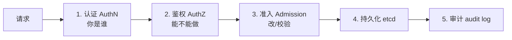
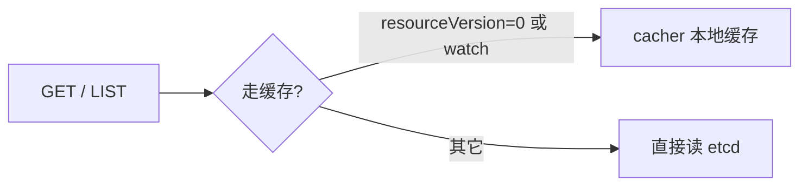

---
tags:
  - k8s
  - api-watch
created: 2026-11-01
status: 已整理
---

# API Server 请求处理流程

[[API Server]] 组件那篇讲了它的职责；这篇拆开看**一个请求进来后到底经过哪些环节**。这是理解认证、准入、watch 的总纲。

## 写请求的完整管道

1. **认证（AuthN）**：识别身份——客户端证书、token、OIDC 等。可配置多种认证插件，任一通过即认定身份。
2. **鉴权（AuthZ）**：判断该身份有无权限——RBAC / Node / Webhook 等授权策略。
3. **准入（Admission）**：对对象做修改或校验——分 Mutating（可改）和 Validating（只校验）两阶段（→ [[准入控制 Admission]]）。
4. **持久化**：写入 etcd。
5. **审计**：记录这次操作到 audit log。

## 读请求的不同

- 普通 GET/LIST 可能直接读 etcd，也可能走 cacher 缓存。
- **Watch 永远走 cacher**（→ [[List-Watch 机制]]），不会每个事件都打 etcd。

> 📌 apiserver 内部为每类资源维护一个 **watch cache（cacher）**：它自己 watch etcd 维护这份缓存，客户端的 watch 和部分 list 从这里读——既保护 etcd，又让多个客户端共享。

## 相关

- 组件职责 → [[API Server]]
- 准入细节 → [[准入控制 Admission]]
- 读路径的缓存 → [[List-Watch 机制]]
