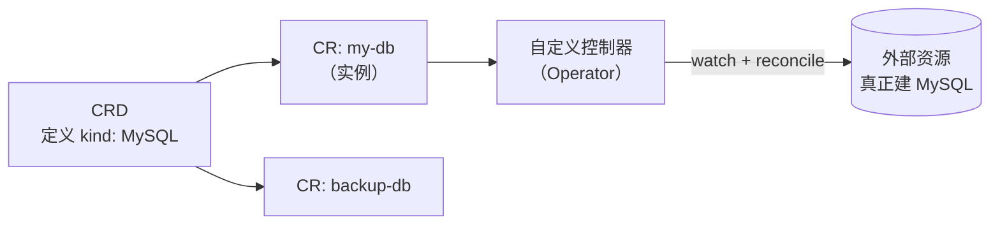
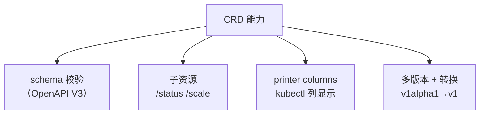
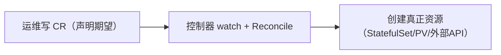
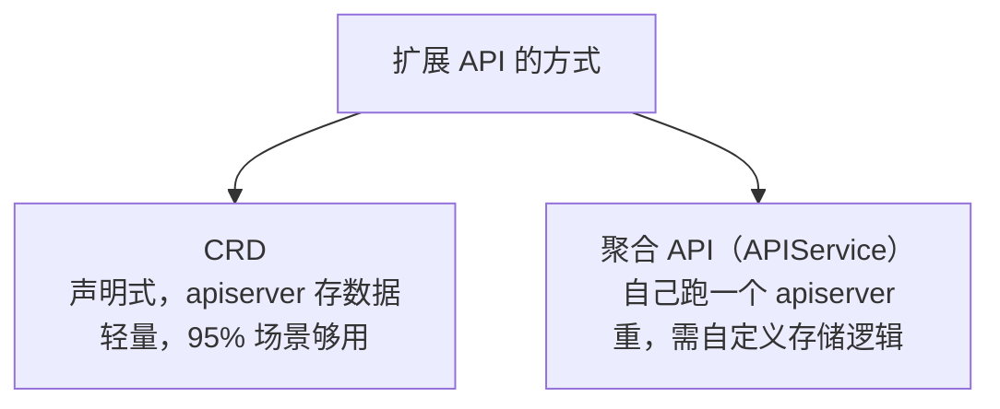

---
tags:
  - k8s
  - api-watch
created: 2026-11-01
status: 已整理
---

# CRD 与 API 扩展

CRD（CustomResourceDefinition）让你**定义自己的资源类型**——像在 K8s 里造一个新 `kind`。配合自定义控制器，就是 **Operator**。

## CRD 定义类型，CR 是实例

- **CRD**：声明「有一种资源叫 MySQL，它的 spec 长这样」（用 OpenAPI schema 描述字段）。
- **CR（Custom Resource）**：按 CRD 定义的实例——`my-db`、`backup-db`。
- 创建 CRD 后，`kubectl get mysql` 就能用了，apiserver 会按 CRD 校验 CR 的字段。

## CRD 能配什么

- **schema**：定义 spec/status 的字段和校验规则。
- **status 子资源**：让控制器单独更新 status（和 spec 分开，减少冲突——见 [[resourceVersion 与乐观并发]]）。
- **scale 子资源**：支持 `kubectl scale` 操作 CR。

## Operator = CRD + 控制器

- 你写一个 CR（比如「我要一个 3 副本的 MySQL 集群」）。
- Operator 控制器 watch 到这个 CR，按 spec 去创建真正需要的 K8s 资源和外部资源，并维护它（备份、升级、故障恢复）。
- 把「人类运维的知识」编码进控制器——这就是 Operator 的本质。

## vs 聚合 API（APIService）

> 📌 大多数自定义资源用 **CRD** 就够了；只有需要完全自定义存储/特殊协议时才用聚合 API。

## 相关

- 控制器循环 → [[控制器与 Reconcile 循环]]
- 写 Operator 的库 → [[Operator 开发]]、[[Controller-runtime]]
- client-go → [[client-go 入门]]
