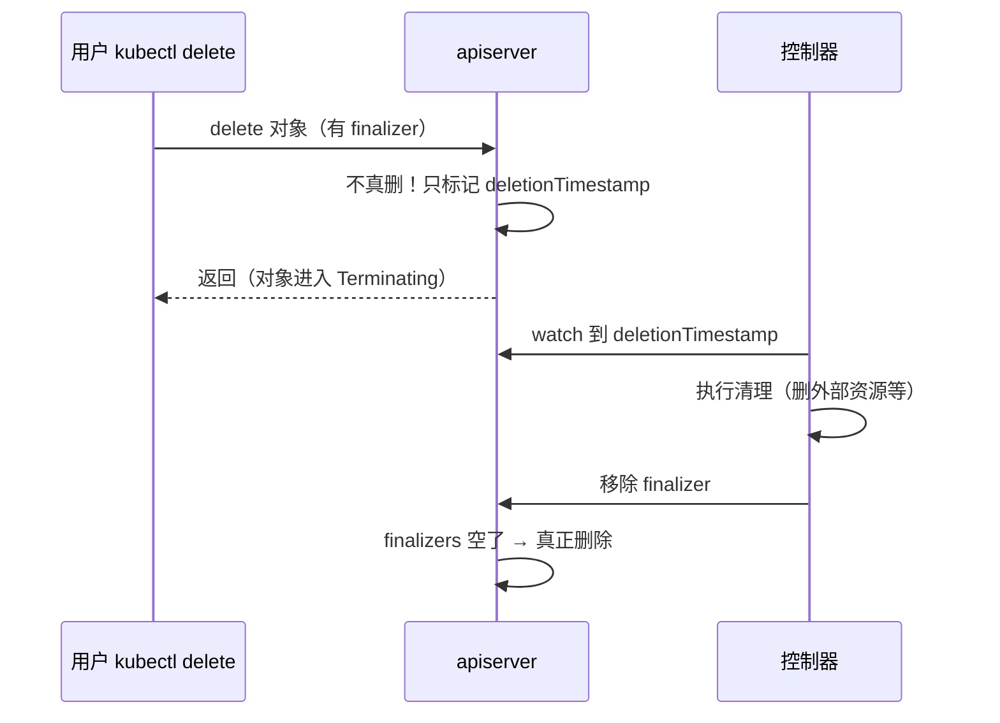
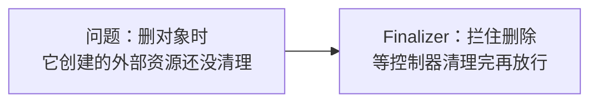

---
tags:
  - k8s
  - api-watch
created: 2026-11-01
status: 已整理
---

# Finalizer 机制

有些对象删除前必须做清理（比如 Operator 创建的外部资源、PV 的后端卷）。**Finalizer** 就是删除前的「清理钩子」，保证对象不会被还没清理就真删。

## 带 Finalizer 的对象怎么删

- `metadata.finalizers` 是一个字符串列表（如 `kubernetes.io/pv-protection`）。
- **只要列表非空，对象就不会被真正删除**——delete 只标记 `deletionTimestamp`。
- 控制器看到 `deletionTimestamp`，跑清理逻辑，然后**移除自己加的 finalizer**。
- 所有 finalizer 都被移除后，对象才被 GC 真正删掉。

## 为什么要这样设计

- Operator 创建了云上的 LB/数据库等外部资源，这些不在 etcd 里。
- 如果对象直接被删，控制器没机会清理外部资源——会泄漏。
- Finalizer 让删除「暂停」，给控制器清理的机会。

## ⚠️ 卡住的 Finalizer

> 如果加了 finalizer 的控制器挂了或逻辑有 bug，finalizer 永远移不掉，对象就**一直卡在 Terminating** 状态。排查时看 `metadata.finalizers`，必要时手动 patch 清掉（谨慎，可能泄漏外部资源）。

## 相关

- 资源生命周期 → [[OwnerReference 与垃圾回收]]
- 控制器清理逻辑 → [[控制器与 Reconcile 循环]]
- Operator 用 finalizer → [[Operator 开发]]
