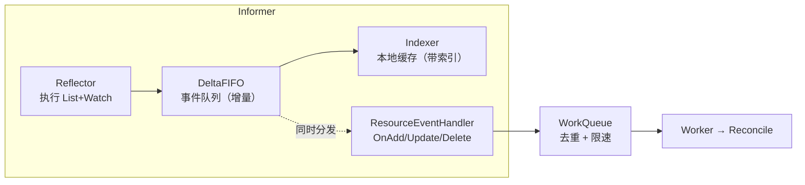
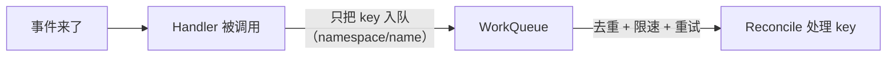

---
tags:
  - k8s
  - api-watch
created: 2026-11-01
status: 已整理
---

# Informer 与工作队列

Informer 是 client-go 提供的高层抽象，**封装了 List-Watch + 本地缓存 + 事件分发**。写控制器几乎都用 Informer，不会裸写 List-Watch。

## Informer 内部结构

- **Reflector**：底层执行 List+Watch，把事件塞进 DeltaFIFO。
- **DeltaFIFO**：先进先出的事件队列，保存对象的「增量」（Added/Updated/Deleted）。
- **Indexer**：本地线程安全缓存，带索引（可按 namespace、label 等快速查），避免每次都打 apiserver。
- **Handler**：注册的回调，收到事件后被触发。

## 为什么还要 WorkQueue

直接在 Handler 里处理业务会有问题：

- **去重**：同一对象短时间多次变化，队列只处理一次（合并）。
- **限速**：处理失败能退避重试，避免雪崩。
- **并发安全**：多个 worker 从队列取 key 并行处理，互不干扰。

> 📌 标准模式：**Handler 只入队 key，Reconcile 按 key 去读缓存+调谐**。这样事件处理和业务逻辑解耦，控制器更健壮。

## SharedInformer

多个控制器关心同一种资源时，用 **SharedInformer** 共享一份 List-Watch 和缓存，避免重复 watch 打 apiserver。controller-manager 内部就是这么做的。

## 相关

- 底层机制 → [[List-Watch 机制]]
- 消费队列的业务循环 → [[控制器与 Reconcile 循环]]
