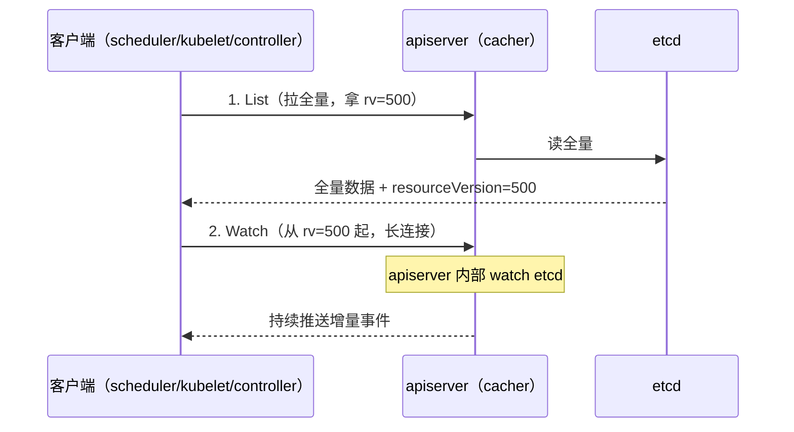
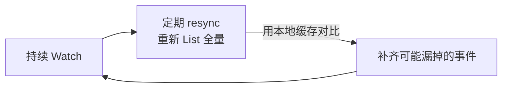

---
tags:
  - k8s
  - api-watch
created: 2026-11-01
status: 已整理
---

# List-Watch 机制

K8s 组件不主动轮询 apiserver（太浪费），而是用 **List-Watch**：先 List 一次建基线，再 Watch 持续收增量。这是整个事件驱动架构的基础。

## List + Watch 组合

> ⚠️ 关键：**客户端 watch 的是 apiserver，不是 etcd**。只有 apiserver 自己 watch etcd，并用自己的 **cacher** 缓存服务客户端（见 [[API Server 请求处理流程]]）。

## 为什么不能只用 Watch

- Watch 只给「增量」，冷启动时本地没基线，没法工作。
- 所以必须先 List 建立完整本地视图，再 Watch 追增量——组合才完整。

## resync：防丢事件的兜底

- 即使 Watch 很可靠，也怕极端情况漏事件。
- Informer 会**定期 resync**：重新 List 全量，和本地缓存对比，把缺的补上。
- resync 不重新创建对象，只是重新触发一遍 handler（让控制器有机会再 reconcile）。

## bookmark：减少 resync 开销

长空闲时客户端的 resourceVersion 会过时（etcd 历史压缩了）。apiserver 会发 **BOOKMARK 事件**（不带具体变化，只更新 resourceVersion），让客户端的版本保持新鲜，避免被迫频繁 resync。

## 相关

- resourceVersion 作为书签 → [[resourceVersion 与乐观并发]]
- 封装 List-Watch 的高级抽象 → [[Informer 与工作队列]]
