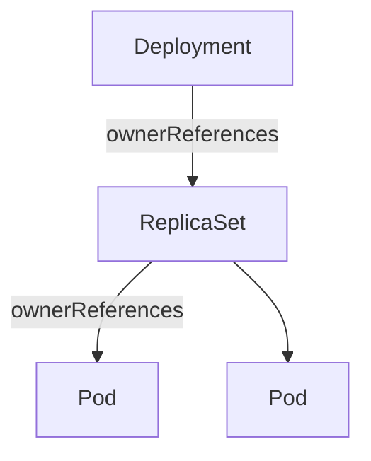
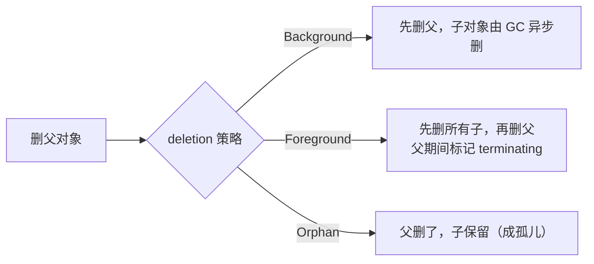

---
tags:
  - k8s
  - api-watch
created: 2026-11-01
status: 已整理
---

# OwnerReference 与垃圾回收

K8s 对象之间有**父子关系**（Deployment→ReplicaSet→Pod）。删父对象时，子对象怎么处理？由 `ownerReferences` + 垃圾回收（GC）控制器决定。

## ownerReferences：谁是谁的爹

- 子对象的 `metadata.ownerReferences` 指向父对象（含父的 apiVersion/kind/name/uid）。
- 这是个链：Deployment → ReplicaSet → Pod，层层归属。

## 级联删除：删父对象时

| 策略 | 行为 |
|---|---|
| **Background**（默认） | 立刻删父，子对象由 GC controller 后台清理 |
| **Foreground** | 先等所有子删完，才真正删父 |
| **Orphan** | 不删子，子变成无主对象 |

> 📌 GC controller 持续 watch 对象，发现某对象的 owner 不存在了（孤儿），就把它删掉（除非 Orphan 策略）。这就是 [[控制器与 Reconcile 循环]] 的一个典型应用。

## 相关

- 控制器机制 → [[控制器与 Reconcile 循环]]
- Deployment 层级 → [[Deployment]]
- 删除前的清理钩子 → [[Finalizer 机制]]
