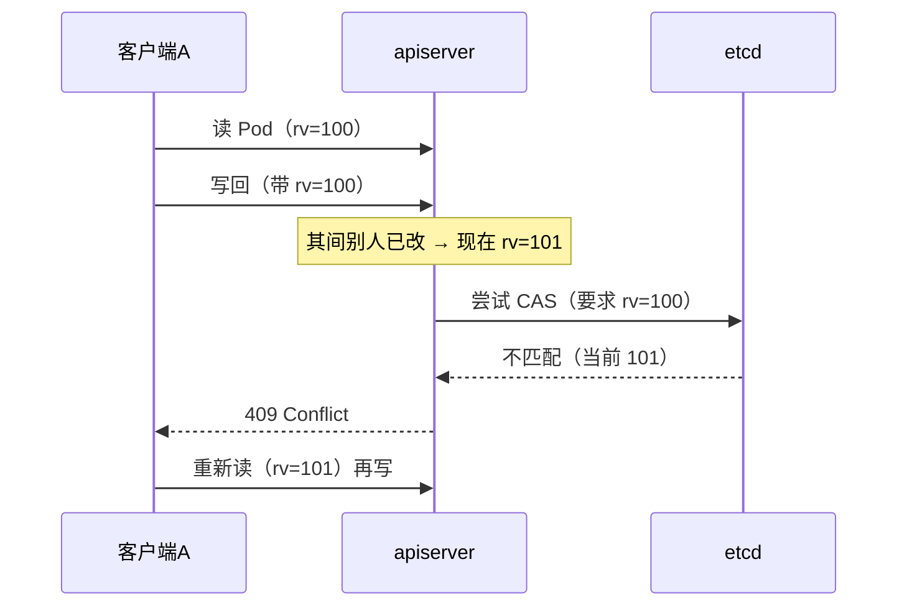
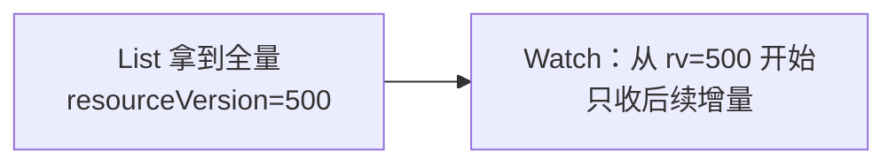

---
tags:
  - k8s
  - api-watch
created: 2026-11-01
status: 已整理
---

# resourceVersion 与乐观并发

每个对象有个 `resourceVersion`，它是 etcd 的**全局递增版本号**（基于 etcd ModRevision）。它支撑 K8s 的**乐观并发控制**和 List-Watch 的一致性。

## 乐观并发：防更新丢失

- 更新对象时**带上读到的 resourceVersion**，apiserver 据此做 CAS（compare-and-swap）。
- 如果中间被别人改过（版本不匹配），返回 **409 Conflict**，客户端必须重新读再写。
- 这防止「后写覆盖先写」丢失更新——比如两个控制器同时改同一对象。

> 📌 这就是为什么控制器写对象常用 **`patch` 而非 `update`**：patch 只改部分字段，冲突面小；update 带整个对象，更容易撞。

## 它也是 List-Watch 的「书签」

- 客户端 List 一次，拿到当时的 resourceVersion 作为「我看到的状态版本」。
- 之后 Watch 从这个版本开始，只收之后的增量事件。
- 这样 List+Watch 组合出「完整且持续更新」的本地视图（→ [[List-Watch 机制]]）。

## 相关

- List-Watch 一致性 → [[List-Watch 机制]]
- 控制器写回的冲突处理 → [[控制器与 Reconcile 循环]]
