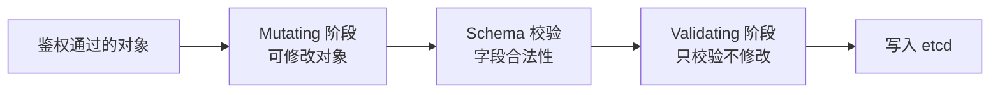
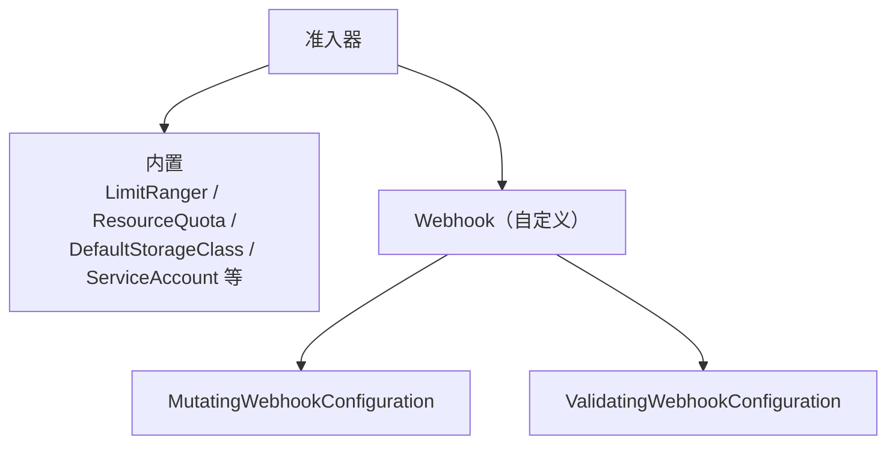
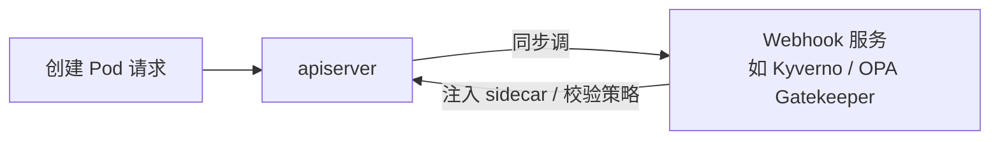

---
tags:
  - k8s
  - api-watch
created: 2026-11-01
status: 已整理
---

# 准入控制 Admission

准入（Admission）是 [[API Server 请求处理流程]] 中**鉴权之后、持久化之前**的一环：对要写入的对象做修改或校验。它是 K8s 可扩展性的关键扩展点。

## 两阶段

- **Mutating**：可改对象（设默认值、注入字段）。例：`DefaultStorageClass` 给没指定 sc 的 PVC 默认填一个。
- **Schema 校验**：检查字段是否符合资源定义（必填、类型）。
- **Validating**：只校验不改。例：`ResourceQuota` 检查是否超配额，超了拒绝。

> 📌 顺序很重要：**先 Mutating 再 Validating**——这样 Validating 校验的是改过之后的最终值。

## 内置准入器 vs Webhook

- 内置准入器：K8s 自带，编译进 apiserver。
- **Webhook**：你自己部署一个 HTTP 服务，apiserver 在准入阶段**同步调用**它——拿到对象，改或校验后返回。

## Webhook 的典型用途

- **策略引擎**：Kyverno、OPA Gatekeeper 都是基于准入 webhook 实现的——强制安全策略、标签规范等。
- **sidecar 自动注入**：Istio 的 sidecar 就是 MutatingWebhook 自动注入的。

> ⚠️ Webhook 是**同步调用**，apiserver 等它返回。所以 webhook 服务必须**高可用 + 低延迟**——挂了或慢了，整个集群写操作都受影响。

## 相关

- 在管道中的位置 → [[API Server 请求处理流程]]
- Pod 安全策略化 → [[Pod 安全与 SecurityContext]]
- 自定义校验 → [[CRD 与 API 扩展]]
