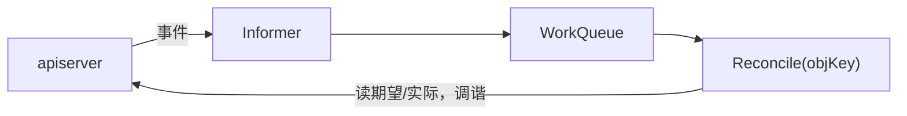
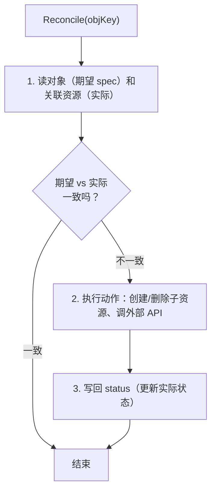

---
tags:
  - k8s
  - api-watch
created: 2026-11-01
status: 已整理
---

# 控制器与 Reconcile 循环

控制器 = **Informer（感知变化）+ WorkQueue（调度处理）+ Reconcile（调谐逻辑）**。Reconcile 是控制器的心脏：把实际状态拉回期望状态。

## 控制器结构

## Reconcile 干什么

以 Deployment 控制器为例：

1. 读 Deployment（期望 3 副本）和它的 ReplicaSet（实际）。
2. 实际不足 → 创建/扩 ReplicaSet。
3. 写回 Deployment.status（更新 readyReplicas 等）。

## Reconcile 的三个关键特性

> 📌 这是控制器模式能自愈、可恢复的根基：

- **幂等**：同一个 key 处理多少次结果都一样——所以失败能放心重试。
- **level-triggered（基于当前状态）**：不依赖「发生过什么事件」，只看「现在期望 vs 实际」——错过事件下次循环也会发现。
- **不假设事件顺序**：事件可能乱序、丢失、重复，Reconcile 照样能收敛。

## 写回的工程要点

- 优先用 `patch` 而非 `update`——减少 [[resourceVersion 与乐观并发]] 冲突。
- status 走 **status 子资源**（`/status` 端点），和 spec 分开更新，冲突面更小。
- 一个 Reconcile 只处理一个 key，不阻塞别的。

## 相关

- 感知与调度 → [[Informer 与工作队列]]
- 控制器实例 → [[Controller Manager]]
- 写回冲突 → [[resourceVersion 与乐观并发]]
