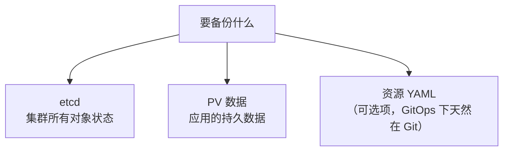
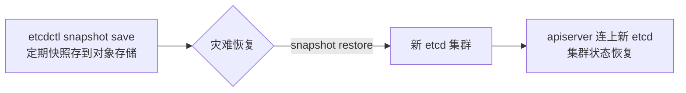
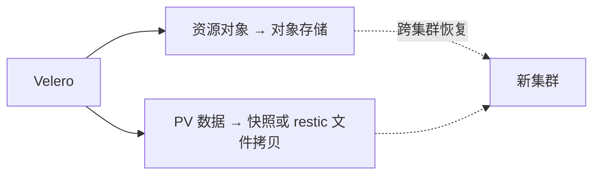

---
tags:
  - k8s
  - ops
created: 2026-11-01
status: 已整理
---

# 备份与恢复

集群故障时能恢复到什么程度，取决于备份了什么。K8s 备份分两层：**etcd（集群状态）** 和 **PV 数据**。

## 备份的两层

> 📌 [[etcd]] 是唯一有状态组件，**etcd 丢了，整个集群状态就丢了**——这是必须备份的核心。

## etcd 备份与恢复

- 用 `etcdctl snapshot save` 定期快照（cron）。
- 恢复时 `snapshot restore` 到新 etcd，再让 apiserver 连上去——集群状态就回来了。
- 这是 K8s 灾难恢复的「终极手段」。

## Velero：集群级备份

- Velero 备份的是**选定的命名空间/资源 + 对应 PV 数据**。
- 适合：跨集群迁移、整个集群灾备、按命名空间粒度恢复。
- 和 etcd 快照互补：etcd 是全量集群状态的最终底牌，Velero 是更细粒度、可跨集群的方案。

## 相关

- 唯一必备份的组件 → [[etcd]]
- PV 数据备份 → [[快照与备份]]
