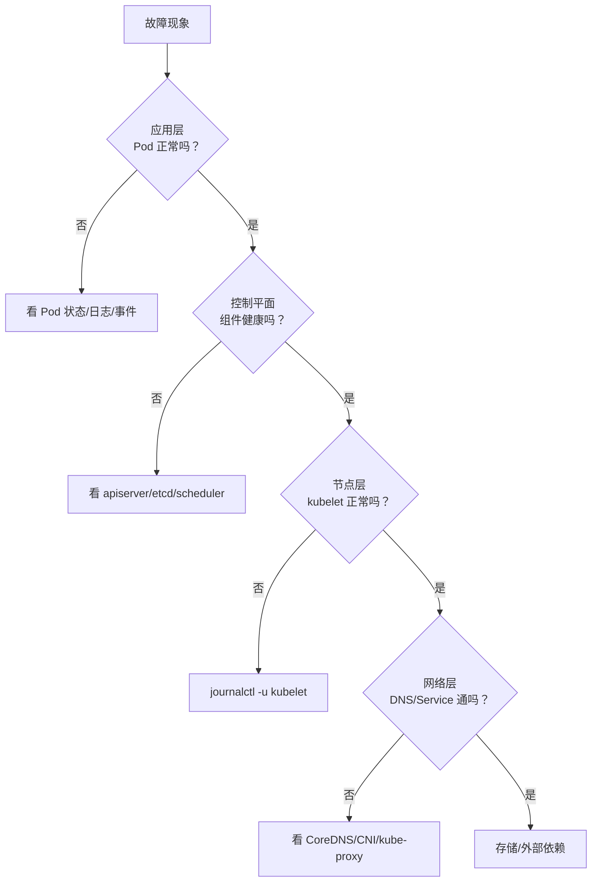

---
tags:
  - k8s
  - ops
created: 2026-11-01
status: 已整理
---

# 故障排查思路

K8s 故障排查的核心方法：**按层定位**——从上（应用）到下（基础设施），每层用对应工具看现象、验证假设。不要无目的乱试命令。

## 分层排查

## 应用层（最常见）

常用命令：

- `kubectl get pods` —— 看 phase。
- `kubectl describe pod <name>` —— 看 Events（拉镜像失败、调度失败都在这）。
- `kubectl logs <pod>` —— 看容器日志（`-p` 看上次崩溃的日志）。
- `kubectl exec -it <pod> -- sh` —— 进容器查（DNS 通不通、端口在不在）。

典型 Pod 异常状态：

| 状态 | 含义 | 排查方向 |
|---|---|---|
| **Pending** | 没调度上或没资源 | describe 看 scheduler 事件、节点资源 |
| **ImagePullBackOff** | 拉不到镜像 | 镜像名/仓库权限/网络 |
| **CrashLoopBackOff** | 启动后崩、重启、再崩 | logs 看应用报错 |
| **OOMKilled** | 内存超 limit 被杀 | 调大 limits 或查内存泄漏 |

## 控制平面

- `kubectl get componentstatuses`（旧）/ 直接看各组件 Pod（`kube-system`）。
- apiserver 慢：看是否 etcd 慢、watch cache 问题。
- etcd：`etcdctl endpoint health`。

## 节点与网络

- 节点 `NotReady`：`journalctl -u kubelet`，看 kubelet 是否挂、容器运行时是否正常。
- DNS 不通：`kubectl exec` 进 Pod `nslookup`；看 CoreDNS Pod 是否正常。
- Service 不通：检查 EndpointSlice 有没有后端（→ [[Endpoint 与 EndpointSlice]]）。

## 相关

- Pod 状态与探针 → [[Pod 生命周期与探针]]
- 组件健康 → [[02-核心组件]]
- 网络排查 → [[CoreDNS 与服务发现]]、[[网络模型与 CNI]]
