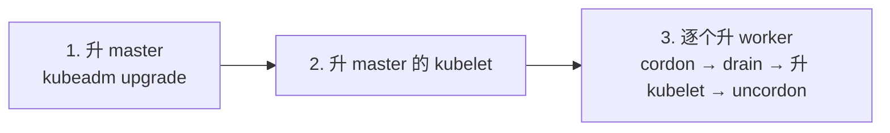
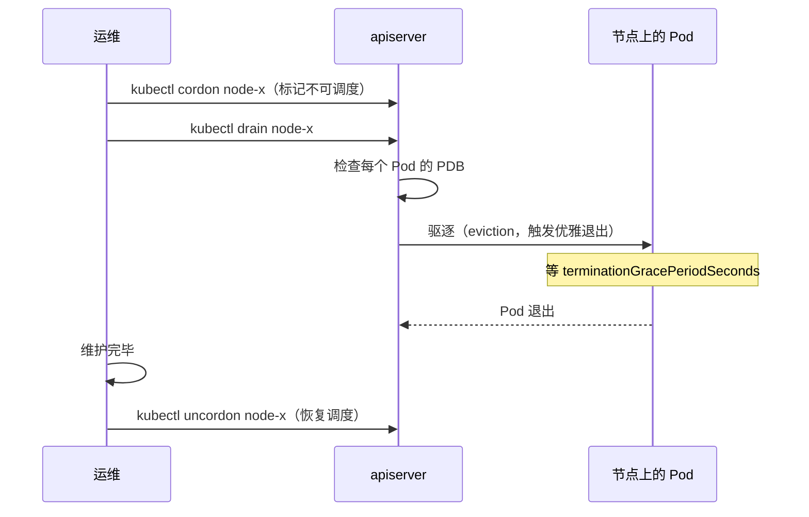

---
tags:
  - k8s
  - ops
created: 2026-11-01
status: 已整理
---

# 集群升级与节点维护

K8s 版本迭代快，升级和节点维护是日常运维。核心原则：**先升控制平面，再升节点；节点维护用 drain 驱逐**。

## 升级顺序

> ⚠️ **版本偏差规则**：节点版本不能高于 master，且 kubelet 落后 kube-apiserver 有版本上限（遵循官方 version skew policy）。所以一定要先升 master。

## 节点维护：cordon + drain

- **cordon**：把节点标 `unschedulable`，新 Pod 不再调度过来（不影响已运行的）。
- **drain**：驱逐该节点上的 Pod（DaemonSet 除外）。受 [[Pod 中断预算 PDB]] 约束——会破坏 PDB 时 drain 卡住等待。
- **uncordon**：恢复可调度。

> 📌 drain 走的是 **Eviction API**（和直接 delete Pod 不同），它会尊重 PDB 和优雅退出。维护节点务必走 drain，别直接删 Pod。

## 相关

- drain 的 PDB 保护 → [[Pod 中断预算 PDB]]
- 优雅退出 → [[Pod 生命周期与探针]]
