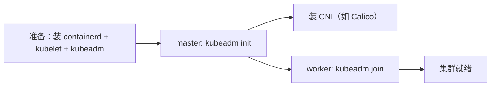
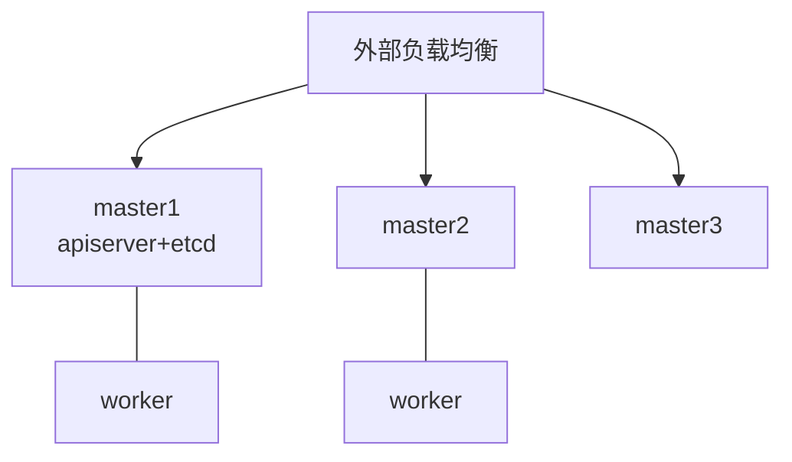

---
tags:
  - k8s
  - ops
created: 2026-11-01
status: 已整理
---

# 集群搭建 kubeadm

kubeadm 是官方的集群搭建工具，把「装一套能跑的 K8s」标准化成几条命令。生产集群常用 kubeadm 做基础，再叠加高可用和运维方案。

## 搭建流程

- `kubeadm init`：在第一个 master 上初始化——生成证书、起 etcd、把控制平面组件以**静态 Pod** 跑起来、生成 join 命令。
- `kubeadm join`：worker 节点用 join 命令加入集群。
- 控制平面组件以**静态 Pod**（kubelet 直接读 `/etc/kubernetes/manifests` 启动，不经 apiserver）形式运行。

## 生产高可用

- 多 master + 外部 LB（apiserver 前面挂负载均衡）。
- etcd 可**堆叠**（和 master 同节点）或**外置**（独立 etcd 集群，更稳但运维更重）。

## 搭建方式对比

| 方式 | 适用 |
|---|---|
| **托管**（GKE/EKS/AKS） | 省心，控制平面厂商管 |
| **kubeadm** | 自建，标准化 |
| **kubespray / RKE** | 自建，带更多自动化 |
| **k3s** | 边缘/轻量场景 |

## 相关

- 证书生成 → [[证书管理与 TLS]]
- CNI → [[网络模型与 CNI]]
- 静态 Pod 启动 → [[Kubelet]]
