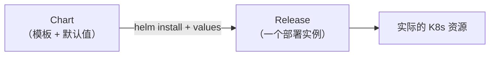
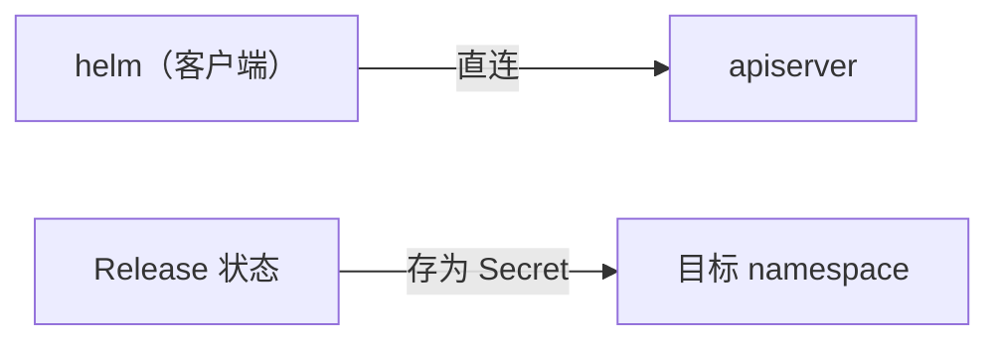

---
tags:
  - k8s
  - ecosystem
created: 2026-11-01
status: 已整理
---

# Helm 包管理

Helm 是 K8s 的**包管理器**（类比 apt/yum）。把一组 K8s 资源打包成 **Chart**，一键安装/升级/回滚——装复杂应用（数据库、监控栈）离不开它。

## 核心概念



- **Chart**：一个应用包——`templates/`（Go 模板渲染 YAML）+ `values.yaml`（默认参数）+ `Chart.yaml`（元信息）。
- **Release**：用某 Chart + 一组 values 部署出来的实例（同一个 Chart 可装多份）。
- **values**：覆盖默认参数，实现同一 Chart 不同环境不同配置。

## Chart 结构

```
myapp/
├── Chart.yaml          # 元信息（名/版本）
├── values.yaml         # 默认参数
└── templates/          # 渲染成 K8s 资源的模板
    ├── deployment.yaml
    ├── service.yaml
    └── _helpers.tpl
```

## Helm v3



- **无 Tiller**（v2 有个服务端 Tiller，v3 移除）——helm 客户端直接用 kubeconfig 调 apiserver。
- Release 状态以 **Secret** 形式存在对应 namespace，方便查询历史和回滚。
- `helm install / upgrade / rollback / uninstall`。

> 📌 Helm 用 Go 模板，能做条件渲染、循环、函数——适合参数多、需复用的复杂应用。简单场景用 [[Kustomize]] 更轻。

## 相关

- 无模板的替代 → [[Kustomize]]
- 配套镜像仓库 → [[镜像仓库与 Harbor]]
