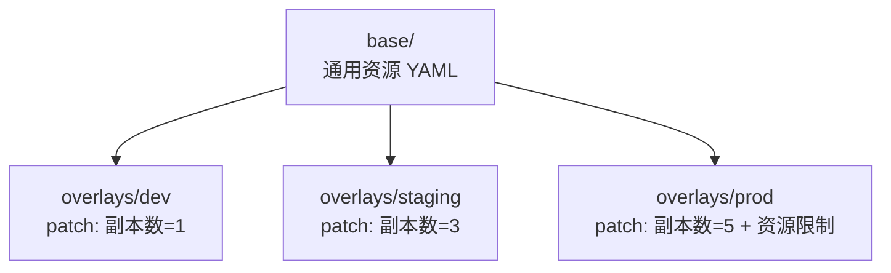
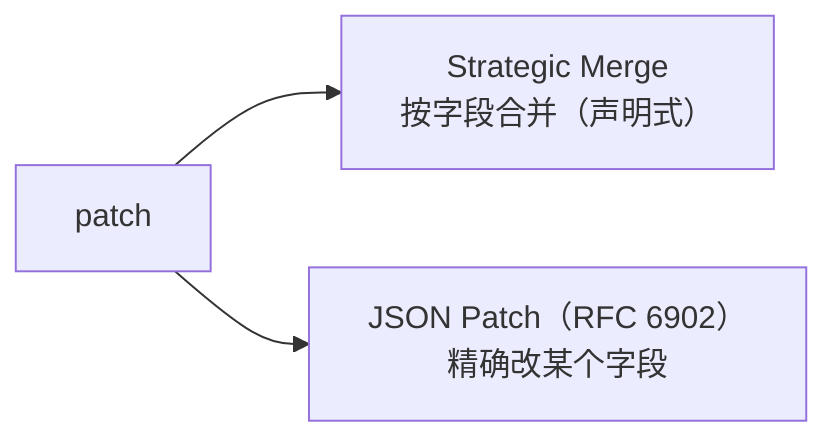

---
tags:
  - k8s
  - ecosystem
created: 2026-11-01
status: 已整理
---

# Kustomize

Kustomize 是 K8s 的**无模板配置管理工具**——不引入模板语法，用「基础 + 覆盖」组织多环境配置。已内置在 kubectl（`kubectl apply -k`）。

## base + overlays 模式

- **base**：一组通用的原始 YAML（Deployment、Service 等）。
- **overlays**：在 base 上叠加 patch，产出针对某环境的最终 YAML。
- 每个 overlay 有 `kustomization.yaml` 声明用哪些 base + 哪些 patch。

## patch 两种方式

- **Strategic Merge**：写一份部分 YAML，K8s 按字段智能合并（如只改 replicas）。
- **JSON Patch**：用路径精确改（适合复杂结构）。

## Helm vs Kustomize

| | Helm | Kustomize |
|---|---|---|
| 机制 | Go 模板渲染 | YAML patch 叠加 |
| 学习成本 | 要学模板语法 | 几乎零（认 YAML 就行） |
| 适合 | 参数多、逻辑复杂的应用 | 多环境差异化、轻量定制 |

> 📌 经验：**应用打包分发用 Helm，组织同一应用多环境差异用 Kustomize**。两者也能混用（Helm chart + Kustomize 后处理）。

## 相关

- 模板化方案 → [[Helm 包管理]]
- 声明式部署 → [[GitOps 与 ArgoCD]]
