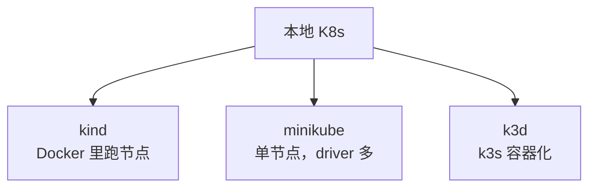
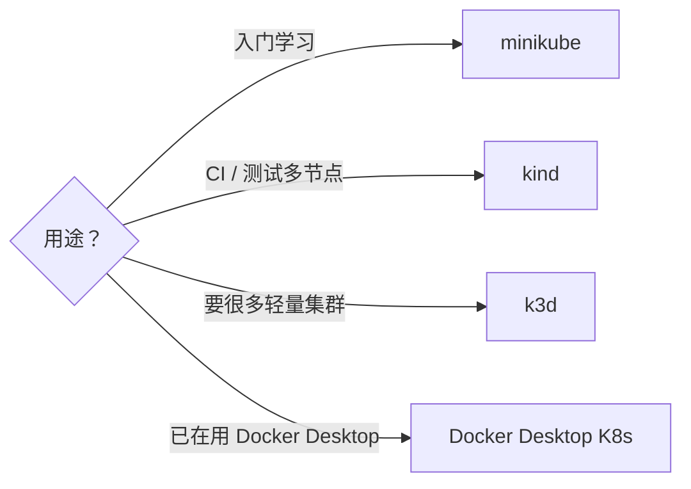

---
tags:
  - k8s
  - ecosystem
created: 2026-11-01
status: 已整理
---

# 本地开发环境

本地起一个 K8s 集群做开发测试，主流工具有 kind、minikube、k3d。选哪个看场景。

## 主流工具对比

| 工具 | 特点 | 适合 |
|---|---|---|
| **kind** | 每个「节点」是一个 Docker 容器，可多节点，启动快 | **CI / 自动化测试**、多节点验证 |
| **minikube** | 单节点，多种 driver（docker/vm/裸机），带 dashboard 等附加功能 | **学习入门**、本地开发 |
| **k3d** | 跑 k3s（轻量 K8s 发行版），资源占用极小 | 资源紧张、需要多个轻量集群 |
| Docker Desktop 自带 K8s | 一键开启 | 已用 Docker Desktop 的开发者 |

## 选择建议

> 📌 kind 在 CI 里最流行（GitHub Actions 直接用），因为纯 Docker、快、可多节点。本地学习 minikube 最友好。无论哪个，`kubectl` 连上去的体验和生产集群一致——学到的知识直接迁移。

## 相关

- 集群搭建生产版 → [[集群搭建 kubeadm]]
- 用它跑什么 → [[03-工作负载资源]]
