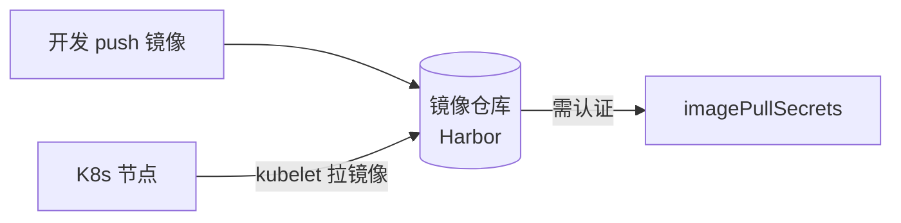
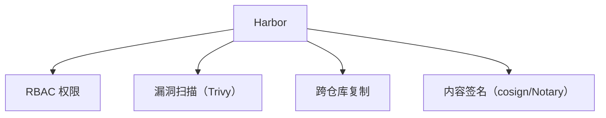

---
tags:
  - k8s
  - ecosystem
created: 2026-11-01
status: 已整理
---

# 镜像仓库与 Harbor

镜像仓库（Registry）存容器镜像，K8s 从它拉镜像运行。私有集群通常自建企业级仓库，**Harbor** 是最主流的开源选择。

## 仓库与 K8s 的关系

- 开发把镜像 push 到仓库，K8s 节点的 kubelet 按 `image: registry/app:tag` 去拉。
- 私有仓库要认证：在 K8s 里建 **imagePullSecret**，Pod 引用它即可拉私有镜像。

## Harbor：企业级仓库

Harbor（CNCF 项目）比原生 registry 多了：

- **RBAC**：项目级权限管理。
- **漏洞扫描**：集成 Trivy，push 时自动扫镜像漏洞。
- **复制**：把镜像同步到其他仓库（多地域）。
- **签名**：镜像签名验真，防篡改（供应链安全）。

## 镜像安全实践

- 用**最小基础镜像**（distroless / scratch / alpine）减小攻击面。
- **定期扫描**漏洞，CI 里卡高危。
- **签名校验**（cosign + admission 策略），只允许已签名镜像部署。
- 别用 `latest` tag——不可复现，随时可能变。

## 相关

- 拉镜像的组件 → [[Kubelet]]
- 认证存哪 → [[ConfigMap 与 Secret]]
- 镜像构建 → [[镜像构建优化]]
