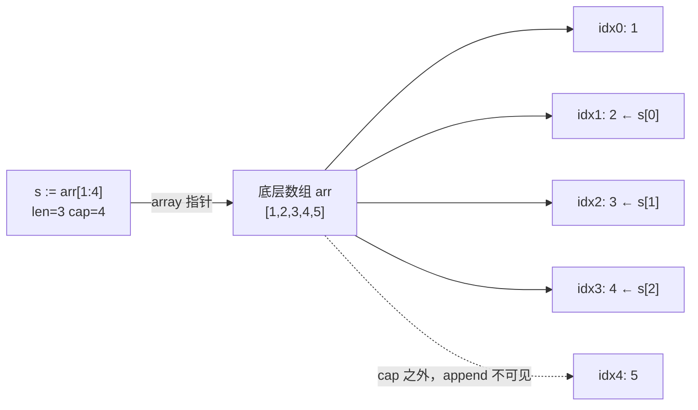
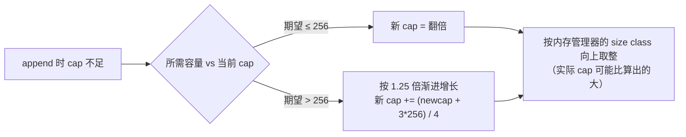
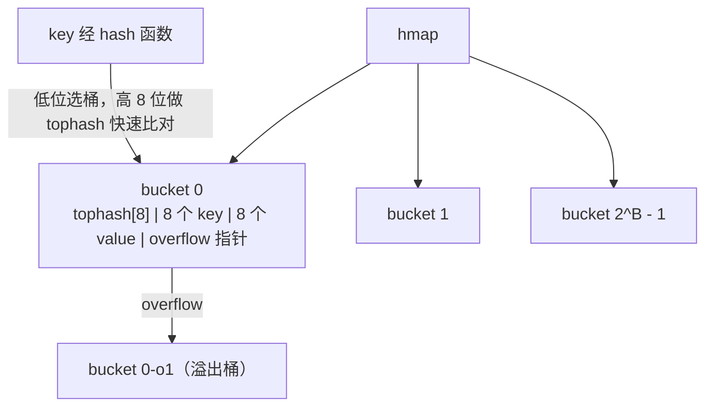
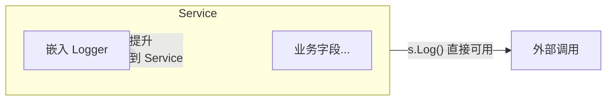
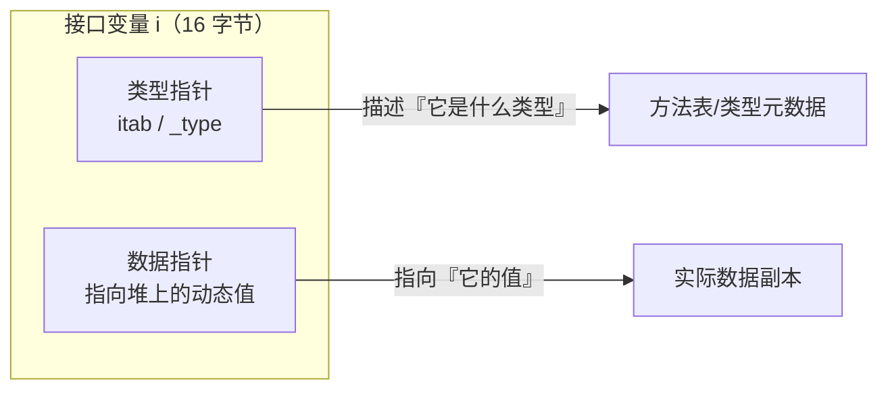
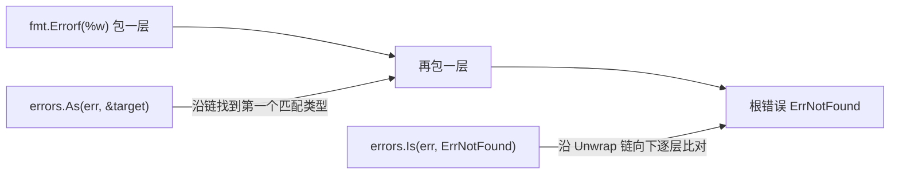
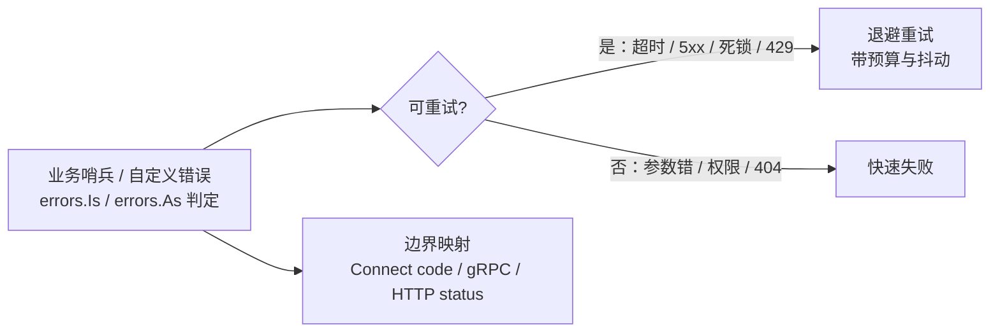
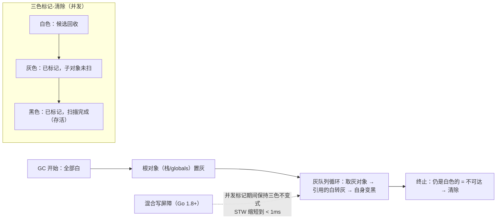

---
tags:
  - go
  - fundamentals
created: 2026-11-01
updated: 2026-11-14
status: 已整理
---

# 📘 语言基础

> 语言层 + 标准库：后端开发的地基。目标不是背语法，而是懂「为什么这样设计」——每个坑背后都是内存模型和运行时的设计取舍。

**全文主线一句话**：Go 是**值语义**的语言——一切赋值传参都是拷贝；切片/map/接口/指针只是把"引用"包装成了值。理解这一点，大部分坑都能自己推导出来。

## 一、类型系统与基础语法

### type：自定义类型 vs 类型别名

```go
type Celsius float64    // 自定义类型：新类型，可以挂方法
type Score = int        // 类型别名：完全等价，编译期替换
```

> 📌 **别名没有新类型身份**——`Score` 就是 `int`，不能挂方法、不能做类型安全区分。自定义类型 `Celsius` 是独立类型，可以挂方法、做编译期类型安全（不会把 `Celsius` 当 `float64` 传错）。

### 命名类型 vs 未命名类型

- **命名类型**：`int`、`string`、`struct{...}` 用 `type` 命名的 → 有方法集、可以做类型断言
- **未命名类型**：`[]int`、`map[string]int` 匿名复合类型 → 可互相赋值（结构相同即可）

### 常量与 iota

```go
type Weekday int
const (
    Sunday Weekday = iota   // 0
    Monday                  // 1
    Tuesday                 // 2
    _                       // 跳过 3
    Thursday                // 4
)
```

- `iota` 在每个 `const` 块重置为 0，**逐行递增**（不是逐个常量）
- 经典用法：位掩码（`Read = 1 << iota; Write; Execute`）
- 无类型常量：`const Pi = 3.14` 没有显式类型，赋值时自动转换——精度无损

### 字符串与 rune

```go
s := "Hello世界"
len(s)              // 12（字节长度，不是字符数！）
for i := 0; i < len(s); i++ { fmt.Println(s[i]) }   // 按字节：72 101 108 108 111 228 184 150 231 149 140
for i, r := range s { fmt.Println(i, r) }            // 按 rune：0 H, 5 世, 8 界
```

> 📌 **string 是不可变的字节序列**（UTF-8 编码）。`s[0] = 'h'` 编译错误。修改字符串要转 `[]byte` 或 `[]rune` 再转回来。
>
> `byte` = `uint8`（一个字节）；`rune` = `int32`（一个 Unicode 码点）。处理中文用 `[]rune`，处理二进制用 `[]byte`。

### 空标识符 `_`

```go
_, ok := m["k"]     // 忽略值
for _, v := range xs {}  // 忽略索引
var _ io.Reader = &MyReader{}  // 编译期接口实现检查（不占内存）
import _ "image/png"  // 只执行 init，不引用
```

## 二、函数

### 多返回值与命名返回值

```go
func Divide(a, b int) (quotient int, remainder int, err error) {
    if b == 0 {
        return 0, 0, errors.New("divide by zero")
    }
    quotient = a / b    // 命名返回值直接赋值
    remainder = a % b
    return              // 裸 return：返回当前命名返回值
}
```

> 📌 **命名返回值**的好处：① 文档作用（参数名即语义）；② 裸 return 简化代码；③ **defer 可以修改命名返回值**（见 defer 节）。缺点：短函数里可读性差，容易混淆局部变量。

### 闭包：捕获变量引用

```go
func counter() func() int {
    n := 0
    return func() int { n++; return n }  // 闭包捕获 n 的引用，不是拷贝
}
c1, c2 := counter(), counter()
c1()  // 1
c1()  // 2
c2()  // 1（独立闭包，各自有自己的 n）
```

> ⚠️ **循环变量捕获坑**（Go 1.22 前）：`for i := 0; ...; { go func(){ fmt.Println(i) }() }` 所有 goroutine 打印同一个值——闭包捕获的是变量引用而非值。**Go 1.22+ 修复**：循环变量每次迭代是独立变量。老版本需 `go func(i int){}(i)` 显式传值。

### init 函数

```go
package foo

var config = loadDefault()  // ① 包级变量初始化
func init() {               // ② init 函数（可多个，按声明顺序执行）
    config.Validate()
}
func init() { /* 另一个 init，也会执行 */ }
```

执行顺序：**被导入包的 init → 本包变量初始化 → 本包 init → main**。同一文件多个 init 按声明顺序；多文件按文件名排序。**init 只能被 runtime 调用**，不可手动调用。

## 三、数组与切片

### 数组：值类型，长度属于类型

```go
a := [3]int{1, 2, 3}
b := a          // 完整拷贝，b 改了 a 不变
var c [3]int    // 长度是类型的一部分：[3]int 和 [4]int 是不同类型
```

实际开发中数组直接用得少（作为值拷贝太贵），它的价值是**切片的底层**。

### 切片：对底层数组的视图

```go
type slice struct {
    array unsafe.Pointer // 指向底层数组
    len   int
    cap   int
}
```



> 📌 **切片传参只拷贝 24 字节**（指针+len+cap），底层数组共享——这是「引用语义」的来源，也是所有切片坑的根源。

### 三个必踩的坑

**坑 1：append 不扩容时覆盖邻居**

```go
s1 := []int{1, 2, 3, 4, 5}
s2 := s1[:2]        // len=2, cap=5（与 s1 共享数组）
s2 = append(s2, 99) // cap 够，不扩容 → s1[2] 被 99 覆盖！
fmt.Println(s1)     // [1 2 99 4 5]
```

**坑 2：append 扩容后两个切片彻底分家**——同一个 `append`，有时影响原切片（不扩容），有时不影响（扩容），行为取决于 cap。

**坑 3：大切片截取导致内存泄漏**——`s := big[:1]` 只留 1 个元素，但**引用了整个 big 数组**，GC 无法回收。正确做法：`copy` 出新切片。

### 扩容机制



> ⚠️ **演进史**：Go 1.18 之前是「<1024 翻倍，≥1024 每次 ×1.25」两段式；**Go 1.18 起**改为 256 阈值 + 平滑过渡，避免大切片扩容时一次跳太多。答出演进史比死背数字加分。

能预估容量就给 `make([]T, 0, n)` 或 `slices.Grow`，避免反复扩容拷贝。

## 四、map

### 底层结构：hash 表 + 桶 + 拉链



- 每个 bucket（`bmap`）存 **8 个 KV**，先比对 tophash（hash 高 8 位）再比对完整 key
- 满了挂溢出桶（拉链法）

### 扩容

| 触发条件 | 行为 |
|---|---|
| 装载因子 > 6.5（count / 桶数） | **翻倍扩容**，桶数 ×2 |
| 溢出桶过多（大量删除导致的稀疏） | **等量扩容**，桶数不变，重新整理紧凑 |

> 📌 map 扩容是**渐进式**的：扩容不是一次性搬完，而是读写时每次搬迁少量 bucket——把 O(n) 摊到后续操作里，避免单次卡顿。

### 五个关键事实

1. **遍历无序**——运行时故意随机化起始桶，防止你依赖偶然的顺序
2. **并发读写直接 fatal**——`concurrent map writes` 是运行时 **throw**，不是 panic，**无法 recover**，进程直接崩。并发场景用 `sync.RWMutex + map` 或 `sync.Map`
3. **元素不可寻址**——`&m["k"]` 编译错误。因为扩容会搬迁元素，地址无意义；也正因此 `m["k"].Field = x`（struct 值）编译错误，必须取出→修改→放回
4. **key 必须可比较**——slice / map / func 不能做 key
5. **取不存在的 key 得零值**——`v, ok := m[k]` 区分"零值"与"不存在"

## 五、struct、方法与组合（Go 的面向对象）

> Go 没有类、没有继承——用 **struct + 方法 + 组合**实现面向对象的核心能力（封装、多态）。这是 Go 设计哲学的根基。

### struct：字段的集合

```go
type User struct {
    ID   int64
    Name string
    Email string `validate:"required"`
}

u := User{ID: 1, Name: "Alice"}
u.Name = "Bob"              // 导出字段直接访问
u := &User{ID: 2}           // 取地址初始化
```

> 📌 **空 struct `struct{}`** 零大小（不占内存），经典用途：`map[string]struct{}` 做 Set、`chan struct{}` 做信号。

### 方法：带接收者的函数

```go
func (u User) FullName() string { return u.Name }       // 值接收者
func (u *User) SetName(s string) { u.Name = s }         // 指针接收者
```

| 对比 | 值接收者 | 指针接收者 |
|---|---|---|
| 方法内修改字段 | ❌ 拷贝不影响原值 | ✅ 通过指针修改 |
| 调用时 | 拷贝整个 struct | 拷贝指针（8 字节） |
| 方法集属于 | T 和 *T | 仅 *T |
| 大 struct | 每次拷贝贵 | 便宜 |

> 📌 工程经验：**统一用指针接收者**（除非类型是小且不可变的值类型，如 `time.Time`），避免方法集不一致的困惑。

### 组合优于继承：嵌入（Embedding）

```go
type Logger struct{}
func (Logger) Log(msg string) {}

type Service struct {
    Logger          // 匿名字段 = 嵌入：Logger 的方法"提升"到 Service
}
s := Service{}
s.Log("hello")     // 直接调用，等价于 s.Logger.Log("hello")
```



嵌入的关键点：
- **方法提升**：被嵌入类型的方法直接在外层类型上可用，无需 `s.Logger.Log()`
- **不是继承**：嵌入是**组合**——内层是外层的一个字段，不是父类
- **字段提升**：`s.Logger` 可以显式访问内层（`s.Logger.Log()`），也可以隐式（`s.Log()`）
- **覆盖**：外层定义同名方法时，外层优先；内层方法被"遮蔽"但不消失（可显式 `s.Logger.Log()` 调用）
- **接口嵌入**：接口也可以嵌入接口（`io.ReadWriter` = `io.Reader` + `io.Writer`）

> ⚠️ **嵌入 vs 继承的本质区别**：继承是 "is-a"（猫是动物）；嵌入是 "has-a"（Service 内含 Logger）。Go 刻意没有继承——避免菱形继承、虚函数表等复杂度。设计上用**小接口 + 组合**替代继承树。

### Go 的多态：接口

Go 的多态完全靠接口——**隐式实现**，不需要 `implements` 关键字：

```go
type Stringer interface { String() string }
type User struct{ Name string }
func (u User) String() string { return u.Name }   // User 自动实现 Stringer

func Print(s Stringer) { fmt.Println(s.String()) } // 多态
Print(User{Name: "Alice"})
```

**接口设计原则**：
- **小接口**：`io.Reader` 一个方法、`error` 一个方法——组合出大接口（`io.ReadWriteCloser`）
- **Accept Interfaces, Return Structs**：函数参数用接口（灵活），返回值用具体类型（明确）
- **在消费侧定义接口**：谁用谁定义，而不是在包里预定义一个大接口让调用方实现——避免不必要的耦合
- **避免空接口 `any`**：丢失类型安全，只在真正不确定类型时用（JSON 解析、泛型约束）

## 六、接口与类型系统（底层原理）

### 接口值的真实结构



- 空接口 `eface` = (类型指针, 数据指针)；非空接口 `iface` = (itab, 数据指针)
- 赋值给接口时**发生一次拷贝**（值装进接口）

> 📌 **经典 nil 坑**：接口 = (类型, 值)。只有**两者都 nil** 接口才等于 nil。`var p *T = nil; var i error = p` ——类型是 `*T`（非 nil），所以 `i != nil`，即使 p 本身是 nil。

```go
func f() error {
    var err *MyError = nil   // 具体 *MyError 类型
    return err               // 返回的 error 接口 != nil ！
}
```

教训：**函数返回接口时，永远 `return nil` 而不是返回一个 nil 的具体类型指针**。

### 方法集规则

| 接收者 | T 的方法集 | *T 的方法集 |
|---|---|---|
| 值接收者 `func (t T) M()` | ✓ | ✓ |
| 指针接收者 `func (t *T) M()` | ✗ | ✓ |

- 可寻址的变量调用时编译器自动 `&t.M()` 帮你补，但**接口赋值时不会自动补**（接口存储的位置不可寻址）

### 断言与 switch

```go
v, ok := i.(T)          // 安全断言，ok 区分失败与零值
switch x := i.(type) {  // 类型 switch
case int:
case *User:
}
```

## 七、指针与值传递

> 📌 **Go 只有值传递**。传指针 = 拷贝指针值（8 字节），指向同一个对象——这就是"引用效果"的全部秘密。

```go
func modify(s []int)      { s[0] = 99 }   // 生效：共享底层数组
func reassign(s []int)    { s = nil }     // 无效：s 是副本的 len/cap/指针
func appendIn(s []int) []int { return append(s, 1) } // 扩容后副本指针更新，调用方看不到！
```

**逃逸分析**：变量分配在栈（快、随函数返回自动回收）还是堆（需要 GC）由编译器决定：

```bash
go build -gcflags='-m' ./...   # 查看逃逸结果
```

典型逃逸：返回局部变量指针、赋值给接口、闭包捕获、大小不确定/超栈限制。**减少不必要的逃逸 = 减少 GC 压力**。

## 八、错误处理

### error 就是一个普通接口

```go
type error interface { Error() string }
```

### 三层用法

```go
// 1. 哨兵错误（包级预定义）
var ErrNotFound = errors.New("not found")
errors.Is(err, ErrNotFound)   // ✅ 用 Is 判断，不要 ==（包装链会失效）

// 2. 自定义错误类型（携带上下文）
type ValidationError struct{ Field string }
func (e *ValidationError) Error() string { return "invalid: " + e.Field }
var ve *ValidationError
errors.As(err, &ve)           // ✅ 解包出具体类型

// 3. 包装（Go 1.13+）
return fmt.Errorf("query user %d: %w", id, err)   // %w 保留错误链

// 4. 聚合多个错误（Go 1.20+）
errs := []error{errA, errB}
return errors.Join(errs...)   // 任一为 nil 会被忽略；全 nil 返回 nil
```

> 📌 **`errors.Join`（1.20+）与 `%w` 的区别**：`%w` 是**单链**（一次包装一个，逐层 `Unwrap() error`），`Join` 是**多叉**（`Unwrap() []error`）。`errors.Is/As` 对两者都生效，会自动遍历整棵树。典型用途是并发任务汇总（`errgroup` 里收集多个子任务错误）、批量校验一次性返回所有字段错误。⚠️ 别用它拼业务上下文——那仍该用 `%w`，否则错误链失去层次。



> 📌 规范：**调用方用 `errors.Is/As` 判断，永远不要 `err.Error() == "..."`**；错误信息用小写、不加标点（方便拼接上下文链）。

### 跨层错误模型（全栈共同地基）

语言层只有一个 `error` 接口，但一次调用可能跨 HTTP / RPC / DB / MQ 四层。**不先给错误分类，重试策略就没有依据**——这是 [[03-Web 与 RPC]] 客户端重试、[[05-数据库]] 乐观锁冲突、[[06-中间件]] Activity 重试三者共用的前提。



| 层 | 表达 | 约定 |
|---|---|---|
| 业务 | `ErrNotFound`、`ErrConflict` 哨兵 + `%w` 包装 | 只在本层定义语义，判定一律 `errors.Is/As` |
| RPC | `connect.CodeNotFound` / gRPC `codes.NotFound` | **只在 API 边界集中映射**，业务层不 import connect 包（连 [[04-Proto 与 Buf]]）|
| HTTP | 404 / 409 / 429 / 503 | 只有 429、503 允许客户端重试 |
| 消费 / 工作流 | 可重试错误 vs 永久错误 | 分类决定进不进重试队列（连 [[06-中间件]]）|

> 📌 **三条纪律**：① 分类在**边界**（handler / repository）做，业务内部只透传包装后的 error；② 只有「可重试」才重试，否则重试会放大故障；③ 重试必须有**预算**（次数 + 总时长上限）和抖动。
> ⚠️ 禁止用 `err.Error()` 的字符串判断类型——错误文案一改，重试逻辑会静默失效。

## 九、defer / panic / recover

### defer 三规则

```go
func example() (result int) {
    defer func() { result++ }()   // ③ 返回前最后执行：改的是命名返回值
    defer fmt.Println("first")    // ② LIFO：后进先出
    fmt.Println("body")           // ① 先执行
    return 1                      // 返回值先被赋为 1，再跑 defer
}
// 输出 body → first，返回 2
```

1. **LIFO 栈序**执行
2. **参数在 defer 语句处立即求值**：`defer fmt.Println(i)` 拷贝当下的 i；`defer func(){ fmt.Println(i) }()` 闭包引用最终值
3. **defer 能修改命名返回值**——这是 `recover` 和资源清理中"兜底返回错误"的基础

### panic / recover

```go
func safeRun() (err error) {
    defer func() {              // recover 必须在 defer 的函数里【直接】调用
        if r := recover(); r != nil {
            err = fmt.Errorf("recovered: %v", r)
        }
    }()
    doWork()
    return nil
}
```

> ⚠️ 三个边界：`recover()` 只在**本函数 defer 中直接调用**才有效；**os.Exit / fatal error（如 map 并发写）不走 defer、不可 recover**；常规错误控制流不要用 panic（只用在校验编程错误、初始化失败）。

## 十、泛型（Go 1.18+）

```go
type Number interface {
    ~int | ~int64 | ~float64   // ~ 表示"底层类型"，含自定义类型
}

func Sum[T Number](xs []T) T {          // 类型参数
    var s T
    for _, x := range xs { s += x }
    return s
}

func Contains[T comparable](xs []T, x T) bool   // comparable：可做 map key 的类型
```

> 📌 **克制原则**：泛型用于「逻辑相同、类型不同」的容器/算法（slice 处理、Set）；业务逻辑用 `interface` 表达行为抽象，不要为了泛型而泛型——没有约束的类型参数只会让错误信息更难读。

## 十一、包与可见性

### 可见性规则

- **大写开头 = 导出**（包外可访问）；**小写开头 = 未导出**（包内可见）
- Go 没有 `public/private/protected`——只靠**首字母大小写**，简单但粒度只到包级

### internal 包

```go
// 项目结构
//   github.com/songli0103/platform/
//     internal/           ← internal 目录：只有 platform/ 及其子包可导入
//       auth/auth.go
//     api/api.go          ← 可以导入 internal/auth
//   github.com/other/     ← 不能导入 platform/internal/auth
```

> 📌 `internal` 是 Go 的"包级私有"机制——限制包的导入范围，防止外部项目依赖你的内部实现。

### 包循环依赖

Go **严禁包循环依赖**（A 导入 B、B 又导入 A → 编译错误）。解法：
- 提取公共接口到第三个包，双方依赖接口
- 依赖注入：调用方传入依赖
- `internal/` 拆分

## 十二、标准库重点

### strings / strconv / fmt

- 拼接循环里用 `strings.Builder`（内部 []byte 复用，避免每次拷贝）；`strings.Join` 处理切片
- `strconv` 是字符串↔数字的唯一正道：`Atoi` / `ParseInt` / `FormatFloat`
- fmt 动词：`%v` 默认、`%+v` 带字段名、`%#v` Go 语法表示、`%T` 类型；`%w` 包装错误

### io / os / bufio：Go IO 的灵魂

```go
r := io.Reader(os.StdIn)        // 一切皆 Reader/Writer
br := bufio.NewReader(r)        // 缓冲包装：减少系统调用
io.Copy(dst, src)               // 流式拷贝，内存恒定
io.ReadAll(r)                   // ⚠️ 一次性读入内存，只用于可信小数据
```

> 📌 **io.Reader/Writer 是整个 Go 生态的通用语**：HTTP body、文件、crypto、压缩、日志全走同一接口——组合万能（`io.MultiWriter`、`io.TeeReader`、`gzip.Reader 包 net.Conn`）。

### encoding/json

```go
type User struct {
    Name  string `json:"name"`
    Email string `json:"email,omitempty"`   // 空值不输出
    Age   int    `json:"-"`
}
```

- 无 tag 时按**导出字段名**匹配（大小写不敏感），未导出字段**永远不参与**
- ⚠️ **数字精度坑**：`Unmarshal` 到 `interface{}` 时数字全是 `float64`，超过 2^53 的 ID 会丢精度 → `decoder.UseNumber()` 或定义具体 struct

### time：四个高频坑

```go
t := time.NewTicker(time.Second)
defer t.Stop()          // ⚠️ Go 1.23 前不 Stop 会泄漏
for now := range t.C { /* ... */ }
```

- `Duration` 是 int64 纳秒：`time.Second * 30`，不要写裸数字
- 超时统一交给 `context.WithTimeout`（连 [[02-并发编程]]）；`time.After` 在循环里会堆积未触发的 Timer

| 坑 | 正确认知 |
|---|---|
| **墙上时钟 vs 单调时钟** | `time.Now()` 同时携带两者；`time.Since` / `Sub` 优先用单调读数，不受 NTP 回拨影响。但 `t.Round(0)`、`t.UTC()`、序列化/存 DB 都会**丢掉单调读数**，跨进程算耗时只能用墙上时钟 |
| **`time.Time` 不能用 `==`** | 内部含单调读数 + `*Location` 指针，同一时刻的两个值可能不等 → 用 `t.Equal(u)`；作 map key / 持久化统一 `t.UTC().Format(time.RFC3339Nano)` |
| **`Timer.Reset` 前要排空** | Go 1.23 前通道有 1 格缓冲，`Stop` 返回 false 时可能残留旧 tick，直接 Reset 会误触发；稳妥写法 `if !tm.Stop() { select { case <-tm.C: default: } }; tm.Reset(d)`。1.23+ 通道改为同步（无缓冲）、未引用 Timer 可被 GC 回收，此坑基本消除 |
| **Parse 的 layout** | 必须写参考时间 `2006-01-02 15:04:05`（不是 `yyyy-MM-dd`）；不带时区的串默认按 UTC 解析，本地时间用 `time.ParseInLocation` |

### reflect：运行期类型能力

接口只能拿到静态类型，需要**按字段名读写、读 struct tag、动态构造值**时才用反射。ORM、JSON、配置映射、依赖注入、client-go 的 Scheme 都建立在它之上（连 [[05-数据库]] GORM、[[Go 与 K8s 开发]]）。第六节讲的 iface 双字结构正是反射的入口——`reflect.ValueOf(i)` 拆开的就是那两个指针。

```go
v := reflect.ValueOf(&cfg).Elem()         // ⚠️ 传指针 + Elem() 才可写
f := v.FieldByName("Timeout")
if f.IsValid() && f.CanSet() { f.SetInt(30) }
tag := v.Type().Field(0).Tag.Get("yaml")  // 读 struct tag
```

| 要点 | 说明 |
|---|---|
| `Type` vs `Value` | `Type` 描述类型（字段、方法集），`Value` 持有具体值并读写 |
| **CanSet 三条件** | 可寻址（指针 `Elem()`）+ 字段导出（大写）+ 非只读；不满足时 `Set*` 直接 panic |
| nil / 零值判断 | `v.IsZero()`（1.13+）；`IsNil()` 只对 chan/func/interface/map/ptr/slice 可用，其它 Kind 调用会 panic |
| 代价 | 运行期解析 + 逃逸 + 无法内联，**热路径禁用**；启动期加载配置用一次可接受 |
| 边界 | 泛型或接口能解决就别用反射——它把编译期错误推迟到运行期 |

### go:embed：把资源编进二进制

```go
//go:embed configs/default.yaml web/dist
var assets embed.FS
```

Go 1.16+，把默认配置、静态资源、模板文件编进二进制，最终只分发一个可执行文件（连 [[07-工程实践]] 的 distroless 构建）。路径是编译期常量、运行时只读，避免部署时漏文件。

## 十三、内存管理与 GC



- **触发时机**：堆内存相对上次存活增长 `GOGC%`（默认 100，即翻倍）时；`GOMEMLIMIT`（Go 1.19+，软上限）兜底；超 2 分钟强制
- **调优入口**：`GOGC=200`（降频率、提内存占用）/ `GOMEMLIMIT`（容器内防 OOM，配合 K8s limit 设 85~90%）

## 十四、go mod 与依赖管理

```
module github.com/songli0103/notes-platform

go 1.22

require (
    github.com/go-chi/chi/v5 v5.0.12
)
```

- **module = 依赖的最小分发单位**；`go.sum` 记录哈希做完整性校验
- **主版本 v2+ 要换模块路径**（`/v2` 后缀）——语义化导入版本
- 常用：`go mod tidy`（对齐 import）、`go mod vendor`（离线构建）、`go work`（多模块本地联调）
- **私有仓库**：`GOPRIVATE=git.company.com/*`（同时跳过 proxy 与 sum 校验）

> 📌 **离线构建**：无公网环境下用 `vendor` 目录或内网 GOPROXY 提供依赖，随构建镜像固化，保证可复现（连 [[09-生态与工具]]）。

## 十五、高频问答

**Q1：切片和数组的区别？append 什么时候共享内存？**
数组是值类型、长度属于类型、赋值全拷贝；切片是 (指针, len, cap) 结构体，共享底层数组。append 时 cap 不够就扩容并搬移——**不扩容则继续共享**（可能覆盖相邻切片），扩容后分家。

**Q2：Go 怎么实现面向对象？有继承吗？**
Go 没有 class 和继承。封装用 struct + 方法（接收者）；多态用接口（隐式实现）；复用用**组合**（嵌入）——嵌入类型的方法提升到外层，但本质是 has-a 不是 is-a。Go 刻意没有继承，避免菱形继承等复杂度。

**Q3：map 并发安全吗？怎么解决？**
不安全，并发写直接 throw（不可 recover）。方案：① `RWMutex + map`——通用首选；② `sync.Map`——适合**读多写少、key 集合稳定**，写多时性能反而差。

**Q4：为什么 `&m["k"]` 编译不过？**
map 扩容会搬迁元素，元素地址不稳定，运行时禁止取址。后果：值类型元素不能原地改字段，必须 `v := m[k]; v.Field = x; m[k] = v`。

**Q5：返回 err 的函数，`var e *MyErr = nil; return e` 有什么问题？**
返回的 error 接口 = (类型 *MyErr, 值 nil)，类型非 nil → 调用方 `err != nil` 为真。**返回接口一律 `return nil`**。

**Q6：defer 的参数求值时机？**
defer 语句执行时立即求值拷贝；闭包形式引用的是最终变量。配合命名返回值，defer 可以在 return 之后修改返回结果。

**Q7：嵌入和继承有什么区别？**
嵌入是 has-a（外层包含内层字段），继承是 is-a（子类是父类）。嵌入的方法提升只是语法糖，内层仍是外层的字段；外层可以定义同名方法覆盖（遮蔽），但内层方法不消失（可显式访问）。Go 没有虚函数表、没有 super 调用。

**Q8：Go 的 GC 为什么暂停时间短？**
并发三色标记 + **混合写屏障**：标记阶段与用户 goroutine 并发，靠屏障维持三色不变式，STW 只剩标记开始/结束的两小段（< 1ms）。

**Q9：errors.Is 和 == 有什么区别？**
`==` 只比较顶层错误值；`errors.Is` 沿 `Unwrap()` 链逐层比对——被 `fmt.Errorf("%w")` 包装过的哨兵错误只有 `Is` 能匹配。

**Q10：Go 为什么只有值传递？没有引用传递吗？**
语义统一简化推理：所有赋值/传参都是拷贝。需要"引用效果"就显式传指针/切片/接口——它们本身就是被拷贝的引用值。理解了"接口与切片都是值"，所有传参行为都可推导。

**Q11：type T int 和 type T = int 有什么区别？**
前者是自定义新类型（独立类型身份，可挂方法，编译期类型安全）；后者是类型别名（完全等价 int，不可挂方法，只是换个名字）。

**Q12：internal 包是什么？**
Go 的包级私有机制——`path/to/internal/foo` 只能被 `path/to/` 及其子包导入，外部项目不可导入。用于防止外部依赖你的内部实现。

## 十六、关联

- 下游 → [[02-并发编程]]（goroutine/channel/context 是语言基础的下一层）
- 跨篇地基 → [[03-Web 与 RPC]]、[[05-数据库]]、[[06-中间件]]（errors.Is/As 错误链、跨层错误模型、值语义贯穿全栈）
- 工程化 → [[07-工程实践]]（测试/pprof/lint/日志/配置）
- 上层 → [[Go 与 K8s 开发]]（client-go / Operator）、[[08-Go 运行时与底层]]（GC / 逃逸 / 调度）
- 上游：[[Go 开发]]
