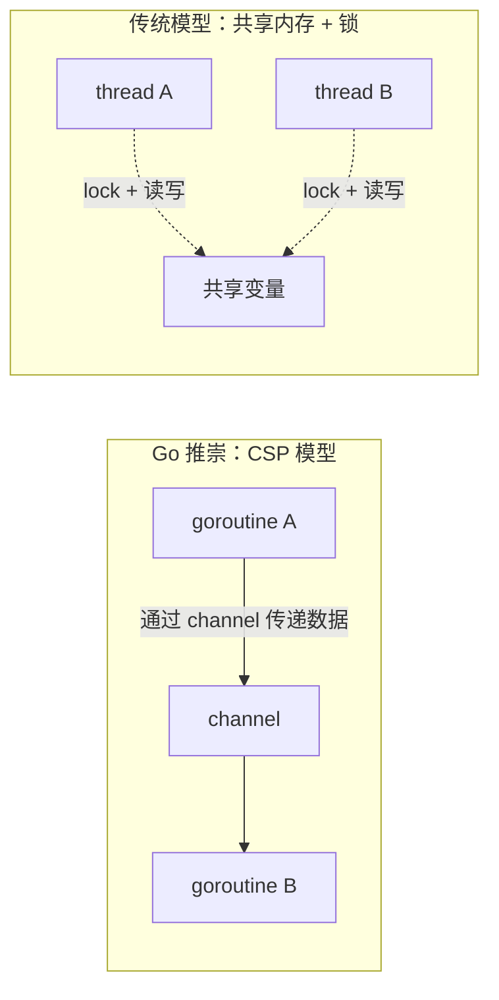
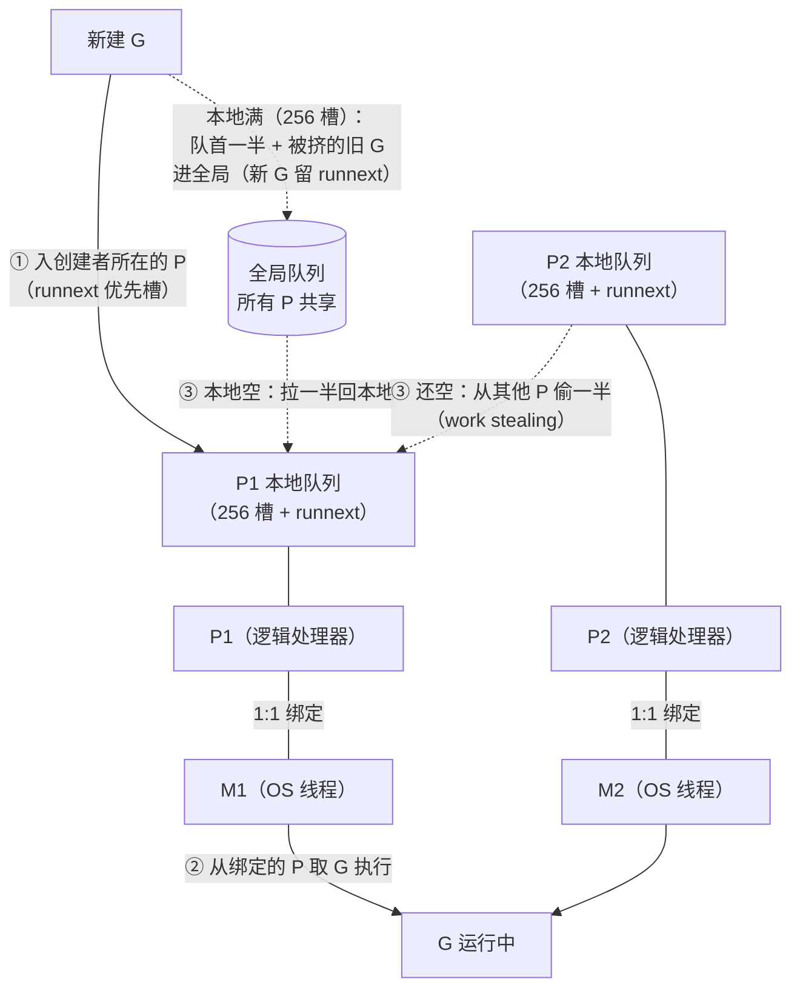
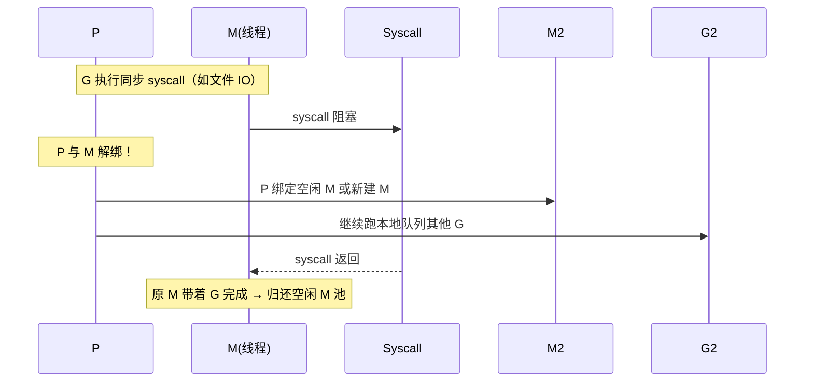
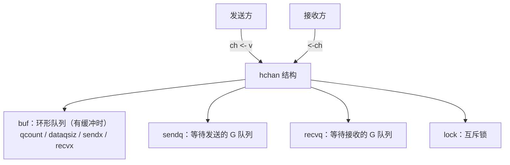
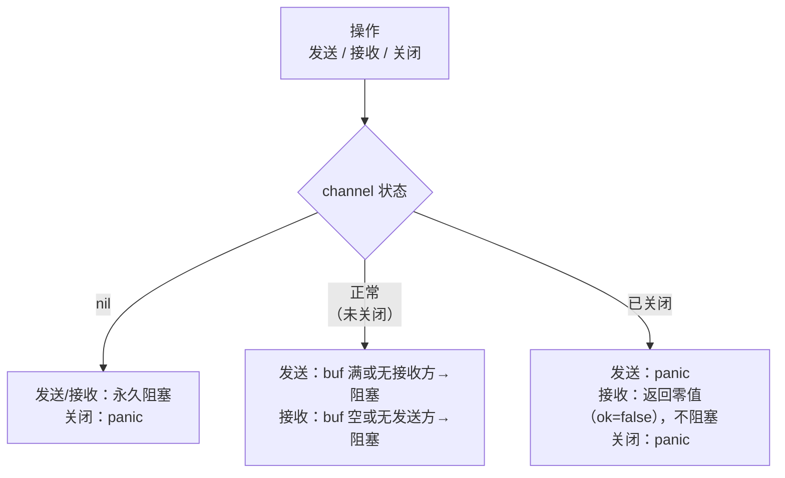
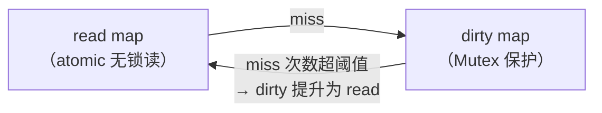
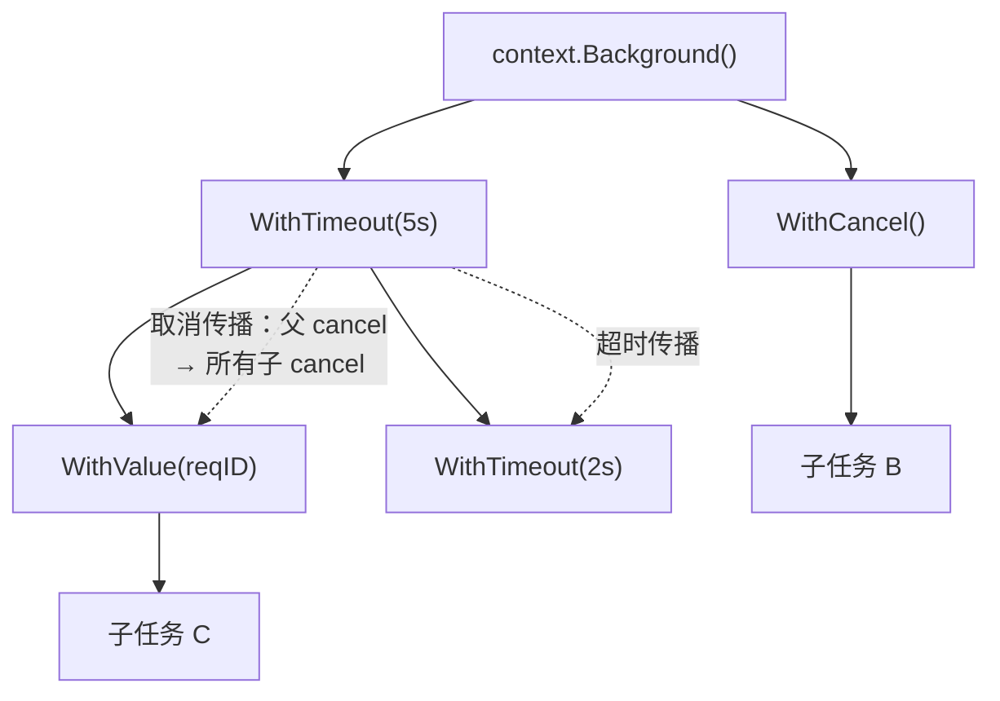
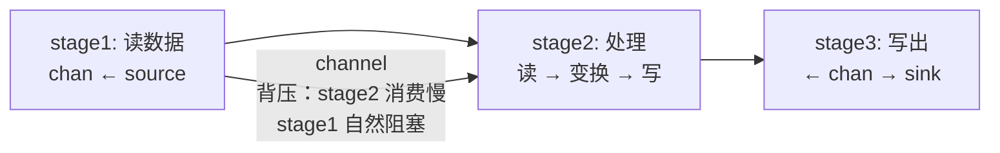
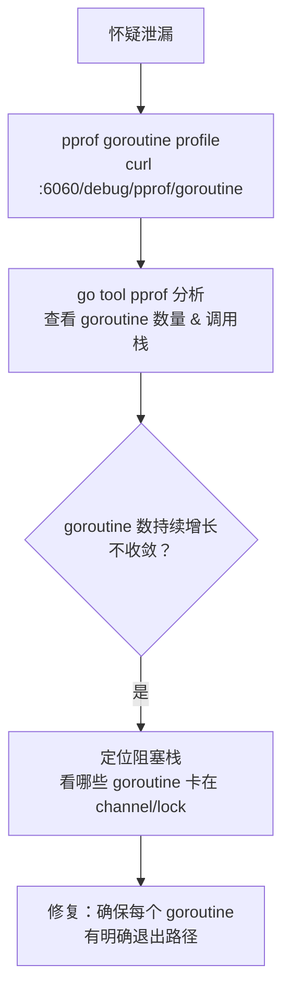

---
tags:
  - go
  - concurrency
created: 2026-11-01
updated: 2026-11-15
status: 已整理
---

# 🔀 并发编程

> Go 的灵魂——"Do not communicate by sharing memory; instead, share memory by communicating"。这篇覆盖从调度原理到并发模式到排障的完整链路。

**全文主线**：Go 并发 = **CSP 模型**（Communicating Sequential Processes）——goroutine 是执行单元，channel 是通信管道。共享数据通过 channel 传递而非加锁共享，锁是最后的手段不是首选。

## 一、并发哲学：CSP vs 共享内存



> 📌 不是"不能用锁"——`sync.Mutex` 是标准库一等公民。而是**优先用 channel 表达并发关系**（谁等谁、谁通知谁），锁只用来保护局部临界区。判断口诀：**"传递数据的归属权用 channel，保护数据的访问用锁"**。

## 二、GMP 调度模型

> 图中标号 ①②③ 与下方「调度流程」前三步一一对应（第 4 步「全部空则 M 休眠」图中略去）。P 按 `GOMAXPROCS` 复制多组，图中画 2 组示意。



| 角色 | 是什么 | 数量 |
|---|---|---|
| **G** | goroutine：用户态协程，初始栈 2KB（可动态伸缩到 1GB） | 数十万 |
| **M** | Machine：OS 线程（真正执行 G 的载体） | 与 G 数无关，按需创建 |
| **P** | Processor：逻辑处理器，持有**本地 G 队列**（256 槽 + runnext 优先槽）和缓存 | = `GOMAXPROCS`（默认=CPU 核数） |

> 📌 **GOMAXPROCS 控制的是并行度（P 数），不是并发度上限**。10 万个 G 可以在 8 个 P 上并发调度（时分复用），但同一时刻最多 8 个 G 真正在跑。

**调度流程**：
1. **新 G 进入创建者所在的 P**——判定规则与满队列行为见下方「新 G 入队细节」
2. P 绑定 M，M 从 P 本地队列取 G 执行
3. P 本地空了 → 从全局队列拉一半 → 还空 → **work stealing**（从其他 P 偷一半）
4. 所有队列都空 → M 进入休眠

**新 G 入队细节（它到底去哪）**：

> **P 的判定看创建者，不看负载**：新 G 由某个正在运行的 G（创建者 G）通过 `go func()` 创建。创建那一刻创建者 G 跑在哪个 P 上（= 它所在 M 绑定的 P，比如 P1），新 G 就进 P1——**没有「挑最闲的 P」这类负载均衡**。依据是局部性：新 G 的数据大概率还在创建者的 CPU 缓存里，留在同一 P 上立刻执行命中率最高。
>
> **精确落点是 runnext 优先槽**：runnext 是每个 P 独有的单槽，保证「P 下一个就调度它」。runnext 空则新 G 直接占住；被占则旧 G 被挤到本地队列尾。
>
> **本地队列满（256 槽）时，进全局的是旧 G，不是新 G**：`runqputslow` 把队首最老的 128 个 G 连同被挤出的旧 G 一起移入全局队列——批量转移是为了摊薄全局锁成本（goroutine 创建是热路径，不能每次创建都抢一次全局锁）；**新 G 本身始终留在 P1 的 runnext**。若存在空闲 P，顺带 `wakep` 唤醒一个来消费。

## 三、goroutine 与系统调用



- **同步 syscall**（文件 IO、`time.Sleep`）：M 阻塞 → **P 与 M 解绑** → P 找另一个 M 继续调度
- **异步 syscall**（网络 IO）：走 **netpoller**（epoll/kqueue），G 挂起到 netpoller 等待，M 不阻塞，P 继续跑其他 G → netpoller 就绪后 G 被重新入队

> 📌 这就是为什么 Go 网络服务能高并发：网络 IO 不阻塞线程，M 始终有活干。

## 四、channel 原理



- **有缓冲**（`make(chan T, n)`）：buf 有 n 个槽，满了发送方阻塞，空了接收方阻塞
- **无缓冲**（`make(chan T)`）：没有 buf，发送方必须等接收方就绪才完成——**同步会面**

**直接发送优化**：接收方已在 recvq 等待时，发送方**不经过 buf**，直接把数据拷贝给接收方并唤醒它（`goready`）——减少一次入队出队。

## 五、channel 操作语义



> ⚠️ **关闭 channel 的铁律**：
> 1. **发送方负责关闭**（只有发送方知道何时没有更多数据）
> 2. **只关闭一次**（重复 close → panic）
> 3. **绝不在接收方关闭**（接收方关了，发送方还在发 → panic）
> 4. 多发送方时用"协调退出"模式（一个 done channel 通知所有发送方退出，最后一个退出的关 data channel）

## 六、select 多路复用

```go
select {
case v := <-ch1:
    // ch1 就绪
case ch2 <- data:
    // ch2 发送成功
case <-time.After(5 * time.Second):
    // 超时
default:
    // 所有 case 都未就绪 → 立即执行（非阻塞模式）
}
```

关键规则：
- 多个 case 就绪 → **随机**选一个（不是按声明顺序！面试高频考点）
- **nil channel 的 case 永远不就绪**——可用来动态启用/禁用分支（`case ch <- v` 中 ch=nil 时该分支被屏蔽）
- `time.After` 每次创建新 Timer——循环里用会造成内存堆积（Timer 到期前不回收），改用 `NewTimer + defer Stop` 或 `context.WithTimeout`

> 📌 **nil channel 屏蔽分支**是 select 的高级技巧：动态控制哪些 channel 参与竞争，避免空 channel 拖慢整个 select。

## 七、sync：Mutex 与锁

### Mutex：两种模式


| 模式 | 行为 | 目的 |
|---|---|---|
| **正常模式** | 新来的 G 先自旋 4 次尝试抢锁，抢不到进队列；**可与队头抢**（fast path） | 低延迟，吞吐优先 |
| **饥饿模式**（Go 1.9+） | 严格 FIFO，新来的直接排队，不抢 | 防止尾延迟饥饿（队尾等 > 1ms 触发） |

> 📌 **不要复制 Mutex**——`go vet` 会拦截。含锁 struct 传参必须传指针。复制后两个锁各管各的，保护失效。

### RWMutex

- 读锁（`RLock`）可并发，写锁（`Lock`）独占
- Go 的 RWMutex **写优先**：有 writer 等待时，新 reader 排队（不抢），避免写饥饿
- **读多写少**才值得用——写多时 RWMutex 比 Mutex 更慢（额外维护 reader 计数）

## 八、sync：WaitGroup / Once / Cond / Pool

### WaitGroup

```go
var wg sync.WaitGroup
for i := 0; i < N; i++ {
    wg.Add(1)
    go func() {
        defer wg.Done()   // ⚠️ defer 确保异常也计数
        work()
    }()
}
wg.Wait()
```

> ⚠️ **Add 必须在 goroutine 外调用**（在 `go func()` 前），不能在 goroutine 内 Add（有竞态：Wait 可能在 Add 前就返回了）。计数器 < 0 会 panic。

### Once

```go
var once sync.Once
func GetInstance() *Config {
    once.Do(func() { config = loadConfig() })  // 只执行一次，即使并发调用
    return config
}
```

内部用 **双重检查 + Mutex**：快速路径 atomic 加载标志位，慢速路径加锁执行。即使 `Do` 内 panic，也算"执行过"（后续调用不会重试）。

### Cond

```go
cond := sync.NewCond(&mu)
// 等待方
mu.Lock()
for !ready {
    cond.Wait()    // 释放 mu → 加入等待队列 → 被唤醒后重新加 mu
}
mu.Unlock()
// 通知方
mu.Lock(); ready = true; mu.Unlock()
cond.Signal()      // 唤醒一个
cond.Broadcast()   // 唤醒全部
```

> 📌 **Wait 必须在持锁状态调用**（它会自动释放锁再等，唤醒后重新获取锁）。**用 for 循环检查条件**，不是 if——防止虚假唤醒。

### Pool

```go
var bufPool = sync.Pool{
    New: func() any { return new(bytes.Buffer) },
}
buf := bufPool.Get().(*bytes.Buffer)
// ... 使用 ...
buf.Reset()
bufPool.Put(buf)
```

- 每个 P 有本地池（无锁优先），Get 时本地空 → steal → 还空 → 调 New
- **GC 时清空**——Pool 不保证存活，只是减少分配压力
- 适用：短生命周期、频繁创建销毁的对象（buffer、临时 struct）

## 九、atomic 与 sync.Map

### atomic

| 操作 | 函数 | 用途 |
|---|---|---|
| 原子读写 | `Load/Store` | int32/int64/uintptr/Pointer |
| CAS | `CompareAndSwap` | 无锁更新：比较旧值→相等才写新值 |
| 原子加减 | `Add` | 计数器 |
| 通用容器 | `atomic.Value` | 存取任意类型值（Store 一次后类型固定） |

> 📌 **atomic vs Mutex**：atomic 适合**单个变量**的无复合操作（计数器、标志位）；Mutex 适合保护**多步操作**（读写多个变量、临界区逻辑）。atomic 无锁（CPU 指令级），比 Mutex 快一个数量级。

### sync.Map



- **读**：先查 read（atomic，无锁）→ miss → 加锁查 dirty → 记录 miss → miss 次数够 → dirty 提升为 read
- **写**：read 有该 key → 原子更新（尝试）；read 没有 → 加锁写 dirty
- **适用**：读多写少、key 集合稳定（配置/缓存）；**写多时 dirty 频繁重建，性能比 Mutex+map 更差**

## 十、context



- **取消传播树**：父 context cancel → 所有子 context 自动 cancel
- `WithCancel`（手动取消）/ `WithTimeout`（定时取消）/ `WithDeadline`（指定时刻）/ `WithValue`（传值）
- `ctx.Done()` 返回一个 channel，cancel 时关闭 → `<-ctx.Done()` 立即返回

> ⚠️ **context 三条铁律**：
> 1. **函数第一个参数**：`func Do(ctx context.Context, ...) error`，层层传递
> 2. **不要存到 struct**：context 是请求级生命周期，存 struct 会导致后续调用无法覆盖（例外：struct 本身就是请求级对象，如 handler）
> 3. **WithValue 只传请求元数据**（tracing ID / request ID），**不要传业务参数**——业务参数应该走函数签名

## 十一、并发模式

### Worker Pool（固定并发 + 任务队列）

```go
func workerPool(ctx context.Context, tasks <-chan Task, results chan<- Result, n int) {
    var wg sync.WaitGroup
    for i := 0; i < n; i++ {
        wg.Add(1)
        go func() {
            defer wg.Done()
            for {
                select {
                case <-ctx.Done():
                    return
                case t, ok := <-tasks:
                    if !ok { return }
                    results <- process(t)
                }
            }
        }()
    }
    wg.Wait()
    close(results)
}
```

> 📌 **为什么不用"每个任务一个 goroutine"**：无限 goroutine 会打爆资源（内存/CPU/DB 连接）。Worker Pool 控制并发度上限 = 控制资源消耗。

### fan-in（多路合并）

```go
func fanIn(chs ...<-chan T) <-chan T {
    out := make(chan T)
    var wg sync.WaitGroup
    for _, ch := range chs {
        wg.Add(1)
        go func(c <-chan T) {
            defer wg.Done()
            for v := range c { out <- v }
        }(ch)
    }
    go func() { wg.Wait(); close(out) }()
    return out
}
```

### pipeline（阶段流水线）



每阶段 N 个 goroutine + channel 连接。背压自动产生：下游慢 → channel 满 → 上游阻塞。**天然限流**。

## 十二、errgroup 与 singleflight

### errgroup：带错误传播的并发编排

```go
import "golang.org/x/sync/errgroup"

g, ctx := errgroup.WithContext(ctx)
for _, url := range urls {
    g.Go(func() error { return fetch(ctx, url) })
}
if err := g.Wait(); err != nil {
    // 第一个 error 返回，其他被 ctx 取消
}
```

> 📌 **errgroup 的核心价值**：第一个 goroutine 返回 error 时**自动 cancel context** → 其他 goroutine 收到取消信号退出。手写 WaitGroup + context 做这个很啰嗦，errgroup 一行搞定。

### singleflight：抑制重复请求

```go
import "golang.org/x/sync/singleflight"

var sf singleflight.Group
func GetUser(id string) (*User, error) {
    v, err, _ := sf.Do(id, func() (any, error) {
        return db.GetUser(id)   // 相同 id 的并发请求只执行一次
    })
    return v.(*User), err
}
```

相同 key 的并发调用 → 第一个执行，其余等结果共享 → **缓存击穿防御**。典型场景：热点 key 失效时只放行一次回源查询。

## 十三、data race 与竞态检测

```bash
go test -race ./...     # 测试时开启
go build -race          # 构建带检测的二进制（生产慎用，2-10x 开销）
```

```go
// ❌ 典型竞态
var count int
go func() { count++ }()  // count++ = 读+加+写，非原子，多 goroutine 并发 = 竞态
go func() { count++ }()

// ✅ 修复
var count int64
go func() { atomic.AddInt64(&count, 1) }()
```

> ⚠️ **race detector 不是万能的**：它检测的是**运行时实际发生的竞态**——如果测试没触发某条并发路径，detector 也发现不了。**"加了锁就安全"是错的**——锁的粒度不对（锁了读但没锁写、锁了字段但没锁复合操作）照样竞态。

常见竞态场景：
1. 共享变量无保护读写（最常见）
2. **map 并发读写**（直接 throw，不可 recover）
3. 闭包捕获循环变量（Go 1.22 前的经典坑）
4. check-then-act 没有原子保护（`if !initialized { init() }`）

## 十四、goroutine 泄漏排查



常见泄漏模式：
1. **channel 发送但无人接收**：`ch <- v` 永远阻塞，goroutine 泄漏
2. **channel 接收但无人发送**：`<-ch` 永远阻塞
3. **context 未传递**：goroutine 内没 select `<-ctx.Done()`，永远不退出
4. **循环里的 time.After**：每次循环创建新 Timer，Timer 到期前不回收

> 📌 **测试期自动检测泄漏**：用 `go.uber.org/goleak`——在 TestMain 里 `defer goleak.VerifyNone(t)`，测试结束时有泄漏 goroutine 直接 fail。

## 十五、happens-before 内存模型

> 📌 **程序序 ≠ 执行序 ≠ 可见序**。Go 内存模型定义了"什么操作保证对另一个操作可见"——只有**同步操作**才能建立 happens-before 关系。

| 同步操作 | happens-before 规则 |
|---|---|
| **channel 发送** | 发送完成 → happens-before → 对应的接收完成 |
| **channel 关闭** | close → happens-before → 接收方收到零值 |
| **Mutex Unlock** | Unlock → happens-before → 下一次 Lock |
| **WaitGroup Done** | Done → happens-before → Wait 返回 |
| **atomic Store** | Store → happens-before → 后续 Load |
| **`for range` 遍历 channel** | 第 N 次发送 → happens-before → 第 N 次接收 |

> ⚠️ **不是"代码在前就先可见"**：没有同步操作的两个 goroutine 之间，读写顺序是未定义的（编译器/CPU 可能重排）。`-race` 检测器就是基于内存模型找违反 happens-before 的访问。

## 十六、高频问答

**Q1：goroutine 和线程的区别？Go 为什么能起十万 goroutine？**
goroutine 是用户态协程，初始栈 2KB（OS 线程栈 1-8MB）；创建/切换在用户态完成（不进内核），成本 ~200ns vs 线程 ~1-2μs；GMP 调度器在用户态管理 G 的调度，M 数量远少于 G 数。十万 goroutine ≈ 200MB 栈内存，十万线程 ≈ 80GB 栈内存——根本起不来。

**Q2：GMP 中 P 的作用？GOMAXPROCS 设多少？**
P 是逻辑处理器，持有本地 G 队列和缓存。GOMAXPROCS = P 数 = **并行度上限**（同时跑的 G 数）。默认=CPU 核数。设太多（如 100）不会提高吞吐，反而增加调度开销和锁竞争。

**Q3：向已关闭的 channel 发送会怎样？从已关闭的 channel 接收呢？**
发送 → panic（`send on closed channel`）。接收 → 返回零值（ok=false），不阻塞、不 panic。所以**只有发送方知道何时关，关闭权在发送方**。

**Q4：select 多个 case 都就绪时怎么选？**
**随机**选一个——不是按声明顺序。这是 Go 刻意的设计，防止某个 case 总是饥饿。

**Q5：Mutex 正常模式和饥饿模式有什么区别？**
正常模式新来的 G 可以抢队头的锁（低延迟）；饥饿模式（队尾等 > 1ms 触发）严格 FIFO 不抢（防尾延迟饥饿）。饥饿模式队列短了（≤1）会切回正常模式。

**Q6：sync.Map 什么时候用？什么时候不要用？**
读多写少、key 集合稳定 → 用（缓存、元数据）。写多 → 不要用，内部 dirty map 频繁重建，比 Mutex+map 更差。key 动态增删多 → 也别用，miss 率高。

**Q7：context 为什么不能存到 struct？**
context 是请求级生命周期，存到 struct 后后续调用无法覆盖（比如中间件改 context）。例外：struct 本身就是请求级对象（如 HTTP handler），生命周期与 context 一致。

**Q8：errgroup 和 WaitGroup 有什么区别？**
WaitGroup 只等完成，不传错误、不取消其他 goroutine。errgroup：第一个 error 自动返回 + cancel context → 其他 goroutine 收到取消信号退出。并发任务带错误处理一律用 errgroup。

**Q9：goroutine 泄漏怎么排查？**
`pprof goroutine profile`（`curl :6060/debug/pprof/goroutine`）→ `go tool pprof` 分析 → 看 goroutine 数是否持续增长 → 定位阻塞调用栈（卡在 channel send/recv 还是 lock）。测试期用 `goleak` 自动检测。

**Q10：Go 的内存模型——"happens-before" 是什么意思？**
只有同步操作（channel、lock、atomic、WaitGroup）才能建立可见性保证：操作 A happens-before 操作 B → A 的写对 B 可见。没有同步操作的两个 goroutine 之间，读写顺序是未定义的——不是"代码在前就先可见"。

**Q11：channel 和锁怎么选？**
传递**数据归属权**（"这个数据归你了"）用 channel；保护**数据访问**（"这个临界区只能一个 goroutine 进"）用锁。口诀：**"own data → channel, share data → lock"**。

**Q12：为什么 Worker Pool 比每个任务一个 goroutine 好？**
无限 goroutine 打爆资源（内存/DB 连接/下游限流）。Worker Pool 控制并发度 = 控制资源消耗 + 自动背压（任务队列满了上游自然阻塞）。

## 十七、关联

- 上游 → [[01-语言基础]]（值语义是理解并发共享的基础、闭包捕获变量）
- 排障工具 → [[07-工程实践]]（pprof / trace / goleak）
- 下游应用 → [[03-Web 与 RPC]]（context 超时传递、channel 背压）、[[05-数据库]]（连接池与事务超时）、[[06-中间件]]（消费并发与限流）
- 底层 → [[08-Go 运行时与底层]]（GMP 抢占 / netpoller / 内存模型）
- 上游：[[Go 开发]]
