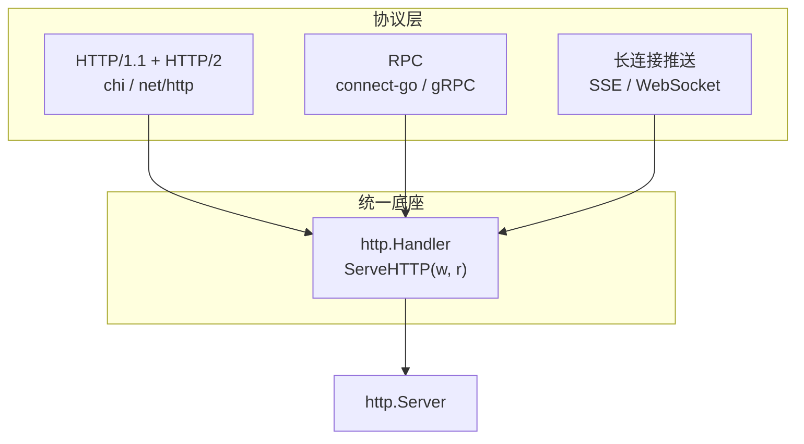
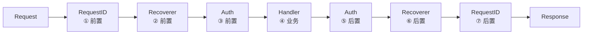
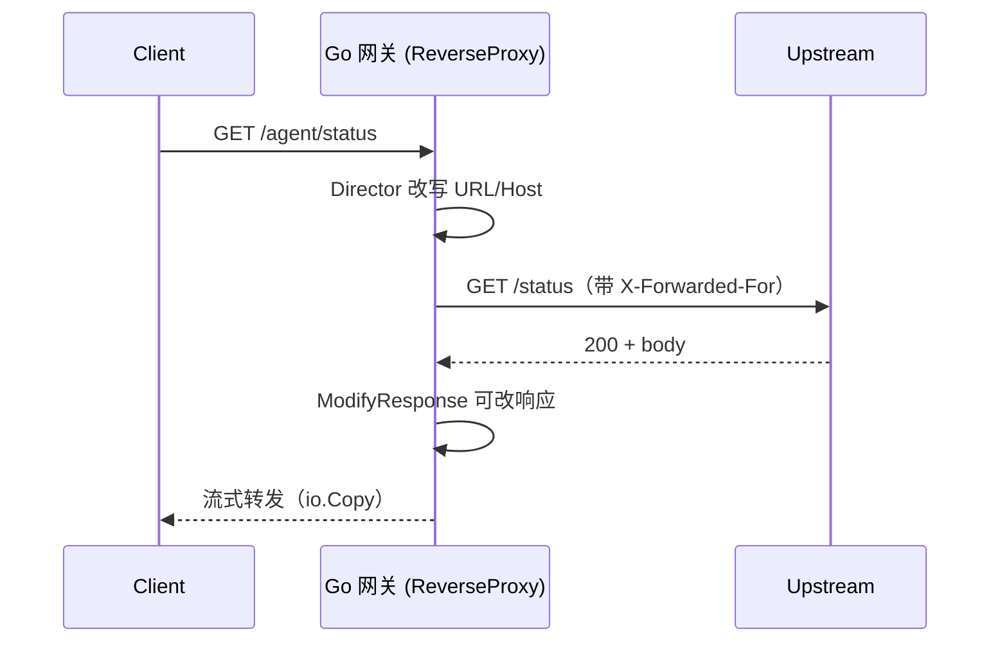
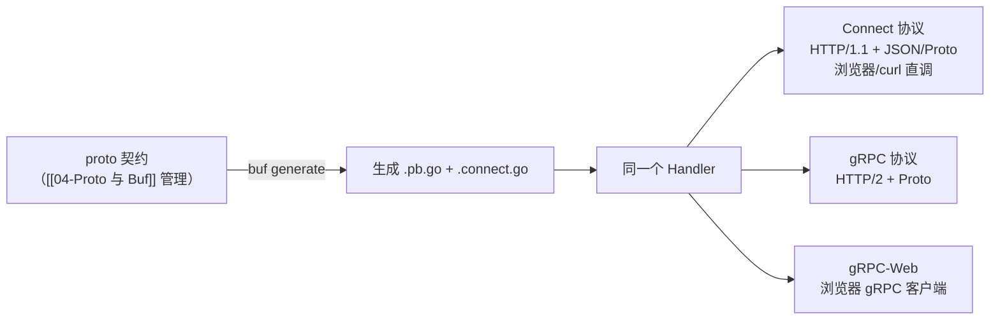
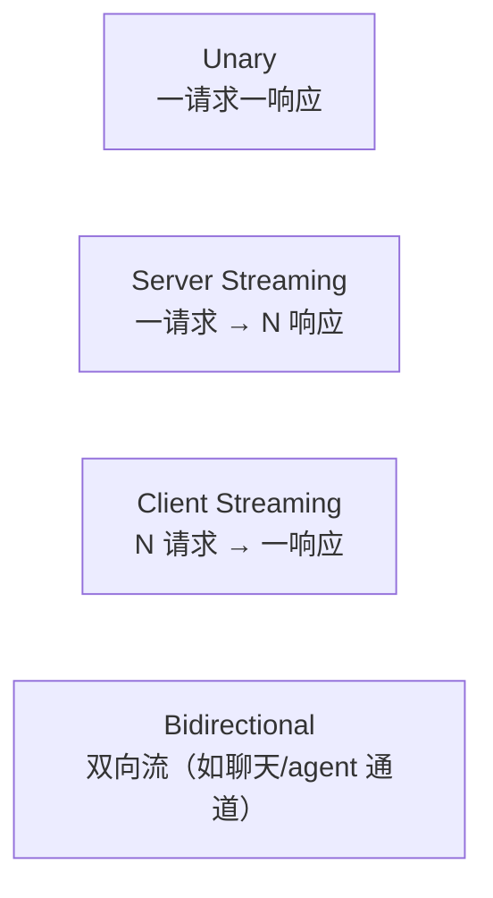
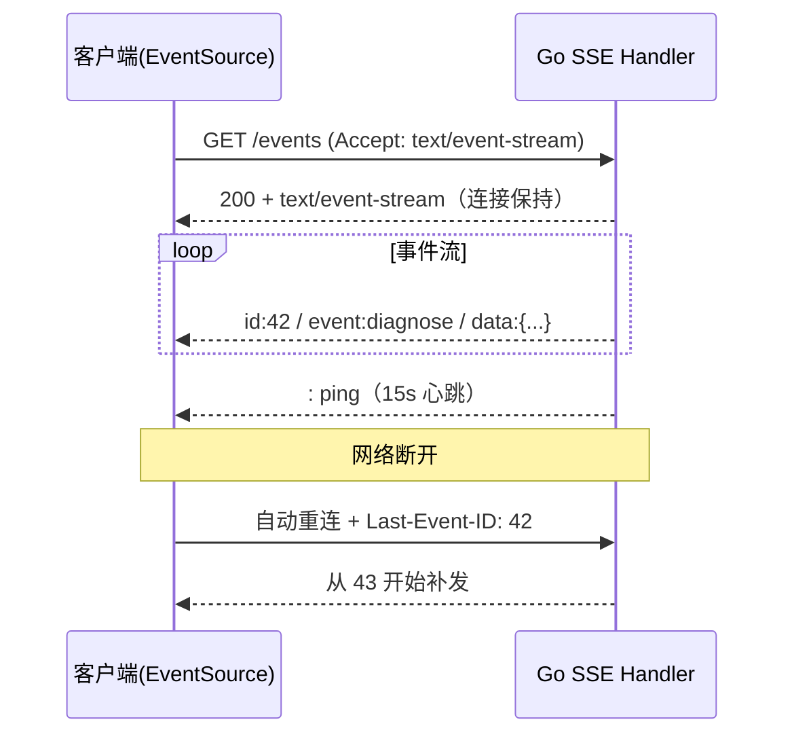
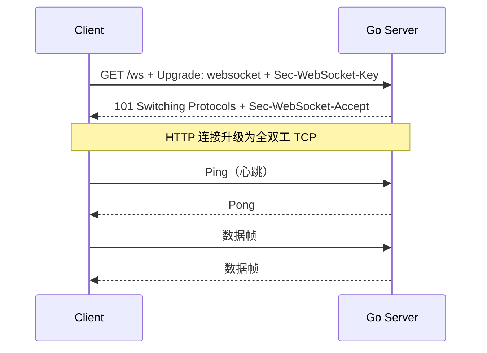
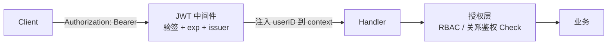

---
tags:
  - go
  - web
  - rpc
created: 2026-11-01
updated: 2026-11-14
status: 已整理
---

# 🌐 Web 与 RPC

> Go 的网络编程层：`net/http` 标准接口 → 路由框架 → RPC 协议 → 长连接推送，最底下还有 `net` 包的原生 TCP / UDP / TLS。接口契约走 [[04-Proto 与 Buf]]。

**全文主线**：Go 的 web 生态建立在 `net/http` 这一个标准接口上——框架只是 Handler 的组合器。理解了 `http.Handler`，chi、connect、中间件、反向代理全是同一个东西的不同包装。



## 一、net/http 服务端原理

### 唯一接口：http.Handler

```go
type Handler interface {
    ServeHTTP(w ResponseWriter, r *Request)
}
```

- `http.Server` 每接受一个连接起一个 goroutine，解析请求 → 调用 `Handler.ServeHTTP`
- `http.HandlerFunc` 是适配器：把普通函数转成 Handler

### Go 1.22 ServeMux 增强

```go
mux := http.NewServeMux()
mux.HandleFunc("GET /api/users/{id}", func(w http.ResponseWriter, r *http.Request) {
    id := r.PathValue("id")   // Go 1.22+ 路径参数
    fmt.Fprintf(w, "user: %s", id)
})
```

> 📌 Go 1.22 起标准 ServeMux 支持**方法 + 通配符**（`GET /users/{id}`），简单服务不用框架也行。但复杂路由组/中间件链仍是 chi 更顺手。

### 生产必配的 Server 超时

```go
srv := &http.Server{
    Addr:              ":8080",
    Handler:           router,
    ReadHeaderTimeout: 5 * time.Second,  // 防 Slowloris 慢头攻击
    ReadTimeout:       15 * time.Second, // 读完整请求（含 body）
    WriteTimeout:      30 * time.Second, // 写响应（⚠️ SSE 必须放宽或禁用！）
    IdleTimeout:       60 * time.Second, // keep-alive 空闲
    MaxHeaderBytes:    1 << 20,          // 1MB
}
```


> ⚠️ 三个高频事故点：
> 1. **不设 ReadHeaderTimeout** → 慢头攻击打满连接（面试常问）
> 2. **WriteTimeout 卡死 SSE** → 长连接推送会被强制断开，SSE 端点要单独放宽或用 `http.ResponseController`（Go 1.20+）设 deadline
> 3. **默认 `http.ListenAndServe` 无任何超时** → 生产禁用

## 二、chi 路由框架

> 选型理由：chi 是**纯 net/http 兼容**的轻量路由器——中间件就是 `func(http.Handler) http.Handler`，不引入自有 Context/绑定器，和整个标准生态无缝组合。gin/echo 自带 Context 体系，性能好但和生态割裂。

```go
// go mod init example.com/api && go get github.com/go-chi/chi/v5@v5.1.0
package main

import (
    "encoding/json"
    "log"
    "net/http"
    "strconv"

    "github.com/go-chi/chi/v5"
    "github.com/go-chi/chi/v5/middleware"
)

func main() {
    r := chi.NewRouter()
    r.Use(middleware.RequestID)
    r.Use(middleware.Recoverer)      // panic → 500，不崩进程
    r.Use(middleware.Logger)

    r.Get("/healthz", func(w http.ResponseWriter, r *http.Request) {
        w.WriteHeader(http.StatusOK)
        _, _ = w.Write([]byte("ok"))
    })

    r.Route("/api/v1", func(r chi.Router) {
        r.Use(AuthMiddleware)         // 组内中间件
        r.Get("/users/{id}", getUser)
        r.Post("/users", createUser)
    })

    log.Fatal(http.ListenAndServe(":8080", r)) // 生产用上面带超时的 Server
}

func getUser(w http.ResponseWriter, r *http.Request) {
    id, err := strconv.ParseInt(chi.URLParam(r, "id"), 10, 64)
    if err != nil {
        http.Error(w, "invalid id", http.StatusBadRequest)
        return
    }
    w.Header().Set("Content-Type", "application/json")
    _ = json.NewEncoder(w).Encode(map[string]any{"id": id})
}

func createUser(w http.ResponseWriter, r *http.Request) { /* ... */ }
func AuthMiddleware(next http.Handler) http.Handler {
    return http.HandlerFunc(func(w http.ResponseWriter, r *http.Request) {
        if r.Header.Get("Authorization") == "" {
            http.Error(w, "unauthorized", http.StatusUnauthorized)
            return
        }
        next.ServeHTTP(w, r)
    })
}
```

**依赖**：`go get github.com/go-chi/chi/v5@v5.1.0` · **运行**：`go run .` → `curl localhost:8080/api/v1/users/42 -H "Authorization: Bearer x"`

- `r.Route()` 路由组 + `r.Use()` 组内中间件（按组隔离，清晰）
- `chi.URLParam(r, "id")` 取路径参数；`middleware.*` 内置常用中间件
- 路由匹配是 radix tree，性能与 gin 同量级；**性能瓶颈永远在 IO 不在路由**

## 三、中间件模式（洋葱模型）



```go
// 标准签名：吃一个 Handler，吐一个 Handler
func Logging(next http.Handler) http.Handler {
    return http.HandlerFunc(func(w http.ResponseWriter, r *http.Request) {
        start := time.Now()
        // 包装 ResponseWriter 才能拿到状态码（接口增强模式）
        ww := middleware.NewWrapResponseWriter(w, r.ProtoMajor)
        defer func() {
            log.Printf("%s %s %d %s", r.Method, r.URL.Path, ww.Status(), time.Since(start))
        }()
        next.ServeHTTP(ww, r)
    })
}
```

> 📌 **顺序即语义**：Recoverer 必须在最外层（才能捕获内层所有 panic）；Auth 在业务前；日志通常最外层（记录全链路耗时）。中间件是**责任链**，前置逻辑按注册顺序执行，后置按反序（栈式展开）。

## 四、反向代理

```go
// 网关/聚合层：把 /agent/* 转发到内部 agent 服务
target, _ := url.Parse("http://agent-svc:9000")
proxy := httputil.NewSingleHostReverseProxy(target)
proxy.ErrorHandler = func(w http.ResponseWriter, r *http.Request, err error) {
    http.Error(w, "upstream unavailable", http.StatusBadGateway)
}
r.Handle("/agent/*", http.StripPrefix("/agent", proxy))
```



- `Director` 改请求（URL/Header），`ModifyResponse` 改响应，`ErrorHandler` 兜底
- 转发是**流式**的（不缓冲整个 body），适合大文件/SSE
- 自定义 Transport 控制连接池（见下节）；`X-Forwarded-For` 自动追加

## 五、HTTP 客户端最佳实践

> ⚠️ **`http.DefaultClient` 没有超时**（`Timeout = 0`），且默认 Transport 的 `MaxIdleConnsPerHost = 2`——高并发下疯狂建连 + 一个慢下游就能拖垮整个服务。生产必须自建 Client。

```go
var httpClient = &http.Client{
    Timeout: 10 * time.Second,   // 全局兜底（含连接+读body）
    Transport: &http.Transport{
        MaxIdleConns:          200,              // 全局空闲连接上限
        MaxIdleConnsPerHost:   50,              // ⚠️ 默认仅 2！必须调大
        MaxConnsPerHost:       100,             // 单 host 硬上限
        IdleConnTimeout:       90 * time.Second,
        TLSHandshakeTimeout:   5 * time.Second,
        ResponseHeaderTimeout: 5 * time.Second, // 防下游只连不响应
        ForceAttemptHTTP2:     true,
    },
}
```

| 超时层 | 作用 |
|---|---|
| `Client.Timeout` | 整个请求（含连接、重定向、读 body）兜底 |
| `Transport.ResponseHeaderTimeout` | 等响应头的上限 |
| `Transport.TLSHandshakeTimeout` | TLS 握手上限 |
| `context.WithTimeout` | **业务级**超时，可跨多个调用传递（首选） |

> 📌 关键习惯：① **复用 Client 实例**（不要每次请求 new，连接池会失效）；② `resp.Body` 必须 `defer Close()`，且**要读完再 Close** 才能复用连接（`io.Copy(io.Discard, resp.Body)`）；③ 重试只对幂等方法（GET/PUT），用指数退避（连 [[02-并发编程]]）。

### 客户端韧性：超时 / 重试 / 限流 / 熔断

调用外部服务时**下游慢或挂是常态**，光设 `Timeout` 不够，四层防护缺一不可。

```go
limiter := rate.NewLimiter(rate.Limit(50), 100)   // golang.org/x/time/rate 令牌桶
cb := gobreaker.NewCircuitBreaker(gobreaker.Settings{ // github.com/sony/gobreaker
    ReadyToTrip: func(c gobreaker.Counts) bool { return c.ConsecutiveFailures > 5 },
    Timeout:     30 * time.Second,                 // Open → HalfOpen 探测窗口
})
```

| 层 | 机制 | 要点 |
|---|---|---|
| **超时预算** | `context.WithTimeout` 沿调用链**递减传递** | 总预算 3s、已耗 2s 就只给下游 1s；不要每层重置成 3s（连 [[02-并发编程]]）|
| **重试** | 指数退避 + 抖动 | 只幂等，且带**重试预算**（次数 + 总时长上限），否则下游抖动被放大成雪崩。可重试判定见 [[01-语言基础]] 跨层错误模型 |
| **限流** | `x/time/rate` 令牌桶 | 客户端侧限制对单个下游的 QPS；服务端侧同一套做成中间件（本文第三节）|
| **熔断** | 三态 **Closed → Open → HalfOpen** | 连续失败达阈值直接短路，不再把连接耗在已知挂掉的下游；HalfOpen 放少量探测流量恢复 |

> 📌 顺序是 **超时 → 限流 → 熔断 → 重试**：先挡住不该发出的请求，再对确实发出且可重试的失败做退避。把重试放在最外层会绕过熔断，等于白做。
> ⚠️ 重试叠加非幂等写（POST 创建资源）会产生重复数据，必须带幂等键（连 [[06-中间件]]）。

## 六、文件上传下载

```go
// 上传：流式 multipart，限制大小，不整体读进内存
func upload(w http.ResponseWriter, r *http.Request) {
    r.Body = http.MaxBytesReader(w, r.Body, 32<<20) // 32MB 上限，防 OOM
    mr, err := r.MultipartReader()
    if err != nil { http.Error(w, "bad multipart", 400); return }
    for {
        part, err := mr.NextPart()
        if err == io.EOF { break }
        if err != nil { http.Error(w, "read part", 400); return }
        if part.FormName() != "file" { _ = part.Close(); continue }
        dst, err := os.Create("/tmp/" + filepath.Base(part.FileName()))
        if err != nil { http.Error(w, "create", 500); return }
        _, err = io.Copy(dst, part)   // 流式拷贝，内存恒定
        _ = dst.Close(); _ = part.Close()
        if err != nil { http.Error(w, "write", 500); return }
    }
    w.WriteHeader(http.StatusCreated)
}

// 下载：io.Copy 流式写出，大文件不占内存
func download(w http.ResponseWriter, r *http.Request) {
    f, err := os.Open("report.tar.gz")
    if err != nil { http.Error(w, "not found", 404); return }
    defer f.Close()
    w.Header().Set("Content-Disposition", `attachment; filename="report.tar.gz"`)
    w.Header().Set("Content-Type", "application/octet-stream")
    _, _ = io.Copy(w, f)
}
```

> 📌 两个防事故点：`MaxBytesReader` 限制请求体；`filepath.Base` 清洗文件名（防路径穿越 `../../etc/passwd`）。别用 `r.ParseMultipartForm(32<<20)` 还以为没内存问题——它会把小文件缓存在内存，大文件落临时盘，需要手动 `RemoveAll` 清理。

## 七、connect-go

> **ConnectRPC**：一份 proto 定义，同一个 Handler 同时服务 **Connect / gRPC / gRPC-Web** 三种协议。浏览器可直接调（无需 grpc-web 代理），错误模型统一，Go 生态里是 gRPC 的轻量现代化替代。



```go
// 依赖：go get connectrpc.com/connect@latest google.golang.org/protobuf
// 生成：buf generate（protoc-gen-go + protoc-gen-connect-go）
package main

import (
    "context"
    "log"
    "net/http"

    "connectrpc.com/connect"
    "example.com/api/gen/user/v1/userv1connect" // 生成代码
    userv1 "example.com/api/gen/user/v1"
)

type userServer struct{}

func (userServer) GetUser(
    ctx context.Context,
    req *connect.Request[userv1.GetUserRequest],
) (*connect.Response[userv1.GetUserResponse], error) {
    if req.Msg.GetId() == "" {
        return nil, connect.NewError(connect.CodeInvalidArgument, errors.New("id required"))
    }
    return connect.NewResponse(&userv1.GetUserResponse{
        User: &userv1.User{Id: req.Msg.GetId(), Name: "Alice"},
    }), nil
}

func main() {
    mux := http.NewServeMux()
    path, handler := userv1connect.NewUserServiceHandler(userServer{})
    mux.Handle(path, handler)
    log.Fatal(http.ListenAndServe(":8080", mux))
}
```

**客户端**（同一份生成代码）：

```go
client := userv1connect.NewUserServiceClient(httpClient, "http://localhost:8080")
resp, err := client.GetUser(ctx, connect.NewRequest(&userv1.GetUserRequest{Id: "42"}))
if err != nil {
    if connect.CodeOf(err) == connect.CodeNotFound { /* 按错误码分支 */ }
}
log.Println(resp.Msg.GetUser().GetName())
```

> 📌 **面试要点**：
> - Connect 协议 unary 是普通 `POST`（Content-Type `application/json` 或 `application/proto`），**curl 能直接调**，调试体验远好于 gRPC
> - 错误码 `connect.Code*` 与 gRPC codes 对齐；`connect.CodeOf(err)` 判类型（连 [[01-语言基础]] 的 error 链）
> - 流式 API：`NewRequest` + `Send`/`Receive`，服务端返回 `connect.ServerStream`
> - 拦截器用 `connect.WithInterceptors(...)`，与 gRPC interceptor 概念一致

## 八、gRPC 原理

- 基于 **HTTP/2**：多路复用（一条连接并发多个 stream）、头部压缩、二进制 Protobuf 帧
- **四种流模式**：



- **拦截器**（Interceptor）：unary/stream 各一套，做鉴权、日志、metrics、重试
- **健康检查**：`grpc_health_v1` 标准服务，K8s gRPC probe（连 [[02-工作负载资源]] 探针）
- **元数据**：`metadata.MD`（类似 HTTP header），走 HTTP/2 headers

> ⚠️ gRPC 的痛点：浏览器不能原生调（需 grpc-web 代理或 Envoy）、调试要 grpcurl、错误模型不如 Connect 直观。**前端要直连 → 选 connect-go**；已有 gRPC 生态/跨语言极致性能 → gRPC。

## 九、connect vs gRPC 选型

| 维度 | connect-go | gRPC |
|---|---|---|
| 传输 | HTTP/1.1 + HTTP/2 均可 | 必须 HTTP/2 |
| 浏览器 | ✅ 直连（Connect/gRPC-Web） | ❌ 需代理 |
| 调试 | curl 直接调 | grpcurl / 专用工具 |
| 代码生成 | buf + protoc-gen-connect-go | protoc-gen-go-grpc |
| 流式 | ✅ 全支持 | ✅ 全支持 |
| 生态 | 新、Go/TS/Kotlin 为主 |  mature，全语言、服务网格原生 |
| 性能 | 同量级（瓶颈在业务） | 略优（HPACK/帧优化成熟） |

> 📌 **决策**：新项目、前端要调、想用 curl 调试 → **connect-go**；已有 gRPC 存量、需要服务网格流量治理、多语言深度生态 → gRPC。

## 十、SSE 服务端推送

> SSE 是单向（服务端→客户端）的 HTTP 长连接，客户端用浏览器原生 `EventSource`，自带重连与 `Last-Event-ID` 断点续传。适合日志流、告警流、生成式输出等单向推送。

### 协议格式

```
id: 42
event: diagnose
data: {"cluster":"prod","level":"warn","msg":"pod pending"}

: 心跳注释行（保活，不触发客户端事件）
retry: 3000

```

| 字段 | 作用 |
|---|---|
| `data:` | 消息体（多行 data 会拼接） |
| `event:` | 事件类型（客户端 `addEventListener` 分类） |
| `id:` | 事件 ID，断线重连时浏览器带 `Last-Event-ID` 请求头 |
| `retry:` | 重连间隔（毫秒） |
| `: 注释` | 心跳/保活 |

### 完整可运行服务端

```go
// 无需第三方依赖，标准库实现
func sseHandler(w http.ResponseWriter, r *http.Request) {
    flusher, ok := w.(http.Flusher)
    if !ok { http.Error(w, "streaming unsupported", 500); return }

    w.Header().Set("Content-Type", "text/event-stream")
    w.Header().Set("Cache-Control", "no-cache")
    w.Header().Set("Connection", "keep-alive")
    w.Header().Set("X-Accel-Buffering", "no") // 禁用 nginx 缓冲

    lastID := r.Header.Get("Last-Event-ID")   // 断点续传起点
    events := loadEventsSince(lastID)         // 业务：从存储补发

    ticker := time.NewTicker(15 * time.Second) // 心跳，防代理超时断连
    defer ticker.Stop()

    for {
        select {
        case <-r.Context().Done():  // 客户端断开 → 必须退出，否则 goroutine 泄漏
            return
        case ev, ok := <-events:
            if !ok { return }
            fmt.Fprintf(w, "id: %d\nevent: %s\ndata: %s\n\n", ev.ID, ev.Type, ev.JSON())
            flusher.Flush()          // ⚠️ 不 Flush 数据留在缓冲区，客户端收不到
        case <-ticker.C:
            fmt.Fprint(w, ": ping\n\n")
            flusher.Flush()
        }
    }
}
```



> ⚠️ **四个生产坑**：
> 1. **必须 `Flush()`**——不 Flush 客户端永远收不到
> 2. **`r.Context().Done()` 必接**——客户端断开不退出 = goroutine 泄漏（连 [[02-并发编程]]）
> 3. **Server.WriteTimeout 会杀长连接**——SSE 端点需放宽或独立 Server
> 4. **代理缓冲**：nginx 默认 `proxy_buffering on` 会攒着不发，加 `X-Accel-Buffering: no`

**背压**：`events` channel 满了说明消费慢——用有界 channel + 丢弃/聚合策略，别无限堆内存。

## 十一、WebSocket

```go
// go get github.com/gorilla/websocket@v1.5.3
var upgrader = websocket.Upgrader{
    ReadBufferSize:  1024,
    WriteBufferSize: 1024,
    CheckOrigin: func(r *http.Request) bool { return true }, // ⚠️ 生产必须校验 Origin！
}

func wsHandler(w http.ResponseWriter, r *http.Request) {
    conn, err := upgrader.Upgrade(w, r, nil)  // 101 Switching Protocols
    if err != nil { return }
    defer conn.Close()
    conn.SetReadLimit(1 << 20)
    _ = conn.SetReadDeadline(time.Now().Add(60 * time.Second))
    conn.SetPongHandler(func(string) error {
        return conn.SetReadDeadline(time.Now().Add(60 * time.Second))
    })
    for {
        _, msg, err := conn.ReadMessage()
        if err != nil { return }
        if err := conn.WriteMessage(websocket.TextMessage, msg); err != nil { return }
    }
}
```



> 📌 **SSE vs WebSocket 选型**：只需服务端→客户端单向推送（告警流、日志流、生成式输出）→ **SSE**（基于 HTTP、自动重连、代理友好、实现简单）；需要双向实时（聊天、协同）→ WebSocket。大规模连接也可交给专用消息中间件托管，不必自己维护连接层。

## 十二、长连接管理（客户端侧）

```go
// 指数退避重连骨架（SSE 客户端 / agent 通用）
func subscribe(ctx context.Context, url string) {
    backoff := time.Second
    for {
        if err := connectOnce(ctx, url); err != nil {
            log.Printf("stream lost: %v, retry in %s", err, backoff)
        }
        select {
        case <-ctx.Done(): return
        case <-time.After(backoff):
        }
        backoff = min(backoff*2, 30*time.Second) // 上限 30s
        // 重连成功后由 connectOnce 内部重置 backoff
    }
}
```

长连接的三个必备机制：
1. **心跳保活**：服务端定时 ping / 客户端 SetReadDeadline + pong
2. **指数退避重连**：`1s→2s→4s…→30s` 封顶 + 抖动（防重连风暴打垮平台）
3. **背压控制**：有界队列，消费慢时丢弃低优先级事件或聚合，绝不无限缓冲

## 十三、鉴权与传输安全



```go
// go get github.com/golang-jwt/jwt/v5@v5.2.1
func jwtAuth(secret []byte, next http.Handler) http.Handler {
    return http.HandlerFunc(func(w http.ResponseWriter, r *http.Request) {
        raw := strings.TrimPrefix(r.Header.Get("Authorization"), "Bearer ")
        tok, err := jwt.Parse(raw, func(t *jwt.Token) (any, error) {
            if _, ok := t.Method.(*jwt.SigningMethodHMAC); !ok {
                return nil, fmt.Errorf("unexpected signing method: %v", t.Header["alg"])
            }
            return secret, nil // ⚠️ 密钥从环境变量/Secret 读，禁止硬编码
        })
        if err != nil || !tok.Valid {
            http.Error(w, "unauthorized", http.StatusUnauthorized)
            return
        }
        claims := tok.Claims.(jwt.MapClaims)
        ctx := context.WithValue(r.Context(), userIDKey{}, claims["sub"])
        next.ServeHTTP(w, r.WithContext(ctx))
    })
}
```

> ⚠️ **四个安全要点**：
> 1. **必须校验签名算法**（防 `alg: none` / RS256→HS256 混淆攻击）
> 2. 密钥走环境变量 / K8s Secret（连 [[06-配置与安全]]），**绝不硬编码**
> 3. JWT 只是 Base64 编码，**不放敏感信息**；`exp` 必校验
> 4. **认证 ≠ 授权**：JWT 证明"你是谁"，"能操作哪些资源"交给授权层做细粒度判定
> 5. 服务间 mTLS 用内部 CA 签发的证书，证书轮换要自动化（连 [[06-配置与安全]]）

## 十四、CORS 与 CSRF

```go
// CORS 中间件要点（生产用 github.com/rs/cors）
func cors(next http.Handler) http.Handler {
    return http.HandlerFunc(func(w http.ResponseWriter, r *http.Request) {
        w.Header().Set("Access-Control-Allow-Origin", "https://console.example.com") // credentials 时不能是 *
        w.Header().Set("Access-Control-Allow-Methods", "GET, POST, PUT, DELETE")
        w.Header().Set("Access-Control-Allow-Headers", "Authorization, Content-Type")
        w.Header().Set("Access-Control-Allow-Credentials", "true")
        if r.Method == http.MethodOptions { // 预检直接返回
            w.WriteHeader(http.StatusNoContent)
            return
        }
        next.ServeHTTP(w, r)
    })
}
```

| 攻击 | 防御 |
|---|---|
| **CORS 误配** | 白名单 Origin（不用 `*` + credentials）；预检 OPTIONS 直接 204 |
| **CSRF** | Cookie `SameSite=Lax/Strict` + CSRF Token（双提交）；JWT 放 Authorization header 天然免疫大部分 CSRF |
| **XSS** | 输出转义、CSP header（JWT 存 localStorage 要评估 XSS 风险） |

## 十五、API 设计

- **资源建模**：`/api/v1/clusters/{id}/components` —— 名词复数、层级表达归属、不在 URL 放动词
- **版本化**：URL 前缀 `/api/v1`（简单直观）；或 `Accept` header（更 REST 但调试麻烦）
- **错误规范**：统一结构 `{"code":"not_found","message":"...","request_id":"..."}`，HTTP 状态码 + 业务 code 双层；`request_id` 贯穿日志（连 [[07-工程实践]]）
- **分页**：cursor-based 优于 offset（大数据量稳定，连 [[05-数据库]]）
- **proto-first**：内部服务用 [[04-Proto 与 Buf]] 定义契约，生成 HTTP+RPC 代码，前后端共用类型

## 十六、原生网络编程：TCP / UDP / TLS

`net/http` 之下是 `net` 包。写代理、网关、自定义协议、健康检查探针时，绕不开这一层。

### TCP 服务端骨架（可运行）

```go
package main

import (
    "bufio"
    "context"
    "errors"
    "log"
    "net"
    "os"
    "os/signal"
    "syscall"
    "time"
)

func handle(ctx context.Context, c net.Conn) {
    defer c.Close()
    r := bufio.NewReader(c)
    for {
        // 关键：用 SetReadDeadline 实现「每次读」的超时，而不是整个连接一个总超时
        if err := c.SetReadDeadline(time.Now().Add(30 * time.Second)); err != nil {
            return
        }
        line, err := r.ReadString('\n')
        if err != nil {
            return // 客户端关闭 / 超时 / 网络错，统一退出，goroutine 随之结束
        }
        select {
        case <-ctx.Done():
            return
        default:
        }
        if _, err := c.Write([]byte("echo: " + line)); err != nil {
            return
        }
    }
}

func main() {
    ln, err := net.Listen("tcp", ":9000")
    if err != nil {
        log.Fatal(err)
    }
    defer ln.Close()

    ctx, stop := signal.NotifyContext(context.Background(), os.Interrupt, syscall.SIGTERM)
    defer stop()

    go func() {
        <-ctx.Done()
        ln.Close() // 让 Accept 立即返回，退出 accept 循环
    }()

    for {
        c, err := ln.Accept()
        if err != nil {
            if errors.Is(err, net.ErrClosed) || ctx.Err() != nil {
                return // 主动关闭，正常退出
            }
            log.Printf("accept: %v", err)
            continue // 临时错误（如 EMFILE）应退避后继续，别直接退出进程
        }
        go handle(ctx, c)
    }
}
```

**并发检查清单**（这类代码最容易埋雷）：

| 检查项 | 本例做法 |
|---|---|
| goroutine 泄漏 | `handle` 在 `ReadString` 出错、`ctx.Done()`、写失败时都能退出；`defer c.Close()` 保证资源释放 |
| context 取消 | `signal.NotifyContext` + `defer stop()`；关闭 `ln` 让 `Accept` 解除阻塞；处理函数检查 `ctx.Done()` |
| 阻塞 | `SetReadDeadline` 防止慢客户端永久占住 goroutine；**不要用无 deadline 的裸 `Read`** |
| 资源释放 | `ln.Close()` 与每个 `c.Close()` 都 `defer` 或显式调用 |
| 数据竞争 | 每个连接只在自己的 goroutine 里读写，无共享可变状态；无需加锁 |

> ⚠️ **Accept 临时错误不要 `log.Fatal`**：`EMFILE`（fd 耗尽）、瞬时网络错会导致进程退出。正确做法是短暂退避后 `continue`。只有 `net.ErrClosed` 或主动取消才退出循环。
>
> 📌 **Deadline 是绝对的、连接级的**：`SetDeadline` / `SetReadDeadline` 设的是**绝对时间点**，长连接里必须在每次读写前重设（如本例），否则第一次超时后连接就永久失效。`context.WithTimeout` 管的是调用生命周期，二者不是一回事。

### UDP 与 TLS 要点

| 主题 | 要点 |
|---|---|
| **UDP** | `net.ListenUDP` + `ReadFromUDP`；**无连接、不保序、不重传、可能丢包**；每个数据报有边界（不像 TCP 是字节流，不存在粘包）。适合 DNS、指标上报、发现协议；要可靠得自己在应用层做序号与重试 |
| **TCP 粘包** | TCP 是字节流，**没有消息边界**。`Read` 返回多少字节完全不确定，必须自己定协议：固定长度头 + 长度字段、分隔符（如本例 `\n`）、或 `io.ReadFull` 读满指定字节 |
| **TLS** | 服务端 `tls.NewListener(ln, &tls.Config{Certificates: ..., MinVersion: tls.VersionTLS12})` 包一层即可；客户端 `tls.Dial` 或 `http.Transport` 的 `TLSClientConfig`。**生产不要设 `InsecureSkipVerify: true`**，它关掉证书校验等于没有认证 |
| **Unix domain socket** | `net.Listen("unix", path)`：本机进程间通信，绕过网络协议栈、无端口冲突；注意 socket 文件的权限与退出时清理 |
| **超时与半开连接** | 只设 `ReadTimeout` 不设 `WriteTimeout` 可能让慢客户端占住写；`net/http` 的 `ReadHeaderTimeout` / `IdleTimeout` 就是这些问题的标准答案（本文第一节） |

> 📌 **为什么不直接用裸 TCP**：`net/http` 已处理连接复用、超时、TLS、HTTP/2、 graceful shutdown。只有需要自定义协议（Redis/MySQL 协议客户端、IoT 长连、代理隧道）时才下沉到 `net`；下沉意味着上面每一项都要自己实现一遍。

## 十七、高频问答

**Q1：`http.DefaultClient` 有什么问题？**
无超时（下游挂起拖死调用方）+ 默认 Transport `MaxIdleConnsPerHost=2`（高并发疯狂建连）。生产必须自建 Client：设 `Timeout`、`Transport` 连接池参数，并全局复用实例。

**Q2：一个 HTTP 请求在 Go 里怎么流转？**
Server Accept 连接 → 每连接一个 goroutine → 解析请求 → `Handler.ServeHTTP(w, r)` → 中间件洋葱链 → 业务 Handler → 写 ResponseWriter。**关键**：连接级 goroutine 由 net/http 管理，业务里再起 goroutine 要自己管生命周期。

**Q3：chi 相比 gin 的优势？**
chi 完全基于 `net/http`：`http.Handler` 接口、`func(Handler) Handler` 中间件，与标准库/connect-go/httputil 无缝组合，无自有 Context 绑定；gin 性能好但自成体系。Go 1.22 标准 ServeMux 也支持方法+通配符，简单服务可零框架。

**Q4：中间件为什么是洋葱模型？顺序怎么定？**
`next.ServeHTTP` 前是前置逻辑（按注册顺序），之后是后置（反序）。Recoverer 放最外层才能捕获内层 panic；日志最外层记录全链路；Auth 在业务前。

**Q5：connect-go 和 gRPC 怎么选？**
前端/浏览器要直连、想 curl 调试、新项目 → connect-go（一份 proto 三协议）。已有 gRPC 存量、需要服务网格流量治理、多语言深度生态 → gRPC。

**Q6：SSE 服务端最容易写错哪几处？**
① 忘记 `Flush()`（数据全在缓冲区）；② 没监听 `r.Context().Done()`（客户端断开 → goroutine 泄漏）；③ `WriteTimeout` 杀长连接；④ nginx 缓冲（加 `X-Accel-Buffering: no`）。

**Q7：SSE 和 WebSocket 怎么选？**
单向推送（日志流、告警流、AI 流式输出）→ SSE（HTTP 原生、自动重连、代理友好）；双向实时 → WebSocket。SSE 的 `Last-Event-ID` 天然支持断点续传，WebSocket 要自己实现。

**Q8：SSE 断线重连怎么做到不丢事件？**
服务端为每个事件写 `id:`；浏览器重连自动带 `Last-Event-ID`；服务端从该 ID 之后补发。要求事件有持久化/可回放的序号（Kafka offset 或 DB 自增 ID）。

**Q9：JWT 中间件的安全要点？**
校验签名算法（防 alg 混淆）、校验 exp/issuer、密钥从环境变量读、不放敏感信息（Base64 可解码），认证之后还要过授权层做细粒度判定。

**Q10：CORS 预检是什么？为什么 credentials 时不能用 `*`？**
非简单请求（自定义 header / application/json）浏览器先发 `OPTIONS` 预检，服务端返回允许的方法/头才发真实请求。带 `Access-Control-Allow-Credentials: true` 时规范禁止 `Allow-Origin: *`，必须回显式白名单 Origin。

**Q11：Server 的四个超时分别防什么？**
`ReadHeaderTimeout` 防慢头攻击（Slowloris）；`ReadTimeout` 防慢请求体；`WriteTimeout` 防慢响应（**SSE 要放宽**）；`IdleTimeout` 管 keep-alive 空闲连接回收。

**Q12：大文件上传怎么防 OOM？**
`http.MaxBytesReader` 限总大小 + `r.MultipartReader()` 逐 part 流式 `io.Copy` 到文件（不 `ReadAll`）+ `filepath.Base` 清洗文件名防路径穿越。

**Q13：TCP 为什么会有「粘包」？Go 里怎么处理？**
TCP 是**字节流、没有消息边界**，`Read` 返回多少字节完全不确定，多次_write 可能被一次读到、一次写可能被拆成多次。必须自己定协议：定长头 + 长度字段（配 `io.ReadFull` 读满）、分隔符、或长度前缀帧。UDP 是数据报、有边界，不存在粘包，但会丢包且不保序。

**Q14：裸 TCP 服务怎么避免 goroutine 泄漏与永久阻塞？**
每连接一个 goroutine，必须保证有明确退出路径：`defer conn.Close()`；用 `SetReadDeadline`/`SetDeadline` 设绝对超时（长连接每次读写前重设）；监听 `ctx.Done()`；`Accept` 遇临时错误退避后继续、只在 `net.ErrClosed`/取消时退出；退出时关闭 listener 让 `Accept` 解除阻塞。[[07-工程实践]] 的优雅退出与 [[08-Go 运行时与底层]] 的 netpoller 是这套机制的上下层解释。

## 十八、关联

- 接口契约 → [[04-Proto 与 Buf]]（proto3 / buf generate）
- 并发基础 → [[02-并发编程]]（goroutine 退出、context、channel 背压）
- 工程化 → [[07-工程实践]]（日志/OTel 追踪/优雅退出）
- 上游应用 → [[AI 工程]]（生成式输出的 SSE 消费）、[[08-Go 运行时与底层]]（netpoller 与长连接）
- 上游：[[Go 开发]]
