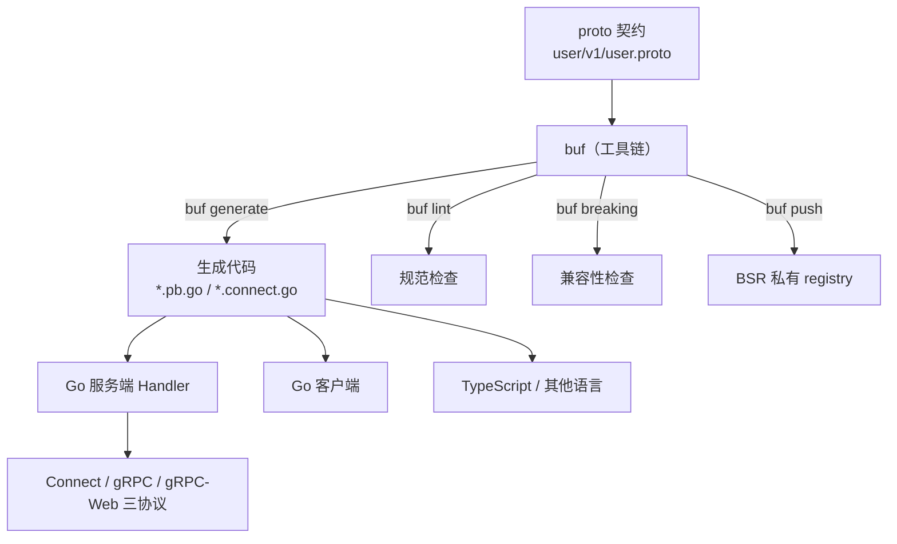
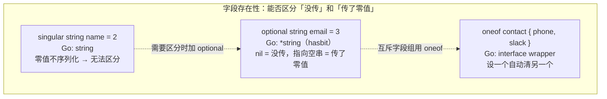
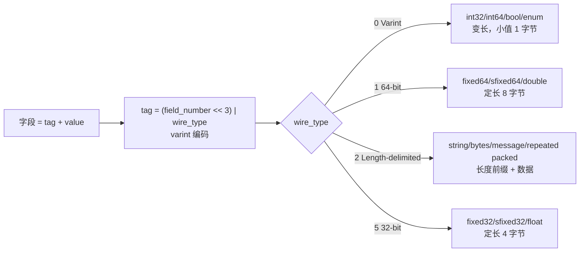
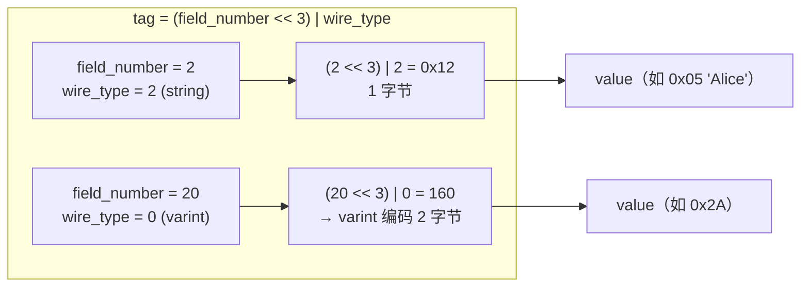
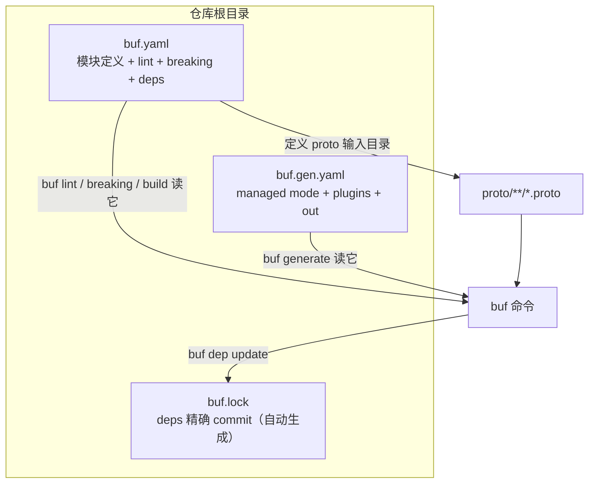
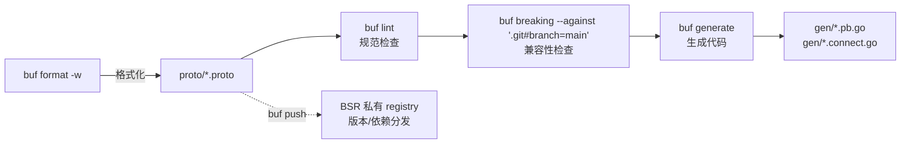
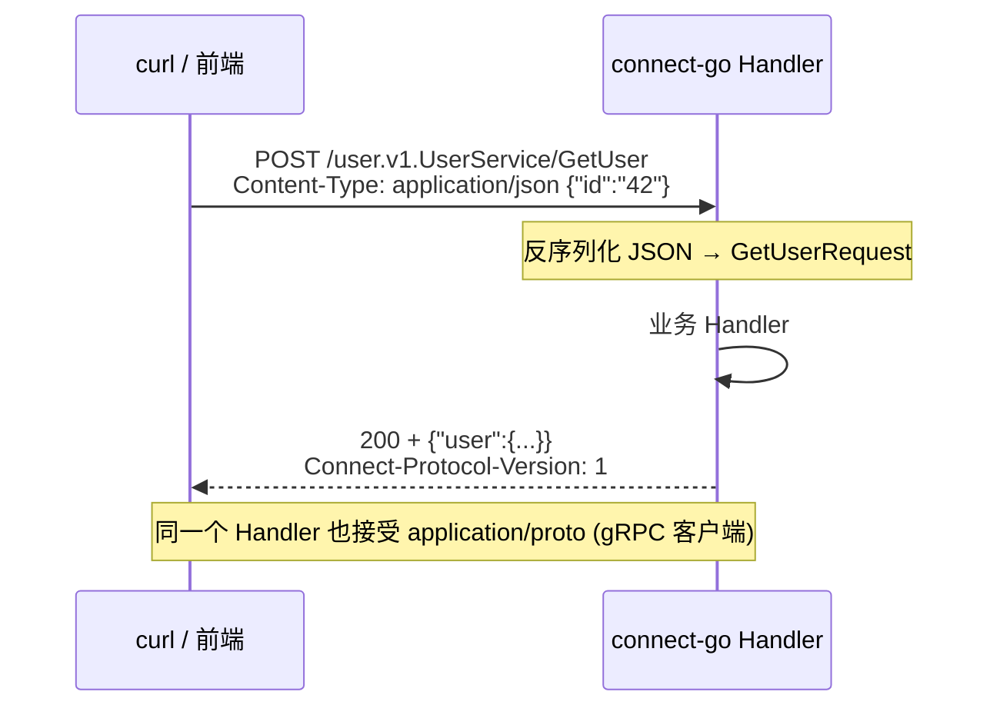
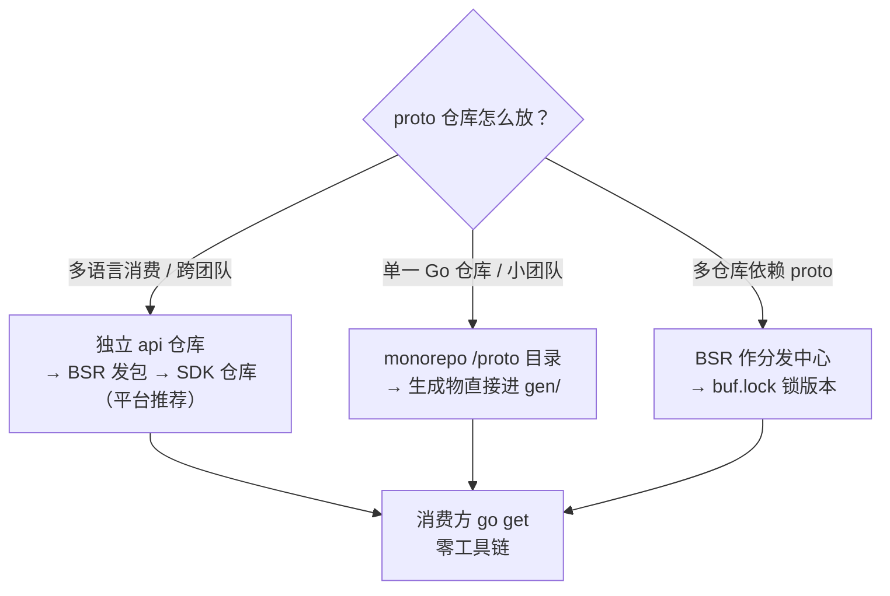
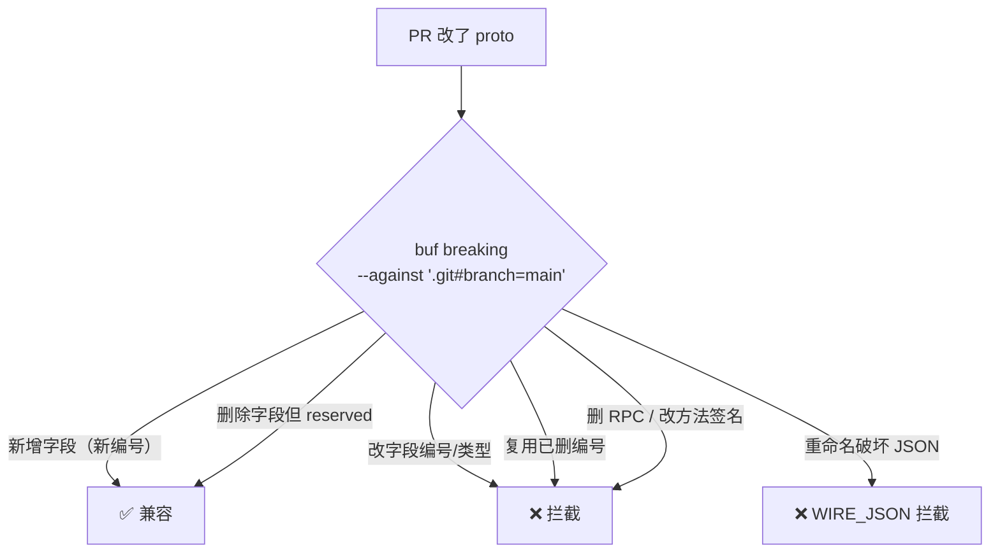
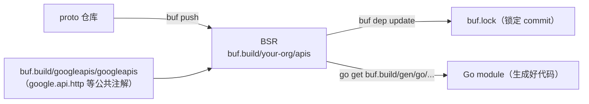

---
tags:
  - go
  - proto
  - buf
created: 2026-11-14
updated: 2026-11-14
status: 已整理
---

# 📜 Proto 与 Buf

> 接口定义与代码生成工具链：proto3 写 schema → buf 管理生成/lint/兼容性 → connect-go 消费。API 的「单一事实源」。

**全文主线**：**proto-first**——接口契约先于代码存在。一份 `.proto` 生成服务端、客户端、类型、文档、校验；人只写业务实现。buf 把「生成 + 规范 + 兼容性」从散装的 protoc 命令变成可进 CI 的工程流程。



## 一、为什么是 proto-first

| 对比 | 手写 API（代码先行） | proto-first |
|---|---|---|
| 契约来源 | 代码/文档（易漂移） | `.proto` 唯一事实源 |
| 前后端类型 | 手抄接口定义 | 生成，天然一致 |
| 多语言 | 各写各的 client | 生成器全覆盖 |
| 兼容检查 | 靠人 review | `buf breaking` 自动拦截 |
| 调试 | 文档可能过期 | `curl` 直调（Connect 协议） |

> 📌 **为什么需要机器可校验的契约**：多语言客户端、发布节奏不一致、服务端与客户端版本错开——契约先于代码存在，才能在 CI 里自动拦住不兼容变更。

## 二、proto3 语法精要

```proto
// proto/user/v1/user.proto
syntax = "proto3";

package user.v1;   // 包名带版本，防止 v1/v2 冲突

option go_package = "github.com/songli0103/notes-platform/gen/user/v1;userv1";

// 枚举：第一个值必须是 0（作为默认零值）
enum Status {
  STATUS_UNSPECIFIED = 0;   // lint 要求值带枚举名前缀
  STATUS_ACTIVE = 1;
  STATUS_DISABLED = 2;
}

message User {
  string id = 1;                       // 字段编号 = wire 上的身份，永不复用
  string name = 2;
  optional string email = 3;           // proto3 optional：显式存在性
  repeated string roles = 4;           // 列表
  map<string, string> labels = 5;      // 映射
  oneof contact {                      // 互斥字段组
    string phone = 6;
    string slack = 7;
  }
  Status status = 8;
  reserved 9, 10;                      // 已删除字段的编号
  reserved "legacy_name";              // 已删除字段的名字
}

message GetUserRequest  { string id = 1; }
message GetUserResponse { User user = 1; }

service UserService {
  rpc GetUser(GetUserRequest) returns (GetUserResponse);
  rpc ListUsers(ListUsersRequest) returns (stream ListUsersResponse); // 服务端流
}
```

### 字段规则

| 规则 | 含义 | Go 生成 |
|---|---|---|
| `singular`（默认） | 0 或 1 个，**零值无存在性**（不序列化） | 值类型 `string`、`int32` |
| `optional` | 显式存在性，能区分"没传"和"传了零值" | 指针 `*string`（protoc-gen-go） |
| `repeated` | 列表，proto3 标量默认 **packed 编码** | `[]T` |
| `map<K,V>` | 映射（K 只能是整型/string/bool） | `map[K]V` |
| `oneof` | 一组互斥字段，设一个清其他 | interface wrapper + 具体类型 |

> ⚠️ **proto3 标量零值不序列化**（无 hasbit）：`"name": ""` 和"没传 name"在 wire 上一样。需要区分时用 `optional`（Go 里变成指针）或 `google.protobuf.FieldMask` 做部分更新。



### 标量类型 → Go 映射（高频）

| proto | Go | 说明 |
|---|---|---|
| `double` / `float` | `float64` / `float32` | |
| `int32` / `int64` | `int32` / `int64` | 负数编码低效 → 用 `sint32/sint64`（ZigZag） |
| `uint64` / `fixed64` | `uint64` | `fixed64` 定长 8 字节，大数更快 |
| `bool` | `bool` | |
| `string` | `string` | 必须 UTF-8 |
| `bytes` | `[]byte` | 任意二进制 |

## 三、wire 编码原理（面试常考）



**字段编号规则**（决定编码体积和兼容性）：




| 编号 | 说明 |
|---|---|
| `1 ~ 15` | tag 占 **1 字节** → 留给最频繁的字段 |
| `16 ~ 2047` | tag 占 2 字节 |
| `19000 ~ 19999` | **编译器保留**，不可用 |
| 最大 `2^29 - 1` | 536870911 |

> 📌 **字段编号是 wire 上的唯一身份**，字段名只是给人看的。所以：
> - **永不复用已删除字段的编号**（老客户端发来的数据会被新字段错误解析）→ 删除时写 `reserved`
> - 加字段用新编号 → 老客户端忽略未知字段，天然向后兼容
> - 改字段类型/编号 = 破坏兼容（除非类型 wire-compatible，见第六节）

## 四、proto3 vs proto2

| 维度 | proto2 | proto3 |
|---|---|---|
| `required` | 有（**已被证明是反模式**） | 移除，全部字段可选 |
| 字段存在性 | 默认有（hasXxx） | 标量默认无，`optional` 显式启用（3.15 GA） |
| 默认值 | 可指定 `[default = x]` | 固定零值，不可自定义 |
| 枚举首值 | 可任意 | **必须为 0** |
| 未知字段 | 保留 | proto3 保留（3.5 后恢复） |

> 📌 为什么去掉 `required`：一旦字段设为 required，就**永远不能删**（老数据反序列化直接失败），成为契约的永久枷锁。proto3 的哲学是"所有字段都可选，兼容性交给演进规则"。

## 五、风格与设计（Google AIP 精简版）

| 约定 | 示例 |
|---|---|
| 包名 = 产品.版本 | `package user.v1;` |
| 文件目录匹配包名 | `proto/user/v1/user.proto` |
| 服务名以 `Service` 结尾 | `UserService` |
| 标准方法 | `GetUser` / `ListUsers` / `CreateUser` / `UpdateUser` / `DeleteUser` |
| 请求/响应消息 | `GetUserRequest` / `GetUserResponse`（RPC 名 + 后缀） |
| 字段命名 | `lower_snake_case`；JSON 自动转 `lowerCamelCase` |
| 枚举值 | `STATUS_UNSPECIFIED = 0`，值带枚举名前缀 |
| 列表响应 | `repeated User users = 1; string next_page_token = 2;` |

> ⚠️ **改字段名不破坏二进制，但破坏 JSON**：`json_name` 默认由字段名生成，重命名会让 `userName` 变成 `name`，前端全挂。`buf breaking --use WIRE_JSON` 专门拦这个。要改就用 `json_name` 显式锁定旧名。

## 六、buf 工具链

### 两个配置文件（v2 格式）




```yaml
# buf.yaml —— 模块定义 + 规范 + 依赖（buf v1.32+ 支持 v2）
version: v2
modules:
  - path: proto
lint:
  use:
    - STANDARD          # 标准规则集（命名/目录匹配/请求响应命名等）
breaking:
  use:
    - FILE              # 最严格：文件级兼容检查
deps:
  - buf.build/googleapis/googleapis   # 依赖的 BSR 模块（如 annotations）
```

```yaml
# buf.gen.yaml —— 代码生成（v2）
version: v2
managed:
  enabled: true         # 托管模式：自动生成 go_package，不用每个 proto 手写
  override:
    - file_option: go_package_prefix
      value: github.com/songli0103/notes-platform/gen
plugins:
  - local: protoc-gen-go            # 生成 message 类型（*.pb.go）
    out: gen
    opt: paths=source_relative
  - local: protoc-gen-connect-go    # 生成 Connect Handler/Client（*.connect.go）
    out: gen
    opt: paths=source_relative
```

> 📌 **managed mode 是 buf 的核心价值之一**：`go_package` 是 Go 特有的选项，不该污染通用 proto 契约。开启后 buf 按 `go_package_prefix` 自动注入，跨语言共用一份 proto 不必为 Go 让步。

### 命令地图



| 命令 | 作用 | CI 位置 |
|---|---|---|
| `buf format -w` | 统一格式 | pre-commit |
| `buf lint` | 规范（命名/目录/包）| PR 必跑 |
| `buf breaking --against '.git#branch=main'` | 与主分支比兼容性 | **PR 必跑（最重要）** |
| `buf build` | 编译成 Image 描述符，检查能否解析 | PR 可选 |
| `buf generate` | 调插件生成代码 | 本地/CI |
| `buf dep update` | 更新 `buf.lock` 依赖版本 | 依赖变更时 |
| `buf push` | 推 BSR | 发包时 |

## 七、完整可运行示例（承接 [[03-Web 与 RPC]] 的 connect-go）

### 1. 项目结构

```
notes-platform/
├── buf.yaml
├── buf.gen.yaml
├── go.mod                  # module github.com/songli0103/notes-platform
├── proto/user/v1/user.proto
├── gen/user/v1/            # 生成物（可不提交，见第八节）
│   ├── user.pb.go
│   └── userv1connect/user.connect.go
└── cmd/server/main.go
```

### 2. 安装工具

```bash
# buf CLI（Windows: scoop install buf / 或下载 release）
# 生成插件（生产固定版本，勿用 latest）
go install google.golang.org/protobuf/cmd/protoc-gen-go@v1.36.1
go install connectrpc.com/connect/cmd/protoc-gen-connect-go@v1.18.1

# Go 依赖
go get connectrpc.com/connect@latest google.golang.org/protobuf@latest

# 生成
buf generate
```

> ⚠️ 插件必须在 `$GOPATH/bin`（已加入 PATH），否则 `buf generate` 报 `plugin not found`。生产把版本号锁进 `tools.go` 或 Makefile。

### 3. 服务端 main.go（完整可运行）

```go
package main

import (
    "context"
    "errors"
    "log"
    "net/http"

    "connectrpc.com/connect"
    userv1 "github.com/songli0103/notes-platform/gen/user/v1"
    "github.com/songli0103/notes-platform/gen/user/v1/userv1connect"
)

type userServer struct{}

func (userServer) GetUser(
    ctx context.Context,
    req *connect.Request[userv1.GetUserRequest],
) (*connect.Response[userv1.GetUserResponse], error) {
    if req.Msg.GetId() == "" {
        return nil, connect.NewError(connect.CodeInvalidArgument, errors.New("id required"))
    }
    return connect.NewResponse(&userv1.GetUserResponse{
        User: &userv1.User{Id: req.Msg.GetId(), Name: "Alice", Status: userv1.Status_STATUS_ACTIVE},
    }), nil
}

func main() {
    mux := http.NewServeMux()
    path, handler := userv1connect.NewUserServiceHandler(userServer{})
    mux.Handle(path, handler)
    log.Println("listening :8080")
    log.Fatal(http.ListenAndServe(":8080", mux)) // 生产用 [[03-Web 与 RPC]] 带超时的 Server
}
```

### 4. 调用（不需要 grpcurl，curl 直连）

```bash
curl -X POST http://localhost:8080/user.v1.UserService/GetUser \
  -H "Content-Type: application/json" \
  -d '{"id":"42"}'
# → {"user":{"id":"42","name":"Alice","status":"STATUS_ACTIVE"}}
```



> 📌 **生成路径**：Handler 的 URL 是 `/<package>.<Service>/<Method>`，由 `userv1connect.NewUserServiceHandler` 返回，不要手写字符串。

## 八、代码生成工程实践

### paths 选项

| 选项 | 输出路径 | 适用 |
|---|---|---|
| `paths=source_relative` | 与 proto 目录结构一致 | monorepo / 独立 api 仓库 |
| `paths=import`（默认） | 按 `go_package` 路径 | 多模块发布 |

### 生成物提交 vs CI 生成

| 方案 | 优点 | 缺点 |
|---|---|---|
| **提交生成物** | 使用者 `go build` 即可，无需 buf/protoc | PR 里生成代码噪音大，容易忘重新生成 |
| **CI 生成（不提交）** | 仓库干净，永远与 proto 同步 | 每个开发环境都要装工具链 |

> 📌 **平台推荐**：独立 `api` 仓库 + **BSR 发包 + 生成物提交到 SDK 仓库**（或 `go get buf.build/gen/go/...` 直接用 BSR 生成的 Go module）——消费方零工具链。CI 里用 `buf generate && git diff --exit-code` 检查生成物是否过期。

### 仓库组织




| 方案 | 适用 |
|---|---|
| 独立 `api` 仓库 | 多语言消费方、跨团队协作、需要版本发布（**平台推荐**）|
| monorepo `/proto` 目录 | 单一 Go 仓库、小团队，简单直接 |
| BSR 作为分发中心 | 多仓库依赖 proto、需要 `buf.lock` 锁版本 |

## 九、buf breaking：兼容性守护



| 规则类别 | 检查范围 |
|---|---|
| `FILE` | 最严格：删除文件/消息/字段/服务都算破坏 |
| `PACKAGE` | 包级（允许跨文件移动消息）|
| `WIRE` | 仅二进制 wire 兼容（允许改字段名）|
| `WIRE_JSON` | wire + JSON 兼容（拦字段重命名/json_name 变更）|

> 📌 **多版本客户端共存**（客户端不一定与服务端同步升级），`breaking` 规则**必须用 `FILE` 或 `WIRE_JSON`**，不能用 `WIRE`。

### 兼容 / 不兼容速查

| 操作 | 兼容？ | 说明 |
|---|---|---|
| 加新字段（新编号） | ✅ | 老客户端忽略未知字段 |
| 删除字段 + `reserved 编号/名字` | ✅ | 防编号被复用 |
| 加新 RPC / 新 message / 枚举新值 | ✅ | 老客户端不调用即可（⚠️ 枚举新值会让老代码走 default）|
| 改字段名 | ⚠️ wire ✅ / JSON ❌ | 用 `json_name` 锁定 |
| 改字段编号 / 类型 | ❌ | wire 解析错乱 |
| 复用已删编号 | ❌ | 老数据被错误解析 |
| `int32↔uint32↔bool↔enum` 互改 | ⚠️ 部分兼容 | 同 varint wire type，但语义可能错，**别赌** |
| 删 RPC / 改请求响应类型 | ❌ | 客户端调用失败 |

## 十、BSR 与依赖管理



- **BSR = Buf Schema Registry**：proto 模块的版本化 registry，类似 Go 的 proxy + module
- `buf.lock` 记录依赖的精确 commit（类似 `go.sum`），保证生成可复现
- **remote plugin**：`buf.gen.yaml` 里用 `- remote: buf.build/protocolbuffers/go:vX.Y.Z`，CI 不必装插件（但需 buf 登录/网络；**无公网环境用 local plugin + vendor**）

> ⚠️ **无公网环境**：BSR / remote plugin 不可用。方案：① 本地插件 + 生成物提交；② 自建 BSR 镜像或内网代理；③ `buf export` 把依赖导出到本地目录。

## 十一、Connect vs grpc-gateway

| 方案 | 机制 | 代价 |
|---|---|---|
| **connect-go** | 同一个 Handler 原生支持 HTTP/JSON（Connect 协议） | 无额外组件，proto 无需注解 |
| **grpc-gateway** | proto 加 `google.api.http` 注解 → 生成 REST 反向代理 → 转发给 gRPC 服务 | 多一个进程/层、要写注解、两套错误映射 |

> 📌 选 connect-go 的理由：浏览器/curl 直调、无需 Envoy、错误模型统一。若存量服务已是 gRPC 且必须暴露 REST → grpc-gateway 是过渡方案。

## 十二、高频问答

**Q1：proto-first 相比手写 API 有什么实际收益？**
契约唯一事实源、前后端/多语言类型一致、`buf lint` 统一规范、`buf breaking` 自动拦破坏性变更、生成代码零手写。多版本客户端共存时，兼容性可机器校验是刚需。

**Q2：为什么字段编号不能复用？**
字段编号是 wire 上的唯一身份。复用后老客户端发来的旧数据会被新字段按新类型解析（例如旧 int32 → 新 string），轻则数据错乱重则解析失败。删除字段必须 `reserved 编号, 名字`。

**Q3：proto3 为什么去掉 required？**
required 字段永远不能删（老数据反序列化直接失败），成为契约永久枷锁；且跨团队协作里"永远不变"的假设不成立。proto3 用"全部可选 + 演进规则"替代。

**Q4：`optional` 在 proto3 里解决什么问题？**
标量默认无存在性（零值不序列化），无法区分"没传"和"传了零值"。`optional` 加回 hasbit，Go 生成指针类型 `*T`，配合 `FieldMask` 做 PATCH 部分更新。

**Q5：buf lint 和 buf breaking 分别管什么？**
lint 管规范（命名、目录匹配、请求响应命名、枚举前缀）；breaking 管兼容性（对比主分支，拦删除字段/改编号/改类型/破坏 JSON 的改名）。**breaking 是 proto-first 的核心护栏**，PR 必跑。

**Q6：managed mode 解决什么？**
`go_package` 是 Go 特有的文件选项，写进 proto 会污染跨语言契约。managed mode 按 `go_package_prefix` 自动注入，同一份 proto 可被多语言生成器消费。

**Q7：生成代码该提交到 git 吗？**
提交：消费方零工具链，但 PR 噪音 + 可能过期。CI 生成：干净但要求所有环境装 buf/插件。平台推荐独立 api 仓库 + BSR 分发 SDK，或提交生成物 + CI 用 `git diff --exit-code` 检查过期。

**Q8：改字段名到底兼不兼容？**
二进制 wire 兼容（字段名不进 wire），但 JSON 不兼容——`json_name` 默认由字段名生成，前端按旧名解析会拿到 undefined。`WIRE_JSON` 规则专拦这个；确需改名时用 `json_name = "oldName"` 锁定。

**Q9：Connect 协议为什么能用 curl 调？**
Connect unary 就是普通 HTTP POST：路径 `/<package>.<Service>/<Method>`，`Content-Type: application/json`（或 `application/proto`），body 是 JSON。同一个 Handler 同时接受 gRPC（HTTP/2 + protobuf）和 gRPC-Web。

**Q10：`paths=source_relative` 和 `paths=import` 区别？**
前者输出路径跟 proto 目录一致（monorepo 友好）；后者按 `go_package` 的完整 import path 建目录（发布 Go module 时用）。用 managed mode 时通常选 `source_relative`。

**Q11：无公网环境怎么用 buf？**
禁用 BSR/remote plugin；本地安装 `protoc-gen-go`/`protoc-gen-connect-go` 并锁版本，生成物提交进仓库，或把公共 proto 依赖 `buf export` 到本地目录随镜像分发。

**Q12：加枚举值兼容吗？有什么坑？**
wire 兼容（老客户端忽略未知枚举值），但老代码通常把未知值走 `default` 分支，可能产生非预期行为。生产约定：新增枚举值要么保证老代码 default 分支安全，要么配合版本协商，且**不要复用/重排已有数值**。

## 十三、关联

- 消费端 → [[03-Web 与 RPC]]（connect-go Handler/Client、SSE 与长连接）
- 工程化 → [[07-工程实践]]（CI 集成、golangci-lint）
- 工具链 → [[09-生态与工具]]（离线构建与镜像分发）
- 上游：[[Go 开发]]
