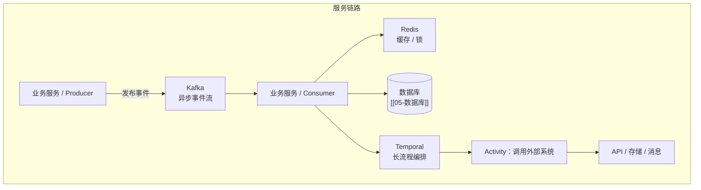
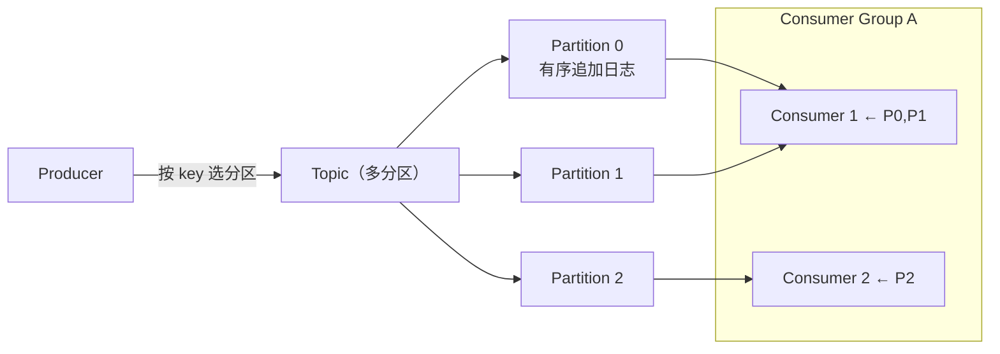
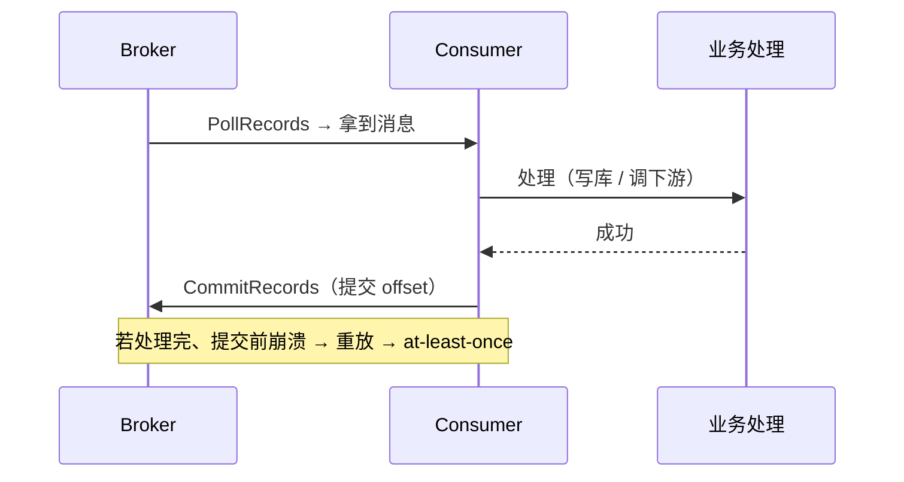
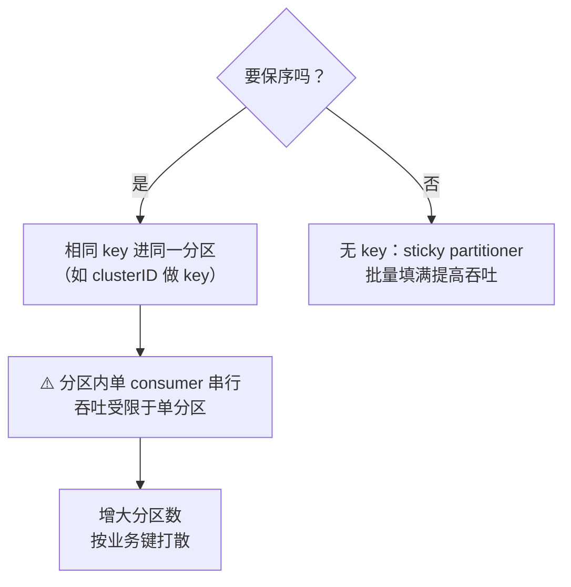
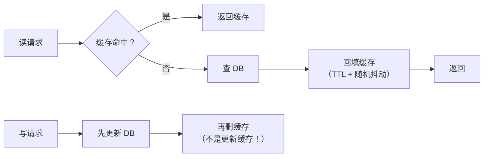
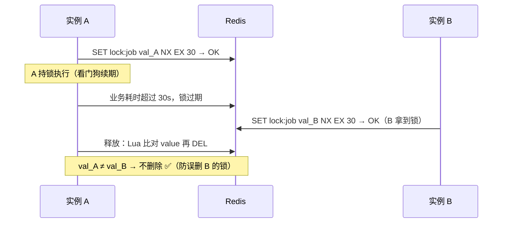
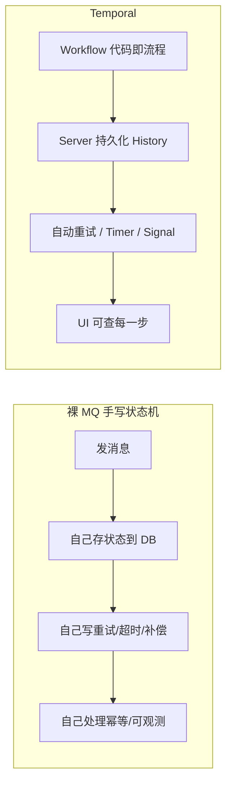
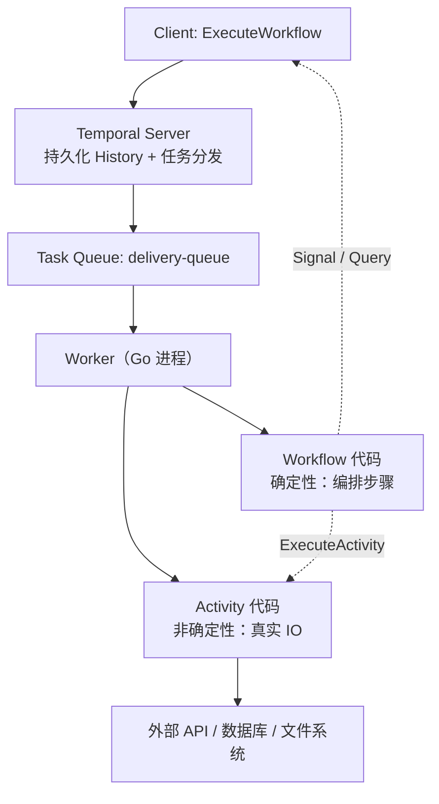
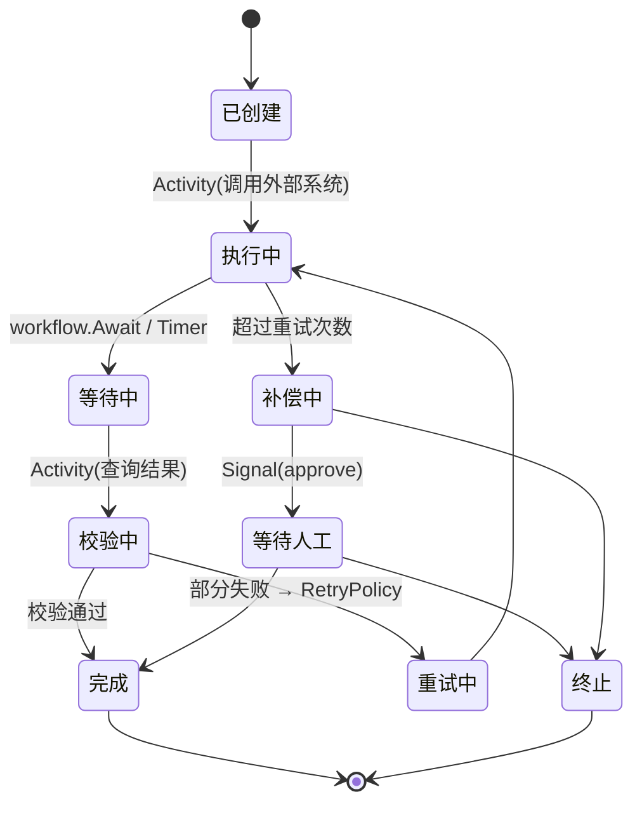
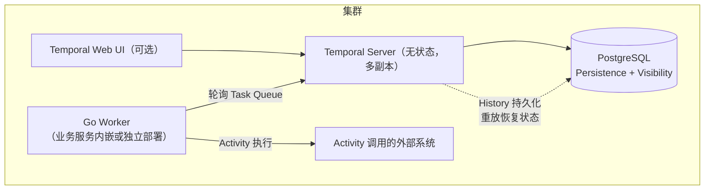

---
tags:
  - go
  - middleware
  - kafka
  - redis
  - temporal
created: 2026-11-14
updated: 2026-11-14
status: 已整理
---

# 🔌 中间件

> Go 服务集成的中间件三件套：Kafka（消息）、Redis（缓存 / 锁）、Temporal（工作流编排）。

**全文主线**：三者是三种**不同的解耦手段**——Kafka 解耦「事件生产与消费」（异步、可重放）、Redis 解耦「计算与存储」（低延迟、临时状态）、Temporal 解耦「流程编排与步骤执行」（持久状态、自动重试）。选错层会出现"用 MQ 硬写状态机"或"用 Redis 锁硬凑分布式事务"这类反模式。



## 一、Kafka：核心心智



| 概念 | 要点 |
|---|---|
| **Topic / Partition** | 分区是并行度和顺序的单位；**只保证分区内有序** |
| **Offset** | 消费位点，由 consumer group 提交到内部 topic `__consumer_offsets` |
| **Consumer Group** | 同组内每个分区只分给一个 consumer（组内分摊）；不同组各自全量消费 |
| **Retention** | 消息按时间/大小保留，**消费完不删除**（可重放，与 RabbitMQ 本质区别）|
| **Rebalance** | 组成员变化时重新分配分区，期间消费暂停 |

> 📌 **选型**：Go 客户端用 **franz-go**（`github.com/twmb/franz-go`，纯 Go、默认开启幂等、API 现代、支持 cooperative-sticky rebalance）；`IBM/sarama` 是老牌但维护缓慢、API 冗长；`confluent-kafka-go` 基于 librdkafka（CGO，性能强但破坏静态链接与交叉编译）。

## 二、Producer：可靠性配置

```go
// go get github.com/twmb/franz-go/pkg/kgo@v1.17.0
package main

import (
    "context"
    "log"
    "time"

    "github.com/twmb/franz-go/pkg/kgo"
)

func main() {
    cl, err := kgo.NewClient(
        kgo.SeedBrokers("kafka-1:9092", "kafka-2:9092"),
        kgo.RequiredAcks(kgo.AllISRAcks()),   // acks=all：等所有 ISR 副本确认
        // 幂等默认开启（franz-go）：PID + 序列号，单会话内去重
        kgo.ProducerBatchCompression(kgo.GzipCompression(), kgo.ZstdCompression()),
        kgo.RecordDeliveryTimeout(10*time.Second),
        kgo.MaxBufferedRecords(10_000),
    )
    if err != nil { log.Fatal(err) }
    defer cl.Close()

    ctx, cancel := context.WithTimeout(context.Background(), 10*time.Second)
    defer cancel()

    // 异步生产：回调里处理结果，绝不忽略 err
    cl.Produce(ctx, &kgo.Record{
        Topic: "cluster-events",
        Key:   []byte("cluster-prod-01"),  // 相同 key 保证进同一分区 → 保序
        Value: []byte(`{"type":"pod_pending"}`),
        Headers: []kgo.RecordHeader{{Key: "source", Value: []byte("agent")}},
    }, func(r *kgo.Record, err error) {
        if err != nil { log.Printf("produce failed: %v", err) }
    })
}
```

| 配置 | 语义 | 生产建议 |
|---|---|---|
| `acks=0` | 不等确认 | 日志采集类可丢数据 |
| `acks=1` | 只等 leader | 折中，leader 宕可能丢 |
| **`acks=all`** | 等所有 ISR | ✅ 配合 `min.insync.replicas=2` |
| **幂等 producer** | PID + 序列号去重 | franz-go 默认开启，**不要关**（`DisableIdempotentWrite`）|
| 事务 `transactional.id` | 跨分区原子写 + offset 一起提交 | 端到端 exactly-once 才需要 |

> ⚠️ **幂等 ≠ 事务**：幂等只保证「单 producer 单会话单分区不重复」；跨分区原子 + 消费位点一起提交需要事务（`kgo.TransactionalID`）+ consumer 侧 `isolation.level=read_committed`。

## 三、Consumer：投递语义与 offset



| 语义 | 怎么实现 | 代价 |
|---|---|---|
| **at-most-once** | 先提交 offset 再处理 | 可能丢消息 |
| **at-least-once**（默认/推荐） | 先处理再提交 | **可能重复 → 消费端必须幂等** |
| **exactly-once**（端到端） | 事务 producer + `read_committed` + 处理结果写回 Kafka | 复杂、吞吐降，多数业务不需要 |

```go
// 消费者组 + 手动提交（at-least-once）
cl, err := kgo.NewClient(
    kgo.SeedBrokers("kafka-1:9092"),
    kgo.ConsumerGroup("platform-events"),
    kgo.ConsumeTopics("cluster-events"),
    kgo.DisableAutoCommit(),                      // ⚠️ 关自动提交，业务成功后手动提
    kgo.Balancers(kgo.CooperativeStickyBalancer()), // 增量 rebalance，减少停顿
    kgo.ConsumeResetOffset(kgo.NewOffset().AtEnd()),
)
if err != nil { log.Fatal(err) }
defer cl.Close()

for {
    fetches := cl.PollRecords(ctx, 100)
    if fetches.IsClientClosed() { return }
    if errs := fetches.Errors(); len(errs) > 0 {
        log.Printf("fetch errors: %v", errs)
        continue
    }
    iter := fetches.RecordIter()
    var processed []*kgo.Record
    for !iter.Done() {
        rec := iter.Next()
        if err := handle(ctx, rec); err != nil {   // 业务处理
            log.Printf("handle failed, will retry: %v", err)
            break   // 不提交 → 下次重放
        }
        processed = append(processed, rec)
    }
    if len(processed) > 0 {
        if err := cl.CommitRecords(ctx, processed...); err != nil {
            log.Printf("commit failed: %v", err)   // 提交失败会重复消费 → 幂等兜底
        }
    }
}
```

> 📌 **幂等消费是必修课**：用业务唯一键（如 `event_id`）在 DB 建唯一索引 / `INSERT ... ON CONFLICT DO NOTHING`（连 [[05-数据库]] UPSERT），重复消息直接跳过。因为 at-least-once 下**重复是必然发生的**，不是异常。

## 四、分区、顺序与 rebalance



**rebalance 风暴**：成员频繁加入/退出 → 全组反复暂停消费。常见原因与对策：

| 原因 | 对策 |
|---|---|
| 滚动发布导致实例反复上下线 | **静态成员** `group.instance.id`（KIP-345），短暂离线不触发 rebalance |
| 处理太慢超过 `max.poll.interval.ms` 被踢 | 加大阈值 / 批量减小 / 处理与拉取解耦 |
| 全量 eager rebalance（stop-the-world） | 用 **cooperative-sticky** 增量协议（franz-go `CooperativeStickyBalancer`）|
| 网络抖动心跳超时 | 调 `session.timeout.ms` / `heartbeat.interval.ms` |

> ⚠️ **分区数不能随便减**：减少分区会破坏 key→分区映射的历史语义。加分区也要评估——加分区后同一 key 可能落到新分区，**保序承诺失效**（若强依赖顺序，扩容要新建 topic 并迁移）。

## 五、Kafka 典型场景与设计要点

| 场景 | 设计 |
|---|---|
| 领域事件（订单、状态变更） | key = 实体 ID（保序）；topic 按事件类型拆；retention 按重放需求设 |
| 任务分发 | 按实体 ID 分流或独立 topic；消费后回写状态事件 |
| 审计 / 操作日志 | 单独 topic + 长 retention，供日志系统 / 数仓消费 |
| 削峰填谷 | 突发流量先进 Kafka，消费端按能力消费，避免打爆 DB |

> 📌 **Kafka 不适合的场景**：需要延迟队列（用 Redis ZSET/Temporal Timer）、需要单条 ACK 与重试队列（Kafka 分区内一条卡住会阻塞后续 → 用死信 topic 跳过）、短生命周期轻量通知（Redis Stream/Pub-Sub）。

## 六、Redis 客户端与连接

```go
// go get github.com/redis/go-redis/v9@v9.5.1
import "github.com/redis/go-redis/v9"

rdb := redis.NewClient(&redis.Options{
    Addr:         "redis:6379",
    PoolSize:     20,                 // 按并发量，默认 10*CPU
    MinIdleConns: 5,
    DialTimeout:  3 * time.Second,
    ReadTimeout:  1 * time.Second,   // 别设太长，快速失败
    WriteTimeout: 1 * time.Second,
    MaxRetries:   2,
})
defer rdb.Close()
if err := rdb.Ping(ctx).Err(); err != nil { log.Fatal(err) }
```

| 能力 | API | 说明 |
|---|---|---|
| Pipeline | `rdb.Pipelined(ctx, fn)` | 打包发减少 RTT，**不保证原子性** |
| 事务 | `rdb.TxPipelined(ctx, fn)` | MULTI/EXEC，原子执行（非回滚式事务）|
| Lua | `rdb.Eval(ctx, script, keys, args...)` | 复杂原子逻辑（如锁释放）|
| nil 判断 | `errors.Is(err, redis.Nil)` | 缓存未命中的正常信号，不是错误 |

> ⚠️ **go-redis v9 所有方法第一个参数是 context**（v8 起改的），超时统一靠 context 传递（连 [[02-并发编程]]）。

## 七、缓存模式与三大问题



> 📌 **Cache-Aside 写策略为什么是「删」不是「更新」**：两个并发写若都更新缓存，可能把旧值后写覆盖新值；且复杂计算结果缓存未必马上用得到（懒加载更划算）。高并发下遗留脏数据用**延迟双删**（删缓存 → 更新 DB → sleep 几百 ms → 再删一次）。

| 问题 | 现象 | 对策 |
|---|---|---|
| **穿透** | 查不存在的 key，每次都打 DB | 缓存空值（短 TTL）+ 布隆过滤器 |
| **击穿** | 热点 key 过期瞬间大量请求打 DB | **singleflight**（连 [[02-并发编程]]）/ 互斥重建 / 逻辑过期 |
| **雪崩** | 大量 key 同时过期或 Redis 宕机 | TTL 加随机抖动 + 多级缓存 + 限流降级 |

```go
// 缓存空值 + TTL 抖动（防穿透 + 防雪崩）
func GetCluster(ctx context.Context, rdb *redis.Client, id string) (*Cluster, error) {
    key := "cluster:" + id
    val, err := rdb.Get(ctx, key).Result()
    if err == nil {
        if val == "" { return nil, ErrNotFound }   // 空值标记
        return decode(val), nil
    }
    if !errors.Is(err, redis.Nil) { return nil, err }

    // singleflight 防击穿：相同 id 的并发请求只查一次 DB
    v, err, _ := sf.Do(id, func() (any, error) {
        c, err := loadFromDB(ctx, id)
        if err != nil { return nil, err }
        ttl := 30*time.Minute + time.Duration(crc32.ChecksumIEEE([]byte(id))%600)*time.Second // 按 key 确定性抖动
        if c == nil {
            _ = rdb.Set(ctx, key, "", 2*time.Minute).Err()   // 空值短 TTL
            return nil, ErrNotFound
        }
        _ = rdb.Set(ctx, key, encode(c), ttl).Err()
        return c, nil
    })
    if err != nil { return nil, err }
    return v.(*Cluster), nil
}
```

> 📌 **TTL 抖动用 key 的确定性哈希**（`crc32(key) % N`），比 `rand` 更好：同一个 key 的 TTL 稳定，不会每次回填都变，也不需要全局随机源。示例需 `import "hash/crc32"`。

## 八、分布式锁



```go
// 加锁：value 必须是唯一随机值（释放时比对，防误删别人的锁）
ok, err := rdb.SetNX(ctx, "lock:delivery:"+clusterID, token, 30*time.Second).Result()

// 释放：必须 Lua 原子比对（GET + DEL 分两步会有竞态）
var release = redis.NewScript(`
if redis.call("get", KEYS[1]) == ARGV[1] then
    return redis.call("del", KEYS[1])
end
return 0`)
_ = release.Run(ctx, rdb, []string{"lock:delivery:" + clusterID}, token).Err()
```

| 要点 | 说明 |
|---|---|
| 唯一 value | 释放前比对，防止 A 超时后误删 B 的锁 |
| 原子释放 | Lua 脚本，不能 GET 后 DEL 两步 |
| **看门狗续期** | 业务没跑完时定时 EXPIRE 续期（防锁过期并发）|
| 过期时间 | 必须设，防持锁进程崩溃后死锁 |
| **Redlock 争议** | 多实例多数派方案有 GC 暂停/时钟漂移下的正确性争议（Kleppmann vs antirez）→ 强一致场景用 **etcd 租约 / DB 锁 / fencing token** |

> ⚠️ **不要滥用分布式锁**：多数"防重复"需求用**唯一索引 / 幂等键 / 乐观锁**（连 [[05-数据库]]）更可靠。分布式锁适合"协调外部系统、无数据库事务可用"的场景，且必须接受它是**尽力而为**的正确性。

## 九、Redis 数据结构实战

| 结构 | 平台用法 | 关键 API |
|---|---|---|
| **Stream** | 轻量事件流（有 consumer group + ACK + pending） | `XAdd` / `XReadGroup` / `XAck` |
| **Pub/Sub** | 即时通知（掉线即丢，无重放） | `Publish` / `Subscribe` |
| **ZSET** | 延迟队列（score=执行时间戳）、排行榜 | `ZAdd` / `ZRangeByScore` |
| **HyperLogLog** | 去重计数（UV，约 0.81% 误差） | `PFAdd` / `PFCount` |
| **Bitmap** | 签到/布尔标记 | `SetBit` / `BitCount` |

> 📌 **Redis Stream vs Kafka**：Stream 有消费组和 ACK，**但没有分区并行、无长期海量堆积能力、持久化依赖 RDB/AOF 配置**。集群内轻量事件/通知用 Stream；跨集群、需要重放和水平扩展的事件流用 Kafka。
>
> ⚠️ **Big Key 与热 Key**：一个 key 存百万元素（大 List/Hash）会阻塞单线程 Redis、删除耗时；热 Key 打爆单分片。拆分 + 本地缓存 + 监控 `redis-cli --bigkeys`。

## 十、Temporal：为什么不用裸 MQ 编排



> 📌 **Temporal 的价值**：把「长时间运行、可能失败、需要重试/超时/人工介入」的流程，写成**一段看似同步的 Go 代码**，状态由 Server 的事件历史（History）持久化——进程重启后从 History **重放**恢复，不丢状态。裸 MQ 要自己实现状态机、重试表、死信、补偿、可观测，成本远超想象。

## 十一、Temporal 核心概念



| 概念 | 职责 |
|---|---|
| **Workflow** | 编排逻辑，**确定性**（禁用 time.Now/rand/直接 IO/goroutine）|
| **Activity** | 干实事（调 API、读写 DB），失败自动重试，**必须幂等** |
| **Worker** | 轮询 Task Queue，执行 Workflow/Activity 代码 |
| **Task Queue** | 任务路由 + 负载均衡（按队列隔离不同业务/资源）|
| **History** | 事件日志，Workflow 状态靠重放恢复 |

## 十二、Workflow 确定性与版本化

```go
// go get go.temporal.io/sdk@latest
func DeliverComponentsWorkflow(ctx workflow.Context, clusterID string) error {
    ao := workflow.ActivityOptions{
        StartToCloseTimeout: 10 * time.Minute,
        RetryPolicy: &temporal.RetryPolicy{
            InitialInterval:    time.Second,
            BackoffCoefficient: 2.0,
            MaximumInterval:    time.Minute,
            MaximumAttempts:    3,
        },
    }
    ctx = workflow.WithActivityOptions(ctx, ao)

    // ① 装组件（Activity，可重试）
    var installID string
    if err := workflow.ExecuteActivity(ctx, InstallComponentActivity, clusterID).Get(ctx, &installID); err != nil {
        _ = workflow.ExecuteActivity(ctx, RollbackActivity, clusterID).Get(ctx, nil) // 补偿
        return err
    }

    // ② 等待验证结果（Signal，可等数小时，不占线程）
    ch := workflow.GetSignalChannel(ctx, "verify-result")
    var ok bool
    ch.Receive(ctx, &ok)
    if !ok { return errors.New("verification failed") }

    // ③ 定时等待（用 workflow.Sleep，不是 time.Sleep）
    _ = workflow.Sleep(ctx, 30*time.Second)
    return nil
}
```

> ⚠️ **确定性是 Temporal 的第一铁律**（因为状态靠 History 重放）：
> - ❌ `time.Now()` / `rand` / 读环境变量 / 直接 HTTP / 开 goroutine / 读全局变量
> - ✅ `workflow.Now(ctx)` / `workflow.SideEffect` / `workflow.Sleep` / `workflow.Go`（Temporal 自己的协程）/ 所有 IO 放 Activity
> - 违反确定性 → 重放结果与首次执行不一致 → Workflow 卡死（`NondeterminismError`）

**版本化**（已运行的 Workflow 改代码不能直接改）：

```go
if workflow.Patched(ctx, "add-verification-step") {
    // 新版本逻辑（老 History 重放走 else 分支）
} else {
    // 老版本逻辑
}
// 所有人都迁移完后：workflow.DeprecatePatch(ctx, "add-verification-step")
```

> 📌 长时间运行 / 事件历史过长（上限约 5 万事件）用 `workflow.NewContinueAsNewError` 开新 Workflow 继续，避免 History 膨胀。

## 十三、Activity 重试与幂等

```go
func InstallComponentActivity(ctx context.Context, clusterID string) (string, error) {
    logger := activity.GetLogger(ctx)
    // 长任务定期心跳：让 Server 知道还活着 + 支持取消
    for step := 1; step <= 10; step++ {
        activity.RecordHeartbeat(ctx, step)
        if err := applyHelmRelease(ctx, clusterID, step); err != nil {
            return "", err   // 非重试错误用 temporal.NewNonRetryableApplicationError
        }
    }
    return clusterID + "-done", nil
}
```

| 超时类型 | 含义 |
|---|---|
| `ScheduleToStart` | 排队等 Worker 的时间 |
| `StartToClose` | **单次尝试**执行上限（最常用）|
| `ScheduleToClose` | 含所有重试的总上限 |
| `HeartbeatTimeout` | 心跳中断多久判定失败（长任务必配）|

> 📌 **Activity 是 at-least-once**：超时 / Worker 崩溃会重跑，业务侧必须幂等——用「业务 ID + step」作幂等键（连 [[05-数据库]] 唯一索引）。Heartbeat 里带进度，重启后可从 `activity.GetInfo(ctx).HeartbeatDetails` 续做。
> ⚠️ 永久错误必须用 `temporal.NewNonRetryableApplicationError` 显式标记，否则会白重试到 ScheduleToClose 超时；「什么算永久错误」的判定标准见 [[01-语言基础]] 跨层错误模型。

## 十四、长流程建模：把业务步骤映射到 Temporal 原语



| 设计点 | Temporal 机制 |
|---|---|
| 外部调用失败自动重试 | `RetryPolicy` + Activity 幂等 |
| 等待长耗时结果（分钟~天） | `workflow.Await` / Timer，不占 Worker 线程 |
| 人工审批 / 外部事件介入 | **Signal** 阻塞等待，可等数天 |
| 查询流程进度 | **Query**（只读，不改状态）|
| 中途失败回滚 | 补偿 Activity（Saga 模式）|
| 批量同类流程 | 每个业务实体一个 Workflow + 上层编排 |

> 📌 **Workflow ID 用业务唯一键**（如 `order-12345`）→ 天然幂等，重复启动不会双跑（返回 `WorkflowExecutionAlreadyStarted`）。

## 十五、Temporal 部署形态与引入成本



> ⚠️ **最小形态**：Server + PG + Worker 三件套即可跑（省略 ES / UI）；功能完整后再按需加组件。

| 组件 | 说明 |
|---|---|
| Temporal Server | 无状态服务，可多副本 |
| **Persistence store** | Cassandra / MySQL / PostgreSQL（存 History、状态）——**必需** |
| **Visibility store** | 高级列表查询（ES 可选；新版本 SQL 也支持基础 visibility）|
| Web UI | 可选，运维查流程很有用 |
| 数据库依赖 | 常用 **PostgreSQL**（Persistence + Visibility 可共库，降低运维面）|

> ⚠️ **引入成本**：Temporal 至少多引入一个 Server + 一个 DB（+ 可选 ES）。轻量场景用「DB 状态机 + 定时任务 + MQ」更省；**流程长、步骤多、需要重试 / 人工介入 / 可追溯**才值得上工作流引擎。

## 十六、高频问答

**Q1：Go 里 Kafka 客户端怎么选？**
franz-go（纯 Go、默认幂等、cooperative rebalance、API 现代）首选；sarama 老牌但维护慢；confluent-kafka-go 基于 CGO，性能强但破坏静态链接与交叉编译。

**Q2：Kafka 怎么保证消息不丢？**
producer：`acks=all` + `min.insync.replicas≥2` + 幂等开启 + 处理 produce 回调的 err；broker：副本数≥3；consumer：**关自动提交，业务成功后手动 CommitRecords**。

**Q3：at-least-once 下重复消费怎么解？**
消费端幂等：业务唯一键（`event_id`）在 DB 建唯一索引，或用 `INSERT ... ON CONFLICT DO NOTHING`。重复是必然事件，不是异常。

**Q4：Kafka 怎么保证顺序？**
只保证**分区内有序**。把需要保序的实体 ID 作为 message key（同 key 同分区），且该分区只能被组内一个 consumer 串行消费。注意增加分区数会改变 key→分区映射，可能破坏既有保序。

**Q5：rebalance 风暴怎么治？**
静态成员 `group.instance.id`（滚动发布不触发）、`max.poll.interval.ms` 调大或减小批量、cooperative-sticky 增量 rebalance、心跳参数调优。

**Q6：Cache-Aside 为什么写操作是删缓存而不是更新缓存？**
并发写时两个更新可能乱序覆盖（旧值后写）；且缓存值可能是复杂计算/聚合结果，写了未必用。删除让它下次懒加载重建，配合延迟双删收敛并发脏读。

**Q7：缓存穿透/击穿/雪崩分别怎么解？**
穿透（查不存在）→ 空值缓存 + 布隆过滤器；击穿（热点过期）→ singleflight / 互斥重建 / 逻辑过期；雪崩（批量过期）→ TTL 随机抖动 + 多级缓存 + 限流降级。

**Q8：Redis 分布式锁的正确姿势和边界？**
`SET key <唯一token> NX EX ttl` + **Lua 比对 token 再 DEL** + 看门狗续期。边界：GC 暂停/时钟漂移下可能失效，强一致场景改用 etcd 租约/DB 锁/fencing token；多数"防重复"需求用唯一索引更可靠。

**Q9：Redis Stream 能替代 Kafka 吗？**
不能。Stream 有消费组和 ACK，但没有分区并行、不适合海量长期堆积、持久化依赖 RDB/AOF 配置。轻量事件用 Stream，需要重放与水平扩展的事件流用 Kafka。

**Q10：Temporal 相比裸 MQ 编排的优势？**
流程写成看似同步的代码，Server 用 History 持久化状态，进程重启自动重放恢复；内置重试/超时/Timer/Signal/Query/UI 可观测。裸 MQ 要自己实现状态机、重试表、死信、补偿，成本极高。

**Q11：Temporal Workflow 为什么必须确定性？**
Workflow 状态靠重放 History 恢复，任何非确定性输入（time.Now、rand、直接 IO、goroutine）都会让重放结果与首次执行不一致，导致 Workflow 卡死。所有非确定性操作放 Activity，时间用 `workflow.Now`，协程用 `workflow.Go`。

**Q12：Activity 为什么要幂等？**
Activity 是 at-least-once（超时/Worker 崩溃会重跑）。用「业务 ID + step」之类幂等键 + DB 唯一索引；长任务用 `RecordHeartbeat` 带进度，重启后从 `HeartbeatDetails` 续做。

**Q13：一个长流程用 Temporal 怎么建模？**
每个业务实体一个 Workflow（ID 用业务唯一键保证幂等），Activity 封装外部调用，长等待用 `workflow.Await` / Timer，人工介入用 Signal，查进度用 Query，失败走补偿 Activity（Saga），批量流程由上层 Workflow 编排。

## 十七、关联

- 上游 → [[Go 开发]]、[[02-并发编程]]（singleflight / context 传递）
- 错误分类 → [[01-语言基础]]（跨层错误模型，决定 Activity / Kafka 重试策略）
- 存储 → [[05-数据库]]（幂等唯一索引、UPSERT、乐观锁）
- 工程化 → [[07-工程实践]]（部署形态、可观测埋点、离线 CI 构建）
- 上层 → [[03-Web 与 RPC]]（重试与幂等键）、[[08-Go 运行时与底层]]（channel 与 GC 对消费延迟的影响）
- 观测 → [[02-可观测性]]（指标与追踪通用机制）
