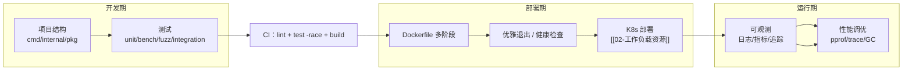
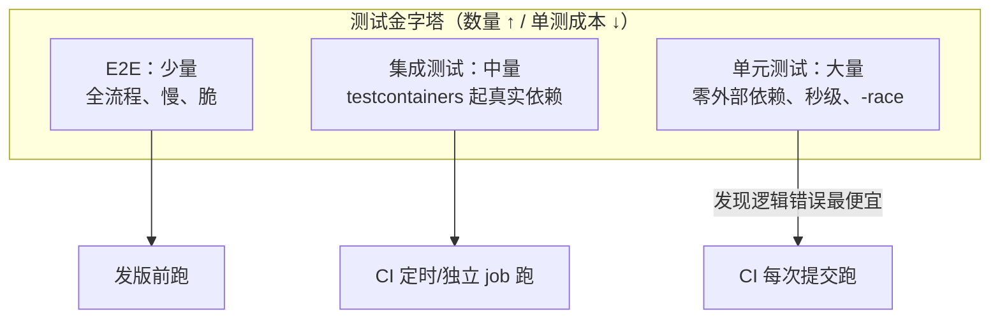
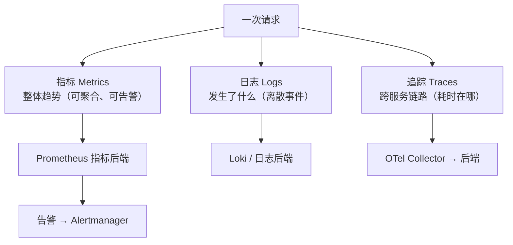
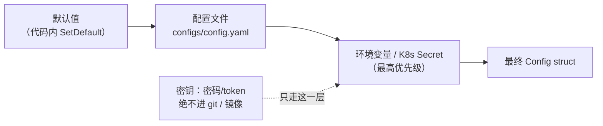
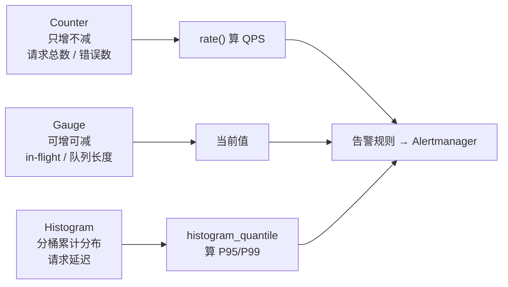
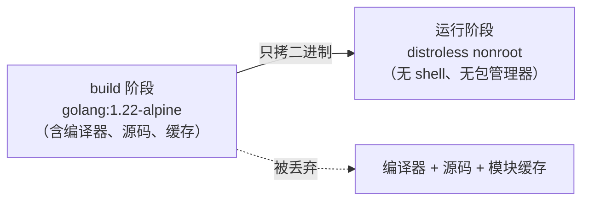
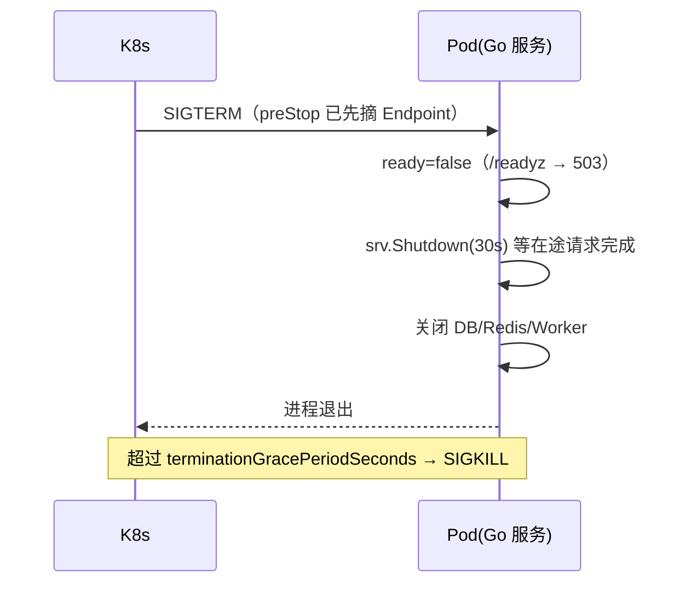
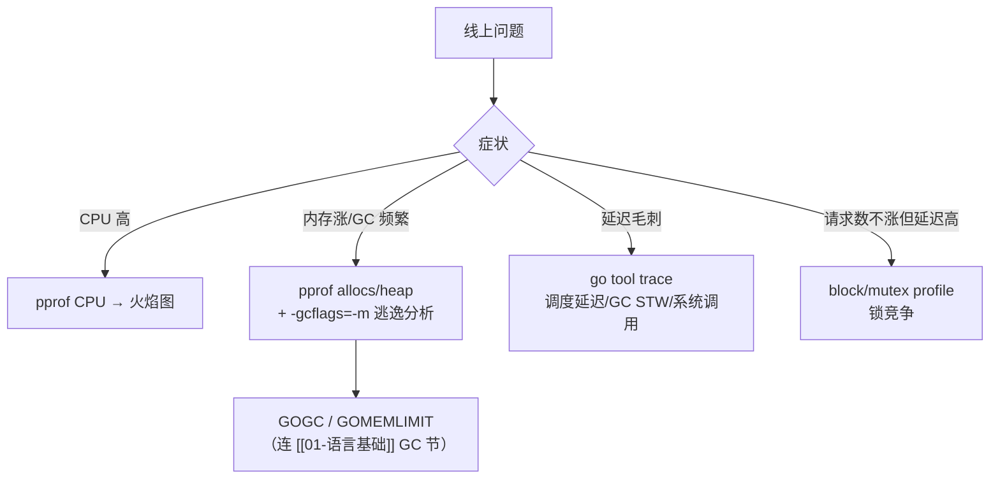

---
tags:
  - go
  - engineering
created: 2026-11-01
updated: 2026-11-15
status: 已整理
---

# 🛠️ 工程实践

> 把代码变成**可运维服务**的全部工程化能力：结构、测试、可观测、部署、调优、质量。

**全文主线**：Go 代码写得对 ≠ 服务跑得稳。工程实践回答的是「上线后怎么知道它活着、慢在哪、挂了怎么优雅退、改坏了怎么被测出来」。



## 一、项目结构

```
notes-platform/
├── cmd/server/main.go        # 入口：只做装配（构造依赖、启动、信号处理）
├── internal/                 # 私有包：外部无法 import（连 [[01-语言基础]]）
│   ├── api/                  # HTTP/RPC handler（薄层，只做协议转换）
│   ├── service/              # 业务逻辑（不依赖 HTTP/DB 细节）
│   ├── repository/           # 数据访问（实现 service 定义的接口）
│   └── config/               # 配置结构 + 加载
├── pkg/                      # 可被外部复用的公共库（谨慎放，发布即承诺）
├── api/proto/                # proto 契约（连 [[04-Proto 与 Buf]]）
├── configs/config.yaml       # 默认配置（不含密钥）
├── migrations/               # DB 迁移（连 [[05-数据库]]）
├── Dockerfile
└── Makefile
```

> 📌 **三条结构原则**：
> 1. **依赖方向单向**：`cmd → api → service → repository`，业务层定义接口、实现层依赖它（依赖倒置），不要反过来 import
> 2. **internal 优先**：不确定要不要公开就放 internal（Go 编译器强制限制导入范围）
> 3. **main 只做装配**：依赖在 main 里手工构造并注入（或 `google/wire` 生成），业务逻辑里**不要出现全局变量单例**

```go
// 依赖注入：构造函数显式声明依赖，测试时可替换
type Service struct {
    repo  Repository      // 接口，不是具体 *sql.DB
    cache Cache
    log   *slog.Logger
}
func New(repo Repository, cache Cache, log *slog.Logger) *Service {
    return &Service{repo: repo, cache: cache, log: log}
}
```

## 二、单元测试



### table-driven test（Go 官方惯用法）

```go
func TestParsePort(t *testing.T) {
    tests := []struct {
        name    string
        in      string
        want    int
        wantErr bool
    }{
        {name: "valid", in: "8080", want: 8080},
        {name: "empty", in: "", wantErr: true},
        {name: "out of range", in: "99999", wantErr: true},
        {name: "not number", in: "abc", wantErr: true},
    }
    for _, tt := range tests {
        t.Run(tt.name, func(t *testing.T) {
            got, err := ParsePort(tt.in)
            if (err != nil) != tt.wantErr {
                t.Fatalf("ParsePort(%q) err=%v, wantErr=%v", tt.in, err, tt.wantErr)
            }
            if got != tt.want { t.Errorf("got %d, want %d", got, tt.want) }
        })
    }
}
```

| 工具 | 用途 |
|---|---|
| `t.Run` | 子测试，case 失败能定位到具体输入 |
| `t.Parallel()` | 子测试并行（⚠️ 循环变量捕获：Go 1.22 前要 `tt := tt`）|
| `t.Cleanup` | 注册清理（比 defer 更适合子测试）|
| `t.Helper()` | 辅助函数里标记，报错行号指向调用方 |
| `TestMain(m *testing.M)` | 全局 setup/teardown（起测试容器、装 goleak）|

```bash
go test ./...                        # 全量
go test -race ./...                  # 竞态检测（连 [[02-并发编程]]）
go test -cover ./... -coverprofile=c.out
go tool cover -html=c.out            # 覆盖率可视化
```

### Mock 策略

```go
// 业务层定义小接口，测试时手写 fake（多数场景够用，无需框架）
type Repository interface { Get(ctx context.Context, id string) (*User, error) }

type fakeRepo struct{ users map[string]*User }
func (f *fakeRepo) Get(_ context.Context, id string) (*User, error) {
    u, ok := f.users[id]
    if !ok { return nil, ErrNotFound }
    return u, nil
}
```

> 📌 **优先手写 fake**；接口多、需要严格校验调用次数/参数时用 `go.uber.org/mock`（`mockgen` 生成，注意原 `golang/mock` 已归档）。**别为了 mock 而预先抽象一堆接口**——接口应由消费方按实际需要定义（连 [[01-语言基础]] 的接口设计原则）。

### 集成测试（testcontainers）

```go
// go get github.com/testcontainers/testcontainers-go/modules/postgres
func TestUserRepository(t *testing.T) {
    ctx := context.Background()
    ctr, err := postgres.Run(ctx, "postgres:16-alpine",
        postgres.WithDatabase("test"), postgres.WithUsername("t"), postgres.WithPassword("t"))
    require.NoError(t, err)
    t.Cleanup(func() { _ = ctr.Terminate(ctx) })

    dsn, _ := ctr.ConnectionString(ctx, "sslmode=disable")
    db, err := sql.Open("pgx", dsn)
    require.NoError(t, err)
    defer db.Close()
    // ... 跑迁移 + 真实 CRUD 断言
}
```

> 📌 集成测试慢且依赖 Docker，用 `//go:build integration` 构建标签隔离，CI 单独跑；单元测试必须**零外部依赖、秒级完成**。

### 测试进阶：subtest / httptest / golden / 覆盖率

```go
package handler

import (
    "encoding/json"
    "net/http"
    "net/http/httptest"
    "testing"
)

func TestGetUser(t *testing.T) {
    cases := []struct {
        name   string
        id     string
        status int
    }{
        {"ok", "42", http.StatusOK},
        {"missing", "", http.StatusBadRequest},
        {"not_found", "999", http.StatusNotFound},
    }
    for _, tc := range cases {
        t.Run(tc.name, func(t *testing.T) {
            // 1.21 起循环变量每轮独立；更早版本需 tc := tc（见 [[08-Go 运行时与底层]] §十一）
            req := httptest.NewRequest(http.MethodGet, "/users/"+tc.id, nil)
            rec := httptest.NewRecorder()
            GetUser(rec, req) // 直接调 Handler，不起真实端口、不依赖网络
            if rec.Code != tc.status {
                t.Fatalf("status = %d, want %d", rec.Code, tc.status)
            }
            var body map[string]any
            if err := json.Unmarshal(rec.Body.Bytes(), &body); err != nil {
                t.Fatalf("body is not JSON: %v", err)
            }
        })
    }
}
```

| 手段 | 用途 | 注意 |
|---|---|---|
| **`t.Run` subtest** | 表驱动用例逐级命名，失败精确定位到某一行数据 | 子测试里 `t.Parallel()` 会让用例并发，注意闭包捕获与共享状态；`t.Parallel()` 后主测试函数会先返回，别在外部读子测试才写的变量 |
| **`httptest.NewRecorder`** | 直接调 `http.Handler` 拿响应，**不监听端口**，毫秒级 | 适合测路由/中间件/序列化；要测真实连接复用、TLS、HTTP/2 用 `httptest.NewServer` |
| **`httptest.NewServer`** | 起真实本地 HTTP 服务，测客户端超时/重试/连接池 | `defer srv.Close()`；`srv.Client()` 拿到预配置客户端 |
| **golden file** | 复杂输出（大 JSON、生成的 proto、SQL）与 `testdata/*.golden` 比对 | 加 `-update` flag 显式更新基线，避免"测试一改就跟着改"；基线文件要进 code review |
| **覆盖率** | `go test -cover ./...`、`-coverprofile` + `go tool cover -html` | 覆盖率是**发现盲区**的工具，不是质量指标；追求 100% 会写出大量只调不断言的假测试 |
| **`testing/synctest`（1.25+）** | 虚拟时钟测并发/定时逻辑，秒级验证"等 1 小时"的分支 | 只适用于被测代码全在单个 goroutine 组且时间来自标准库；有真实 IO 时无效 |
| **`-race` + `goleak`** | 竞态与 goroutine 泄漏 | CI 必开 `-race`；`go.uber.org/goleak` 在 `TestMain` 里检查残留 goroutine |

> ⚠️ **测试的三个反模式**：① `time.Sleep` 等等异步结果（改用 channel + `select` 超时，或用 `synctest`）；② 测试间共享全局状态/端口导致 `t.Parallel()` 下互相干扰；③ 用 `reflect.DeepEqual` 比整个大对象，失败时看不出差异（用 `go-cmp` 输出 diff）。

## 三、Benchmark 与 Fuzz

```go
var sink string   // 防止编译器把结果优化掉

func BenchmarkFormat(b *testing.B) {
    b.ReportAllocs()          // 报告每次分配的次数/字节
    for i := 0; i < b.N; i++ {
        sink = Format("hello", 42)
    }
}
```

```bash
go test -bench=. -benchmem -count=5 ./... | tee new.txt
benchstat old.txt new.txt     # 统计显著对比，别凭单次数字下结论
```

> ⚠️ 三个坑：① 结果没被消费 → 编译器 DCE 掉，测了个寂寞；② setup 耗时算进基准 → 用 `b.ResetTimer()`；③ 单次测量下结论 → 用 `-count` + `benchstat`。

### Fuzz（Go 1.18+）

```go
func FuzzParsePort(f *testing.F) {
    f.Add("8080")            // 种子语料
    f.Add("")
    f.Add("-1")
    f.Fuzz(func(t *testing.T, s string) {
        _, _ = ParsePort(s)  // 目标：任何输入都不 panic、不越界
    })
}
```

```bash
go test -fuzz=FuzzParsePort -fuzztime=30s
# 崩溃样本自动落到 testdata/fuzz/FuzzParsePort/，成为回归用例
```

> 📌 Fuzz 最擅长找**边界 bug**（解析、编解码、索引计算）。参数类型有限制（string/[]byte/int 等基础类型），复杂结构要自己从 bytes 构造。

## 四、可观测性三支柱



| 支柱 | 回答的问题 | 成本 | Go 工具 |
|---|---|---|---|
| 日志 | 这一条请求发生了什么 | 高（量大）| `log/slog` / zap |
| 指标 | 整体 QPS / 延迟 / 错误率 | 低（定长）| prometheus/client_golang |
| 追踪 | 一次调用跨几个服务、慢在哪 | 中（采样）| OpenTelemetry |

### 日志：slog（标准库）与 zap

```go
// Go 1.21+ 标准库 slog：零第三方依赖
logger := slog.New(slog.NewJSONHandler(os.Stdout, &slog.HandlerOptions{
    Level: slog.LevelInfo,
    AddSource: true,
}))
slog.SetDefault(logger)
slog.InfoContext(ctx, "request handled",
    "method", r.Method, "path", r.URL.Path, "duration_ms", elapsed.Milliseconds(),
    "trace_id", traceID,   // 与 trace 关联的关键字段
)
```

```go
// 极致性能场景用 zap（结构化、近乎零分配）
// go get go.uber.org/zap
logger, _ := zap.NewProduction()
defer func() { _ = logger.Sync() }()
logger.Info("request handled",
    zap.String("path", r.URL.Path), zap.Duration("latency", d))
```

> 📌 **日志规范**：① 结构化（key-value，不要 `fmt.Sprintf` 拼串）；② 必带 `request_id` / `trace_id`（连 [[03-Web 与 RPC]] 中间件注入）；③ 级别语义化（Error=需要人介入，不是"出错了"就 Error）；④ **绝不打印密码/token/完整请求体**；⑤ 高频路径开采样，否则日志比业务还贵。

### 配置管理（12-Factor）




```go
// go get github.com/spf13/viper
viper.SetDefault("server.port", 8080)
viper.SetConfigName("config"); viper.AddConfigPath("configs")
_ = viper.ReadInConfig()                     // 文件可选，读不到不报错
viper.SetEnvKeyReplacer(strings.NewReplacer(".", "_"))
viper.AutomaticEnv()                          // SERVER_PORT 覆盖 server.port
var cfg Config
if err := viper.Unmarshal(&cfg); err != nil { log.Fatal(err) }
```

> ⚠️ **优先级**：环境变量 > 配置文件 > 默认值。**密钥只从环境变量 / K8s Secret 注入**（连 [[06-配置与安全]]），绝不进镜像或 git。全局 `viper` 有状态，多实例测试要 `viper.Reset()`；更轻量的替代是 `envconfig` + struct tag。

### 指标：Prometheus




```go
// go get github.com/prometheus/client_golang/prometheus
var (
    reqTotal = prometheus.NewCounterVec(prometheus.CounterOpts{
        Name: "platform_http_requests_total", Help: "Total HTTP requests",
    }, []string{"method", "path", "code"})
    reqDuration = prometheus.NewHistogramVec(prometheus.HistogramOpts{
        Name:    "platform_http_request_duration_seconds",
        Help:    "Request latency",
        Buckets: prometheus.DefBuckets,   // 5ms~10s，按业务调整
    }, []string{"path"})
)
func init() { prometheus.MustRegister(reqTotal, reqDuration) }

// 中间件里记录
start := time.Now()
next.ServeHTTP(ww, r)
reqTotal.WithLabelValues(r.Method, route, strconv.Itoa(ww.Status())).Inc()
reqDuration.WithLabelValues(route).Observe(time.Since(start).Seconds())

// 暴露端点
mux.Handle("GET /metrics", promhttp.Handler())
```

> ⚠️ **label 基数爆炸**：绝对不要把 `user_id`、`cluster_id`（高基数）当 label——每个组合一条时序，能打爆 Prometheus。高基数信息放日志/追踪。
>
> 📌 三类指标：Counter（只增，如请求数）、Gauge（可增可减，如 in-flight）、Histogram（分布，算 P99）。**P99 必须用 Histogram**，不能用 Gauge 存平均值。

### 链路追踪：OpenTelemetry

```go
// go get go.opentelemetry.io/otel go.opentelemetry.io/contrib/instrumentation/net/http/otelhttp
otel.SetTextMapPropagator(propagation.TraceContext{})  // W3C traceparent 透传
tr := otel.Tracer("platform/api")
ctx, span := tr.Start(r.Context(), "GetUser")
defer span.End()
span.SetAttributes(attribute.String("cluster.id", clusterID))
// 下游调用：用 otelhttp 包装 client，自动注入 header
handler := otelhttp.NewHandler(router, "platform-api")
```

```mermaid
sequenceDiagram
    participant C as Client
    participant A as 平台 API
    participant B as Agent 服务
    participant DB as DB
    C->>A: HTTP（traceparent: 00-abc...）
    Note over A: span A（root）
    A->>B: RPC（透传 traceparent）
    Note over B: span B（parent=A）
    B->>DB: query（span C）
    DB-->>B: result
    B-->>A: response
    A-->>C: 200
    Note over A,B,DB: 所有 span 由 OTel Collector 汇总成一个 trace
```

> 📌 **追踪的价值在跨服务**：单机 pprof 看不出"慢在下游服务"，trace 一眼定位。OTel Collector 通常以 DaemonSet / Sidecar 就近做**采样 + 缓冲**，再上报后端，避免每个 Pod 直连远端（连 [[02-可观测性]]）。

## 五、Dockerfile 多阶段构建

```dockerfile
# syntax=docker/dockerfile:1.7
FROM golang:1.22-alpine AS build
WORKDIR /src
COPY go.mod go.sum ./
RUN --mount=type=cache,target=/go/pkg/mod go mod download
COPY . .
RUN --mount=type=cache,target=/root/.cache/go-build \
    CGO_ENABLED=0 GOOS=linux go build -trimpath -ldflags="-s -w" -o /out/app ./cmd/server

FROM gcr.io/distroless/static-debian12:nonroot
COPY --from=build /out/app /app
USER nonroot:nonroot
EXPOSE 8080
ENTRYPOINT ["/app"]
```



| 要点 | 原因 |
|---|---|
| `CGO_ENABLED=0` | 静态二进制，不依赖 glibc（alpine→scratch 也能跑）|
| `-ldflags="-s -w"` | 去符号表和调试信息，体积降 30%+ |
| `-trimpath` | 去掉本机路径，构建可复现 |
| distroless / scratch | 无 shell → 攻击面小；scratch 需自己拷 CA 证书 + tzdata |
| `USER nonroot` | 最小权限（连 [[06-配置与安全]] PSS）|
| `.dockerignore` | 排除 `.git` / 本地产物，缩小构建上下文 |
| BuildKit cache mount | 依赖/编译缓存跨构建复用 |

> ⚠️ 用 scratch 时，HTTPS 调用会因缺 CA 证书报 `x509: certificate signed by unknown authority`；要么 distroless（自带 CA），要么显式 `COPY --from=build /etc/ssl/certs/ca-certificates.crt`。

### CGO 与交叉编译

`CGO_ENABLED=0` 不是随手加的 flag，它决定二进制能否静态链接、能否用一条 `GOOS/GOARCH` 命令交叉编译到任意目标架构。

| 维度 | `CGO_ENABLED=0`（推荐） | `CGO_ENABLED=1` |
|---|---|---|
| 链接 | 纯静态，可跑 scratch / distroless | 动态链接 glibc/musl，镜像要带对应 so |
| 交叉编译 | `GOOS=linux GOARCH=arm64 go build` 直接出包 | 需目标平台 C 交叉工具链（`aarch64-linux-gnu-gcc`），CI 复杂 |
| DNS 解析 | 纯 Go resolver，行为确定 | 可能走 cgo resolver（受 `/etc/nsswitch.conf` 影响，容器里易变）|
| 依赖选择 | 只能选纯 Go 库 | 可用 C 库（性能强但牺牲可移植性）|

> 📌 **选型原则**：需要静态链接或多架构产物时优先纯 Go 依赖——Kafka 用 franz-go 而非 `confluent-kafka-go`（连 [[06-中间件]]）、SQLite 用 `modernc.org/sqlite` 而非 `mattn/go-sqlite3`。一个依赖引入 cgo，整条构建流水线都得为它配交叉编译器。

```bash
GOOS=linux GOARCH=amd64 CGO_ENABLED=0 go build -o dist/app-amd64 ./cmd/server
GOOS=linux GOARCH=arm64 CGO_ENABLED=0 go build -o dist/app-arm64 ./cmd/server
go tool dist list | grep linux     # 查看支持的 GOOS/GOARCH 组合
file dist/app-amd64               # 确认 statically linked
ldd  dist/app-amd64               # 静态包应输出 not a dynamic executable
go version -m dist/app-amd64      # 查看构建时 GOARCH / CGO_ENABLED / 依赖版本
```

镜像侧用 `docker buildx build --platform linux/amd64,linux/arm64` 产出多架构 manifest，同一个 tag 由 kubelet 按节点架构自动拉取（连 [[02-工作负载资源]]）。
⚠️ **坑**：`FROM golang:alpine` 里漏写 `CGO_ENABLED=0`，二进制会依赖 musl，换到 distroless 直接起不来；`go:embed`（见 [[01-语言基础]]）把默认配置一起打进包，可做到现场只分发一个可执行文件。

## 六、优雅退出（容器化必备）

```go
// go 1.20+ signal.NotifyContext
ctx, stop := signal.NotifyContext(context.Background(),
    syscall.SIGINT, syscall.SIGTERM)
defer stop()

var ready atomic.Bool
ready.Store(true)

go func() {
    if err := srv.ListenAndServe(); err != nil && !errors.Is(err, http.ErrServerClosed) {
        log.Fatal(err)
    }
}()

<-ctx.Done()                       // 收到 SIGTERM
ready.Store(false)                 // ① 先摘流量：/readyz 开始返回 503
shutdownCtx, cancel := context.WithTimeout(context.Background(), 30*time.Second)
defer cancel()
if err := srv.Shutdown(shutdownCtx); err != nil {  // ② 停止收新请求，等在途完成
    _ = srv.Close()                 // ③ 超时强关
}
_ = db.Close()                     // ④ 释放资源
```



> ⚠️ **三个易错点**：
> 1. **必须 `Shutdown` 而不是 `Close`**——Close 直接断所有连接，在途请求全丢
> 2. **先置 ready=false 再 Shutdown**：K8s 从 Endpoint 摘除有延迟，先让 readiness 失败能防新流量打进来（连 [[02-工作负载资源]] 的 preStop/探针）
> 3. **grace period 要给足**：preStop 占 `terminationGracePeriodSeconds` 的时间，Shutdown 超时必须小于剩余时间
> 4. 后台 goroutine（worker、SSE 连接）也要用 ctx 取消，否则进程被 KILL

## 七、健康检查

```go
mux.HandleFunc("GET /healthz", func(w http.ResponseWriter, _ *http.Request) {
    w.WriteHeader(http.StatusOK)   // liveness：只证明进程活着
})
mux.HandleFunc("GET /readyz", func(w http.ResponseWriter, r *http.Request) {
    if !ready.Load() {
        http.Error(w, "shutting down", http.StatusServiceUnavailable); return
    }
    ctx, cancel := context.WithTimeout(r.Context(), time.Second)
    defer cancel()
    if err := db.PingContext(ctx); err != nil {
        http.Error(w, "db unavailable", http.StatusServiceUnavailable); return
    }
    w.WriteHeader(http.StatusOK)
})
```

> 📌 **liveness 绝不检查下游依赖**（DB/Redis/下游服务）——DB 抖一下会导致全量 Pod 被重启，把局部故障放大成雪崩。liveness 只回答"进程是否卡死"；依赖检查放 readiness。

## 八、性能调优：pprof / trace

```go
import _ "net/http/pprof"   // 注册 /debug/pprof/*（⚠️ 生产必须鉴权或只绑 localhost）
```

```bash
go tool pprof -http=:0 http://localhost:6060/debug/pprof/profile?seconds=30  # CPU
go tool pprof -http=:0 http://localhost:6060/debug/pprof/heap                # 存活对象
go tool pprof -alloc_space ...   # 累计分配（定位 GC 压力源）
go tool pprof ...goroutine       # goroutine 泄漏（连 [[02-并发编程]]）
```

| Profile | 回答什么 |
|---|---|
| `profile` (CPU) | 时间花在哪个函数 |
| `heap` | 当前谁占着内存 |
| `allocs` | 谁在疯狂分配（GC 压力）|
| `goroutine` | 协程数/阻塞栈（泄漏定位）|
| `block` / `mutex` | 锁竞争（需 `runtime.SetBlockProfileRate(1)` / `SetMutexProfileFraction(5)` 开启）|



```bash
go test -trace=trace.out -run=TestHotPath
go tool trace trace.out     # 看调度、GC、network blocking
GODEBUG=gctrace=1 ./app     # 每次 GC 的停顿/堆变化
```

> 📌 调优顺序：**先测量再优化**——pprof 定位热点 → 改最痛的一处 → benchstat 验证 → 重复。凭直觉加缓存/改并发，多数时候是把问题挪个地方。

## 九、代码质量与 CI

```yaml
# .golangci.yml（节选）
run:
  timeout: 5m
linters:
  enable:
    - errcheck        # 未检查的 error（最高价值）
    - govet
    - staticcheck
    - ineffassign
    - unused
    - gosec           # 安全：硬编码密钥、SQL 拼接、弱随机
    - bodyclose       # resp.Body 未关闭（连 [[03-Web 与 RPC]]）
```


```bash
gofmt -l .                    # 应无输出
goimports -w .
go vet ./...
golangci-lint run ./...
go test -race -cover ./...
```

> 📌 **CI 门禁优先级**：`gofmt` → `go vet` → `lint` → `test -race` → `build`。无公网环境下 `golangci-lint` 和插件要固定版本随镜像分发（连 [[04-Proto 与 Buf]] 的离线生成策略）。

### 依赖安全与供应链

```bash
govulncheck ./...            # 基于调用图判断「漏洞是否真的被调到」，比纯版本扫描少误报
go list -m all               # 列出实际依赖树（含间接）
go mod verify                # 校验已下载模块与 go.sum 一致
go mod tidy -diff            # 1.23+：只输出需要变更的 diff，不写文件，适合 CI 门禁
```

| 手段 | 解决什么 | 要点 |
|---|---|---|
| **`govulncheck`** | 已知 CVE 是否影响本程序 | 基于 Go 漏洞数据库 + 静态调用图；进 CI 门禁，但要注意它只覆盖**已收录**漏洞 |
| **`go.sum` + `go mod verify`** | 依赖内容被篡改 | `go.sum` 必须提交；CI 里 `go mod download` 后 `verify` |
| **依赖最小化** | 攻击面与体积 | 拒绝"为了一个函数引一个大库"；`go mod why -m <module>` 查清为什么引入 |
| **版本固定与工具链** | 可复现构建 | `go.mod` 的 `go` + `toolchain` 指令锁语言与工具链；第三方工具用 `go tool`（1.24+）声明为模块依赖 |
| **最小权限运行** | 漏洞被利用后的影响面 | 容器非 root、只读根文件系统、丢弃 capabilities（连 [[06-配置与安全]]） |
| **秘密管理** | 凭据泄漏 | 密钥/令牌走环境变量或挂载的 Secret，**禁止硬编码、禁止进镜像层**；构建参数不会藏住秘密 |

> ⚠️ **安全编码底线**：SQL 一律参数化（`$1` / `?`，不拼字符串，连 [[05-数据库]]）；口令哈希用 `bcrypt` / `argon2` 而非 MD5/SHA；随机数用 `crypto/rand` 而非 `math/rand`；所有外部输入做长度与范围校验；错误信息对外不暴露堆栈、SQL、路径等内部细节。
>
> 📌 `govulncheck` 是**调用图敏感**的：依赖里存在漏洞函数但你没调到，它不会报警。这比 `npm audit` 式的纯版本匹配精确得多，但也意味着重构后要重跑。

## 十、高频问答

**Q1：Go 项目目录怎么分层？为什么用 internal？**
`cmd/` 入口装配、`internal/` 私有实现、`pkg/` 可复用公共库、`api/` 契约。依赖方向单向（cmd→api→service→repository），业务层定义接口。`internal` 由编译器强制限制导入范围，防止外部项目依赖内部实现（连 [[01-语言基础]] 包与可见性）。

**Q2：table-driven test 相比一堆独立测试函数好在哪？**
新增 case 只加一行数据；case 用 `t.Run` 命名可精确定位；配合 `t.Parallel` 并行。是 Go 官方 testing 包推荐的标准范式。

**Q3：什么时候手写 fake，什么时候用 mockgen？**
依赖少、只需返回固定值 → 手写 fake（零依赖、最直观）。需要严格校验调用次数/顺序/参数 → `go.uber.org/mock`（原 golang/mock 已归档）。别为 mock 预先抽象一堆接口，接口由消费方定义。

**Q4：benchmark 结果为什么不可信？常见三个坑？**
① 结果未被消费被编译器优化掉（用包级 `sink` 变量）；② setup 时间算进基准（`b.ResetTimer()`）；③ 单次测量下结论（`-count=5` + `benchstat` 做统计对比）。

**Q5：fuzz 测试适合找什么 bug？**
解析、编解码、索引计算等**边界输入**导致的 panic/越界/死循环。种子语料 `f.Add`，`go test -fuzz` 变异输入；崩溃样本自动存入 `testdata/fuzz/` 成为回归用例。

**Q6：日志用 slog 还是 zap？**
Go 1.21+ 新项目优先 `log/slog`（标准库、够快、与 context 集成）；极致性能/已有 zap 生态用 zap。关键不是选哪个，而是**结构化 + 带 trace_id + 不打印敏感信息**。

**Q7：Prometheus 三种指标类型怎么选？label 有什么坑？**
Counter（只增）、Gauge（可增减）、Histogram（分布/P99）。**绝不用高基数字段（user_id/cluster_id）做 label**——每个组合一条时序会打爆存储；高基数信息放日志/追踪。

**Q8：liveness 探针为什么不能检查 DB？**
liveness 失败会重启 Pod。DB 抖动导致全量重启 = 把局部依赖故障放大成服务雪崩，且重启也修不好 DB。依赖检查放 readiness（只摘流量）。

**Q9：优雅退出的正确顺序？**
SIGTERM → `ready=false`（先摘流量）→ `srv.Shutdown(ctx)`（停新请求、等在途）→ 取消后台 goroutine → 关闭 DB/Redis → 退出。`Shutdown` 超时要小于 `terminationGracePeriodSeconds` 减去 preStop 时间（连 [[02-工作负载资源]]）。

**Q10：Dockerfile 为什么要多阶段 + CGO_ENABLED=0？**
build 阶段带编译器/源码，运行阶段只拷静态二进制 → 镜像从数百 MB 降到十几 MB、攻击面小。`CGO_ENABLED=0` 保证不依赖宿主 glibc，能跑在 distroless/scratch 上。scratch 需自行拷 CA 证书。

**Q11：线上 CPU 高 / 内存涨 / 延迟毛刺分别用什么工具？**
CPU 高 → pprof CPU 火焰图；内存涨或 GC 频繁 → pprof `allocs`/`heap` + `-gcflags=-m` 逃逸分析 + `GOGC/GOMEMLIMIT`；延迟毛刺 → `go tool trace`（调度/STW/系统调用）；锁竞争 → block/mutex profile。**先测量再优化**。

**Q12：CI 里 `go test -race` 为什么必须开？**
race detector 能发现共享变量无保护读写等数据竞争（连 [[02-并发编程]]）。局限：只检测运行时实际触发的路径，且 2-10x 开销不适合生产常开。

**Q13：无公网环境 CI 怎么保证可复现？**
固定 Go / lint / buf / 插件版本并随镜像或离线包分发；`go mod vendor` 或内网 GOPROXY；禁用 BSR / remote plugin（连 [[04-Proto 与 Buf]]）；生成物提交 + `git diff --exit-code` 检查过期。

**Q14：`httptest.NewRecorder` 和 `httptest.NewServer` 怎么选？**
测 Handler 逻辑（路由、中间件、序列化）用 `NewRecorder`——直接调用 `ServeHTTP`，不起端口、毫秒级、零网络依赖；测客户端行为（超时、重试、连接池、TLS、HTTP/2）用 `NewServer` 起真实本地服务并 `defer srv.Close()`。绝大多数单元测试应停留在 Recorder 层。

**Q15：`govulncheck` 和普通依赖版本扫描有什么不同？**
`govulncheck` 基于 Go 漏洞数据库 + **静态调用图**，只报告程序里真正能被调用到的漏洞函数，误报远少于"看到版本号就报"的扫描器。代价是覆盖不了未收录漏洞，且重构调用关系后必须重跑；CI 里应与 `go mod verify`、依赖最小化一起用。

## 十一、关联

- 上游 → [[Go 开发]]、[[01-语言基础]]（逃逸/GC/包可见性）、[[02-并发编程]]（race/goroutine 泄漏）
- 协议层 → [[03-Web 与 RPC]]（中间件注入 request_id、Server 超时）、[[04-Proto 与 Buf]]（CI 里的 lint/breaking）
- 存储层 → [[05-数据库]]（迁移、连接池探活）、[[06-中间件]]（Redis 探活）
- 观测体系 → [[02-可观测性]]（三支柱与采集链路）
- 部署 → [[02-工作负载资源]]（探针 / preStop）、[[08-Go 运行时与底层]]（GC 调优与 pprof 进阶）
