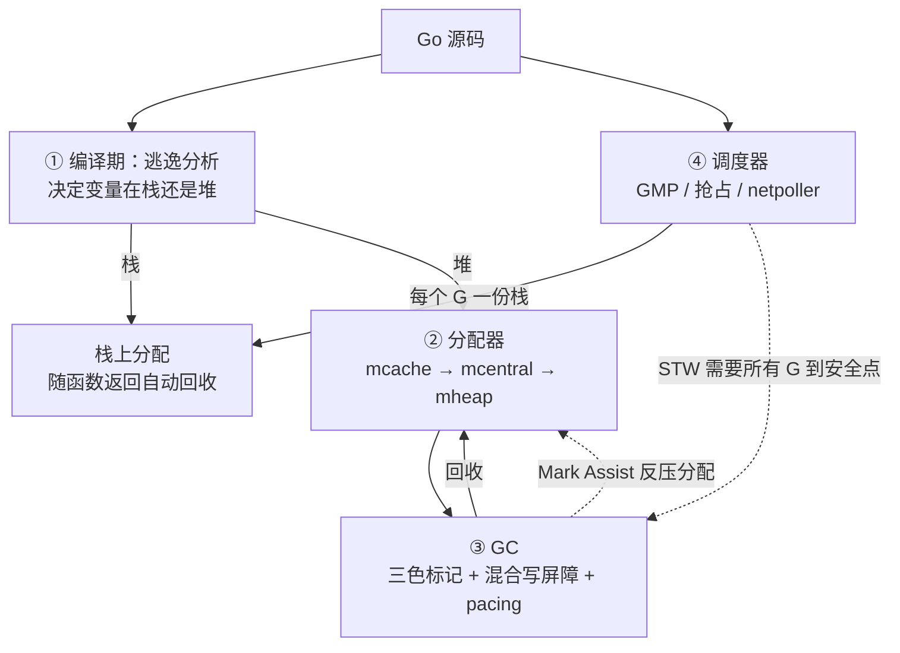
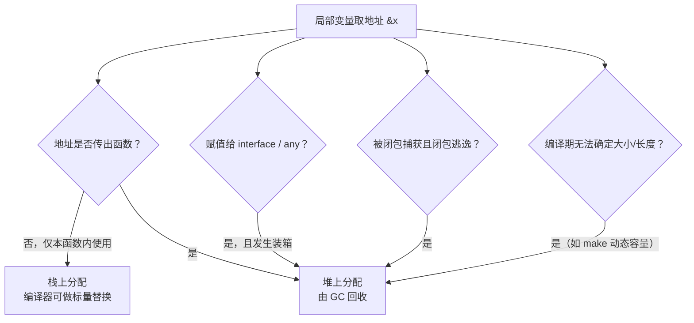
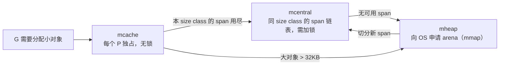
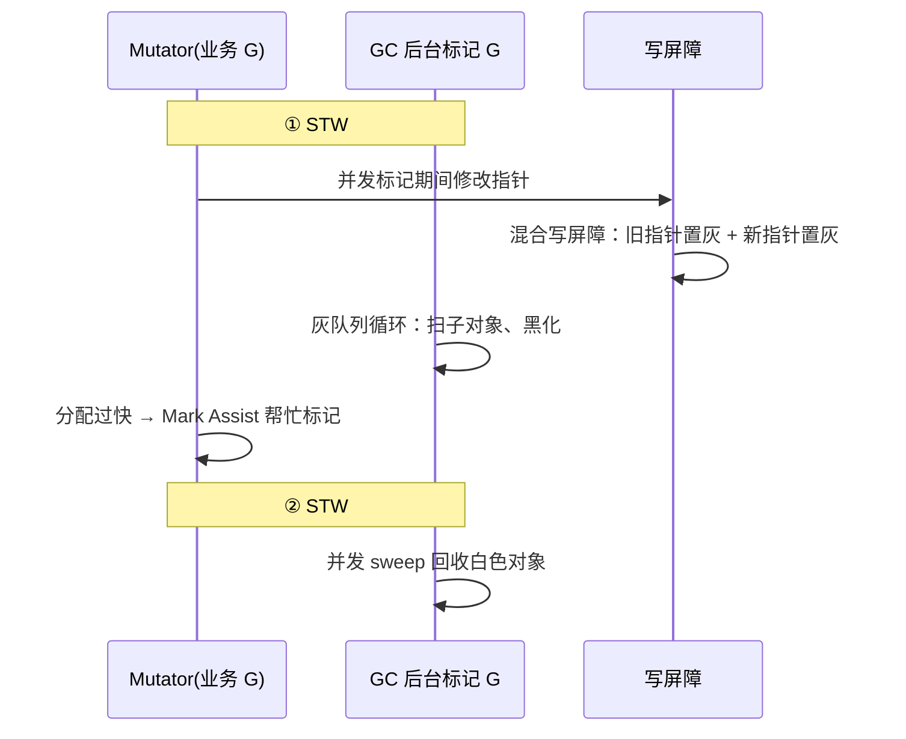
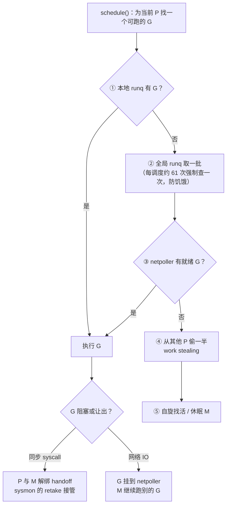
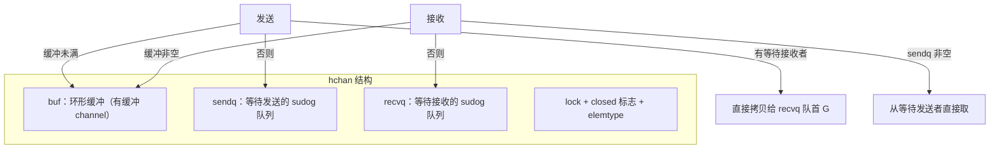
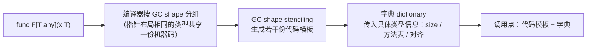
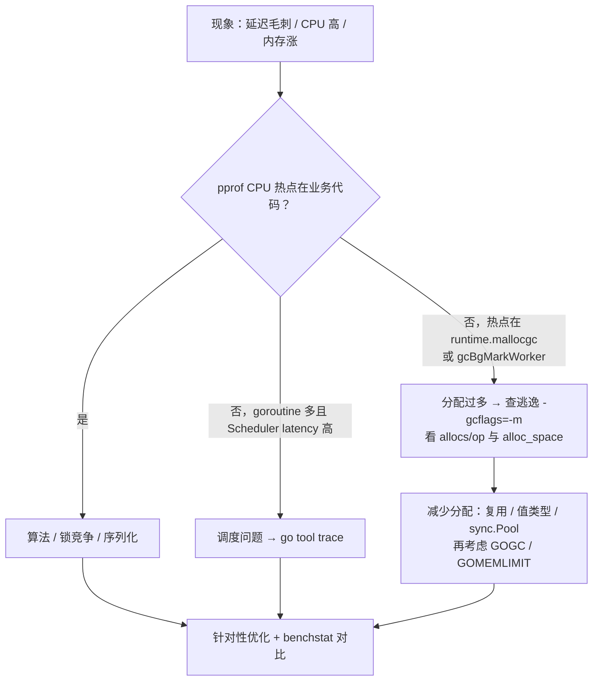

---
tags:
  - go
  - runtime
  - gc
  - performance
  - 面试
created: 2026-11-15
updated: 2026-11-15
status: 已整理
---

# ⚙️ Go 运行时与底层

> 面向面试：**解释「代码为什么这样跑、代价在哪里」**——[[01-语言基础]] / [[02-并发编程]] 讲语义，本篇讲支撑这些语义的运行时机制。

**全文主线**：一段 Go 代码的性能，最终由三件事决定——**分配了多少内存**（逃逸分析与分配器）、**GC 为此付出多少**（标记、屏障、pacing）、**goroutine 怎么被调度**（GMP、抢占、netpoller）。三者互相牵制：分配多 → GC 频繁 → Mark Assist 抢 CPU → 延迟抖动；goroutine 多 → 调度与栈内存开销上升。排查性能问题，本质是判断瓶颈落在哪一段。



> 📌 **一句话定位**：本篇是「为什么」的层，[[07-工程实践]] 是「怎么测」的层。先用 pprof 找到现象，再回本篇找机制解释，最后回到 [[01-语言基础]] / [[02-并发编程]] 改写代码。三者形成闭环，缺任一环都只能猜。
>
> ⚠️ **版本口径（2026-11 核对）**：运行时实现细节（size class 数量、GC 算法、调度策略）随版本演进。本文的机制描述以当前主线为准，涉及具体版本号处标注适用语境；**验证手段优先于记忆结论**——`go version`、`go build -gcflags=-m`、`GODEBUG=gctrace=1`、`go tool trace` 都能在自己环境里直接复现。

---

## 一、内存布局与对齐：struct 为什么不是字段大小之和

```go
package main

import (
    "fmt"
    "unsafe"
)

type Bad struct {
    a bool   // 1B
    b int64  // 8B
    c bool   // 1B
}

type Good struct {
    b int64  // 8B
    a bool   // 1B
    c bool   // 1B
}

func main() {
    fmt.Println(unsafe.Sizeof(Bad{}), unsafe.Alignof(Bad{}))   // 24 8
    fmt.Println(unsafe.Sizeof(Good{}), unsafe.Alignof(Good{})) // 16 8
    fmt.Println(unsafe.Offsetof(Bad{}.b), unsafe.Offsetof(Bad{}.c)) // 8 16
}
```

| 规则 | 说明 |
|---|---|
| **对齐系数** | 每个类型有 `Alignof`；`int64` 在 64 位平台按 8 字节对齐，字段起始地址必须是它的整数倍 |
| **内部填充** | `Bad.a` 后要补 7 字节才能让 `b` 落在 8 的倍数上 |
| **尾部填充** | struct 总大小要向上取整到**最大字段对齐系数**的倍数，保证数组里每个元素仍对齐 |
| **struct 对齐** | 等于所有字段对齐系数的最大值 |

> 📌 **可落地的结论**：把大对齐字段（8B/16B）放前面、小字段聚在后面，能减少填充。这只是**内存占用**优化，不要为了它牺牲可读性；只有高频创建的大 struct / 百万级切片元素才值得做。检测用 `golang.org/x/tools` 的 `fieldalignment` analyzer（独立命令 `go install golang.org/x/tools/go/analysis/passes/fieldalignment/cmd/fieldalignment@latest`，或在 `golangci-lint` 的 `govet` 里启用 `enable: [fieldalignment]`）——它**不是** `go vet` 的内置 flag。

**false sharing（伪共享）**：两个 goroutine 分别写同一缓存行（通常 64B）里的不同变量，会让该缓存行在 CPU 核间反复失效。高频写的热点字段（计数器、状态位）用 padding 隔开：

```go
type Counter struct {
    n    int64
    _    [56]byte // 补到 64B，避免与相邻 Counter 共享缓存行（示意，按目标平台缓存行大小调整）
}
```

> ⚠️ 这是**优化手段而非默认做法**：先有 pprof / perf 证据再上，盲目 padding 只会浪费内存。

---

## 二、逃逸分析：变量到底在栈上还是堆上

### 2.1 判定原则

编译器做**静态**分析：如果一个变量的地址在函数返回后仍可能被访问，它就必须逃逸到堆；否则优先放栈（分配只是移动 SP，回收零成本）。



**亲自验证，不要背结论**：

```bash
go build -gcflags='-m -m' ./...    # 打印逃逸决策与理由
go test -gcflags='-m' -run '^$' ./pkg
# 典型输出：./main.go:12:6: moved to heap: x
#           ./main.go:20:9: ... escapes to heap
```

### 2.2 高频逃逸场景（面试按「为什么」答）

| 场景 | 原因 | 规避 |
|---|---|---|
| `return &T{}` / 返回局部变量指针 | 地址在返回后仍被使用 | 让调用方提供 `*T` 或返回值（编译器可做 NRVO 类优化） |
| 装箱进 `interface{}` / `any` | 接口值需要存类型指针 + 数据指针，数据常需在堆上 | 热路径用具体类型或泛型 |
| `fmt.Sprintf` / `fmt.Println(x)` | 参数是 `...any`，触发装箱 | 日志热路径用 `slog` 的强类型属性 / `strconv` |
| 闭包捕获后返回闭包 | 捕获变量的生命周期随闭包延长 | 传参而非捕获，或缩小闭包作用域 |
| `make([]T, n)` 且 n 非常量 | 编译期无法确定大小 | 预估容量用小栈数组 + 切片复用：`var buf [64]byte; s := buf[:0]` |
| `map` / `slice` 元素是指针 | 容器本身在堆上，`&s[i]` 通常随之逃逸 | 存值而非指针（注意拷贝成本） |
| 向 channel 发送指针 | 接收方生命周期不确定 | 权衡：值拷贝 vs 堆分配 |

> ⚠️ **逃逸不是错误，是成本**：一次堆分配 ≈ 几十纳秒 + 后续 GC 扫描成本。只有在**每请求热路径、每秒百万次**时才值得优化；用 `-gcflags=-m` 和 `benchmem` 的 `allocs/op` 验证收益，别凭感觉改代码。
>
> 📌 **编译器会做标量替换**：若逃逸分析发现对象虽取地址但从未真正离开函数，编译器可能把它拆成若干标量完全放寄存器/栈，`-m -m` 里能看到。所以"取了地址就一定在堆"是错的。

---

## 三、内存分配器：TCMalloc 血统的三级缓存



| 组件 | 作用域 | 职责 |
|---|---|---|
| **mcache** | 每个 P 一份 | 每种 size class 缓存一个 `mspan`，分配**完全无锁**（P 不会被并发访问） |
| **mcentral** | 全局，按 size class 分桶 | 收集同类 span，维护"有空闲槽/无空闲槽"两链表；mcache 归还/申请时加锁 |
| **mheap** | 全局 | 管理页（8KB）与 arena，向 OS 申请内存；大对象直接走这里 |
| **mspan** | 分配单元 | 一段连续页，按固定 size class 切槽，用位图标记已分配 |
| **tiny allocator** | mcache 内 | < 16B 且**不含指针**的对象合并进一个 16B 块，专门消除小对象碎片 |

> 📌 **size class 的代价**：对象按预定义的约 60+ 个尺寸档位分配，实际申请 33B 会落到 48B 档 → **内部碎片**。这也是"struct 少填充几个字节"有时有效的底层原因（跨档与不跨档的差别）。具体档位数量随版本微调，用 `runtime/malloc.go` 或 `GODEBUG` 相关输出核对。
>
> ⚠️ **无指针对象不参与 GC 扫描**：`map[int]int` 之类不含指针的容器，GC 不需要遍历其元素。这就是"用值而非指针填满大切片能显著降 GC 压力"的机制来源。

---

## 四、栈管理：连续栈与 morestack


- 初始 goroutine 栈 **2KB**，按需扩缩（64 位平台默认上限 1GB，可用 `runtime/debug.SetMaxStack` 调整上限字节数；该设置是全局的，且调大只放宽限制、不减少常规占用）。
- **连续栈**（Go 1.3 起）：增长时分配一块更大的连续内存并整体拷贝，替代早期分段栈，消除"热点函数调用在栈边界反复扩缩"的抖动。
- 栈拷贝要**修正所有指向栈的指针**，所以栈上地址不能随便缓存；这也是 `uintptr` 存栈地址极危险的原因之一（§九）。
- **代价**：10 万个 goroutine × 2KB = 200MB 起步；深度递归或大栈帧会连续触发拷贝。排查 goroutine 暴涨时要同时看栈内存。

---

## 五、GC 深入：从三色标记到 pacing

[[01-语言基础]] 已给出三色标记总览，本节补**为什么能并发、代价在哪**。



### 5.1 混合写屏障解决什么

纯 Dijkstra **插入屏障**（新引用置灰）需要 GC 结束时**重新扫描所有栈**（栈上写不触发屏障），代价大；纯 Yuasa **删除屏障**（被覆盖的旧引用置灰）需要 GC 开始时快照所有栈。Go 1.8 起的**混合写屏障**同时做两件事：

- 覆盖旧指针时把**旧对象**置灰 → 防止存活对象被误回收；
- 写入新指针时把**新对象**置灰 → 防止黑色对象直接指向白色对象。

由此**栈无需重新扫描**（GC 开始时栈整体置黑且全程屏障保证堆侧不变量），两次 STW 都缩到微秒~亚毫秒级。

> ⚠️ 屏障**只对堆上指针写生效**，且是编译器在指针赋值处自动插入的运行时调用——这是"写密集 + 指针多的结构"GC 成本更高的原因，也是无指针对象更省的机制。

### 5.2 GC pacing：什么时候触发、为什么不失控

| 概念 | 说明 |
|---|---|
| **pacer** | 根据上次存活堆大小与 `GOGC` 预测下一次触发点，提前启动标记，让堆增长与标记进度匹配 |
| **GOGC** | 默认 100：堆相对上次存活增长 100% 时触发。`GOGC=200` 降频换内存，`GOGC=50` 更频繁换低堆占用；`GOGC=off` 完全关闭 |
| **GOMEMLIMIT**（1.19+） | 总内存**软上限**；接近上限时即使未到 GOGC 也会提前 GC，并加大 Mark Assist 力度 |
| **Mark Assist** | 分配过快的 G 被"征税"——先帮忙做标记工作再继续分配，避免标记追不上分配导致堆无限涨 |
| **STW 放大** | 若 G 长时间不到安全点（密集循环、cgo），STW 会被拉长；异步抢占（§六）正是为此存在 |

> 📌 **调优顺序**：先用 pprof 确认瓶颈是 GC（`runtime/metrics` 的 `/cpu/classes/gc/total:cpu-seconds`、`/gc/heap/allocs:bytes`，以及 heap profile 的 `alloc_space`）→ 优先**减少分配**（复用、值类型、池化）→ 再考虑 `GOGC` → 最后才用 `GOMEMLIMIT` 兜底。**调 GOGC 治不了分配本身过多**，只是把成本摊平。指标名用 `go tool metrics` 或 `runtime/metrics.All()` 现场核对。
>
> ⚠️ `GOMEMLIMIT` 是**软**限制：极端分配速率下仍可能超限甚至 OOM，不能当硬隔离用；容器里应同时设 K8s memory limit 并留余量。

### 5.3 观测入口

```bash
GODEBUG=gctrace=1 ./your-binary 2> gc.log
# 每个 GC 周期输出：gc # @time %: 停顿 / 各阶段耗时 / 堆大小 / 目标
go tool trace -http=:8080 trace.out      # 看 GC、调度、STW、Mark Assist 全貌
```

```go
package main

import (
    "fmt"
    "runtime"
    "runtime/metrics"
)

func main() {
    var m runtime.MemStats
    runtime.ReadMemStats(&m) // 本身有一次 STW，不要高频调用
    fmt.Println(m.HeapAlloc, m.HeapInuse, m.NumGC, m.PauseTotalNs)

    // 生产推荐：runtime/metrics 按周期采样，无 STW
    samples := []metrics.Sample{
        {Name: "/memory/classes/heap/objects:bytes"},
        {Name: "/cpu/classes/gc/total:cpu-seconds"},
        {Name: "/sched/goroutines:goroutines"},
    }
    metrics.Read(samples)
    for _, s := range samples {
        fmt.Printf("%s = %v\n", s.Name, s.Value)
    }
}
```

> 📌 指标名用 `go doc runtime/metrics` 或 `runtime/metrics.All()` 现场核对，不同 Go 版本会增删 key；读取不存在的 key 会得到 `Value.Kind() == KindBad`，不会 panic。

> ⚠️ `runtime.ReadMemStats` 会触发 STW，**禁止放在每请求热路径**；生产用 `runtime/metrics` 包按周期采样，或直接暴露 `prometheus` 的 Go collector。

---

## 六、GMP 深入：抢占、sysmon 与 netpoller

[[02-并发编程]] 给了 GMP 与 work stealing 的骨架，本节补调度循环的运行机制。



| 机制 | 说明 |
|---|---|
| **g0** | 每个 M 自带的调度栈，负责 `schedule` / `morestack` / GC 等运行时工作；用户 G 跑在自己的栈上 |
| **异步抢占（1.14+）** | 基于信号的非协作式抢占，`sysmon` 给长时间运行的 M 发 `SIGURG`，在安全点注入异步抢占；解决**无函数调用的密集循环无法被抢占**导致的 STW 拉长 |
| **协作式抢占** | 函数调用 prologue 检查栈增长时顺带检查抢占标志（`stackguard0` 被置为抢占哨兵） |
| **sysmon** | 独立线程（不绑 P）：触发 `retake`（回收长期 syscall 占用的 P）、netpoll、forcegc（2 分钟无 GC 时强制）、抢占长跑 G |
| **handoff** | M 进入阻塞 syscall 前标记 P 为 `_Psyscall`；sysmon 发现超时就把 P 剥离交给空闲 M，避免整个 P 上的 G 饿死 |
| **netpoller** | epoll/kqueue 封装；网络 fd 就绪后把对应 G 重新入队，**IO 不占用 OS 线程** |
| **GOMAXPROCS** | 并行度（P 数），不是并发上限；1.25 起在 Linux 上会读取 cgroup CPU limit 并动态调整（容器场景更合理） |

> 📌 **一个请求慢，可能是被调度延迟而非代码慢**：`go tool trace` 的 "Scheduler latency" 与 G 从就绪到运行的等待时间能区分"算得慢"和"排不上队"。goroutine 数远超 P 数 + 大量 CPU 密集任务时，先看这个再谈优化算法。
>
> ⚠️ **别把 GOMAXPROCS 设得比 CPU 配额大**：容器里 CPU limit = 2 但机器 64 核时，旧版本默认按 64 建 P，会加剧 CFS 节流与上下文切换。1.25+ 已容器感知；旧版本用 `automaxprocs` 之类的库或显式设置。

---

## 七、channel / mutex 的运行时实现



| 机制 | 底层要点 |
|---|---|
| **channel** | `hchan` + 一把锁；`sudog` 封装被挂起的 G 与待传数据；发送/接收在**同一个锁**下完成数据拷贝，所以 channel 传递是同步的内存交接 |
| **select** | 编译器改写成 `selectgo`：先按**伪随机顺序**打乱 case（避免固定优先级饿死），锁住所有 channel，找就绪 case；全不就绪则把当前 G 挂进所有 case 的等待队列 |
| **Mutex 饥饿模式（1.9+）** | 正常模式自旋 + 抢锁（吞吐优先）；某 G 等待超 1ms 切饥饿模式，按等待队列 FIFO 移交（防尾延迟饿死） |
| **Mutex 自旋** | 短临界区在多核上先自旋几次再休眠，避免立刻陷入内核；单核/持锁久则直接休眠 |
| **sync.Pool** | 每 P 一份 `private` + `shared` 队列，**GC 时会被清空**，只适合"可随时重建的临时对象"，不能当长连接缓存 |
| **atomic** | 底层是 CPU 的 CAS / LL-SC + 内存屏障；Go 的 `sync/atomic` 提供顺序一致语义，不需要像 C++ 手动选 memory order |

> ⚠️ **channel 不是免费的**：每次收发都加锁并可能触发 G 切换。超高吞吐的纯数据管道，用带缓冲 channel + 批量、或无锁环形缓冲更快；先 benchmark 再换。

---

## 八、unsafe 与底层指针：能用，但必须知道代价

```go
package main

import (
    "fmt"
    "unsafe"
)

func main() {
    s := []int32{1, 2, 3, 4}
    // 合法：*T1 -> unsafe.Pointer -> *T2，且目标类型不超过原内存范围
    p := unsafe.Pointer(&s[0])
    view := unsafe.Slice((*byte)(p), len(s)*4) // 1.17+ 推荐写法，替代手写 SliceHeader
    fmt.Println(len(view))
    // 1.20+ 也提供 unsafe.String / unsafe.StringData 处理 []byte <-> string 零拷贝
}
```

| 规则 | 说明 |
|---|---|
| **四种合法转换** | `*T1 ↔ unsafe.Pointer ↔ *T2`、`unsafe.Pointer → uintptr`、配合 syscall/reflect 在同一表达式内回转、`reflect.Value.Pointer/UnsafeAddr → unsafe.Pointer` |
| **uintptr 陷阱** | `uintptr` 是整数，**GC 不把它当指针**：对象可能被回收或栈被拷贝移动。转换必须发生在**同一个表达式**内，禁止先存 uintptr 再之后转回 Pointer |
| **unsafe.Slice/String** | 1.17 / 1.20 起替代手写 `reflect.SliceHeader`，后者极易因 GC 与逃逸出错 |
| **//go:linkname** | 直接链接到 runtime 内部符号，破坏兼容性且需 `unsafe` 导入，升级即可能崩；生产禁用 |
| **reflect 代价** | 运行期类型查询、装箱与动态调用，热路径明显慢于泛型/静态调用 |

> ⚠️ **使用原则**：零拷贝转换（网络包解析、序列化库）是合理场景；绕过类型系统做"性能优化"前，必须有 benchmark 证明收益 > 可维护性损失。用 `go vet -unsafeptr` 与 `checkptr`（`go test -race` 默认开）兜底。

---

## 九、泛型的实现：为什么不是纯单态化



| 概念 | 说明 |
|---|---|
| **单态化（C++/Rust）** | 每个具体类型生成完整副本：快，但二进制膨胀、编译慢 |
| **纯字典（Java 擦除式）** | 只一份代码，靠装箱：二进制小，但值类型要装箱、性能差 |
| **Go：GC shape stenciling** | 折中——按类型的**指针布局**（GC shape）分组生成代码，同组内共用；具体类型信息由字典传递，值类型不装箱 |
| **类型约束 / comparable** | 约束决定字典里有哪些操作可用；`comparable` 保证 `==` 可用，但接口作 `comparable` 时运行期可能 panic（值不可比较） |
| **泛型方法**（1.27+） | 方法可声明**自己的**类型参数（`func (l List[E]) Map[R any](...)`）；但**接口方法仍不能声明类型参数，泛型方法也不能用来实现接口方法**（接口方法表需编译期确定）。1.26 及更早只能把这类逻辑写成包级泛型函数 |
| **实例化** | 编译期确定用到的 shape 集合；跨包泛型会被编译进调用方，可能影响编译时间与二进制大小 |

> 📌 泛型替代 `interface{}` 的收益不只是类型安全，更是**消除装箱逃逸**（§二）。但泛型不是零成本：字典查表与代码体积都在，热路径仍需 benchmark 对比。
>
> ⚠️ **泛型方法的版本口径**：1.18~1.26 的旧资料普遍写「方法不能有类型参数」，Go **1.27（2026-08）已放开**这一限制。面试里被问到时，先确认对方问的是哪个 Go 版本——`go.mod` 的 `go` 指令决定语言版本。

---

## 十、性能诊断进阶：从现象回到机制



| 工具 | 看什么 | 开启方式 |
|---|---|---|
| `pprof` cpu / heap | 热点函数、分配来源（`alloc_space` vs `inuse_space`） | `net/http/pprof` 或 `go test -cpuprofile` |
| **block / mutex profile** | 阻塞在 channel、锁上的时间 | **默认关闭**，需 `runtime.SetBlockProfileRate(1)` / `SetMutexProfileFraction(1)`（连 [[07-工程实践]]） |
| `GODEBUG=gctrace=1` | 每轮 GC 停顿、堆增长、目标 | 环境变量 |
| `go tool trace` | G 调度延迟、STW、Mark Assist、syscall 阻塞、GC 各阶段 | `runtime/trace.Start`；1.25+ `FlightRecorder` 可低开销常开 |
| `-gcflags=-m -m` | 逃逸决策与理由 | 编译期 |
| `go test -bench -benchmem` + `benchstat` | `ns/op` / `B/op` / `allocs/op` 的前后对比 | 基准测试 |

> 📌 **顺序不能反**：先量化（pprof / trace）→ 再定位层（分配 / GC / 调度 / 算法）→ 最后改代码 → 用 benchstat 验证。跳过量化直接调 `GOGC` 或加 `sync.Pool`，是性能调优最常见的无效劳动。

---

## 十一、Go 版本演进（2026-11 核对，按官方 release notes 为准）

> 只列**与运行时、语言、工程实践强相关**的变化；完整清单见 `go.dev/doc/go1.xx`。日期为发布月份。

| 版本 | 关键变化 | 对笔记的影响 |
|---|---|---|
| **1.18** | 泛型、原生 Fuzz、workspaces | [[01-语言基础]] 泛型、[[07-工程实践]] Fuzz |
| **1.19** | `GOMEMLIMIT` 软内存上限 | §5.2 |
| **1.20** | `errors.Join` 包装多错误、PGO 预览 | [[01-语言基础]] 错误链 |
| **1.21** | `min/max/clear` 内置、`slices`/`maps`/`cmp` 包、`log/slog`、**PGO GA**、工具链前向/后向兼容 | [[07-工程实践]] slog / benchmark |
| **1.22** | **循环变量每轮独立**（闭包陷阱修复）、`range 10`、ServeMux 方法与通配、math/rand/v2 | [[03-Web 与 RPC]] ServeMux、[[02-并发编程]] 闭包 |
| **1.23** | **range-over-func / `iter` 包**、`unique`（值驻留）、Timer/Ticker 重构、泛型别名预览、Go telemetry | [[01-语言基础]] time 坑 |
| **1.24** | **泛型类型别名正式可用**、**Swiss Table map**、`go tool` 工具依赖、`os.Root`、`weak` 指针、`testing.B.Loop`、FIPS 140-3 | §九泛型底层 |
| **1.25** | **容器感知 GOMAXPROCS**、Green Tea GC（实验）、`testing/synctest` 转正、`encoding/json/v2` 实验、`runtime/trace.FlightRecorder`、`sync.WaitGroup.Go` | §六 GOMAXPROCS、§十 trace |
| **1.26** | Green Tea GC 默认（GC 开销下降）、cgo 调用提速、`go fix` modernizers、后量子 TLS 混合默认 | §五 GC |
| **1.27** | **泛型方法**（接口方法仍不可带类型参数）、`encoding/json/v2` + `jsontext` GA、`uuid` 包、小对象分配提速、goroutine 泄漏 profile GA | §九泛型方法口径**按版本区分** |

> 📌 **泛型方法（1.27）的准确边界**：具体类型的方法可以声明自己的类型参数；**接口方法不能声明类型参数，泛型方法也不能满足接口方法**。这条限制来自接口方法表需要编译期确定，与 GC shape 无关，答题时别混为一谈。

> ⚠️ **演进最快的三处**：GC 实现（Green Tea）、泛型能力边界（1.27 泛型方法）、容器感知调度。写笔记或答题时标注「基于哪个 Go 版本」，用 `go version` 与官方 release notes 复核，不要拿旧结论当当前事实。
>
> 📌 **1.22 循环变量变更必须记**：1.22 之前 `for _, v := range xs { go func(){ use(v) }() }` 所有 goroutine 共享同一个 `v`；1.22 起每轮独立。面试里若面试官按旧语义追问，要能说明「取决于 go.mod 的 go 指令版本」——语言版本由 `go` 指令控制，这正是 1.21 工具链兼容机制的作用。

---

## 十二、高频问答 🎯

**Q1：怎么判断一个变量逃逸到堆了？逃逸一定不好吗？**
用 `go build -gcflags='-m -m'` 看编译器决策与理由。逃逸不是错误：堆分配约几十纳秒 + 后续 GC 成本，只有高频热路径才值得优化；且编译器会做标量替换，"取了地址就必在堆"是错的。优先看 `allocs/op` 与 heap profile 再动手。

**Q2：`struct` 字段顺序为什么影响内存占用？**
每个字段要按其对齐系数对齐，编译器在字段间插入 padding，struct 尾部还要补齐到最大对齐系数的倍数。把 8B/16B 字段放前、小字段聚后能减少填充；但只有百万级元素或高频创建时才值得为此牺牲可读性。

**Q3：Go 的 GC 为什么能做到亚毫秒 STW？**
并发三色标记 + 混合写屏障。屏障同时给旧指针与新指针置灰，保证堆侧三色不变式，因此栈在 GC 开始时整体置黑后**无需重新扫描**；只剩两次极短 STW（开启屏障扫根、标记终止）。代价是每次堆指针写都有屏障开销，以及 Mark Assist 会在分配过快时抢业务 CPU。

**Q4：`GOGC` 和 `GOMEMLIMIT` 什么关系？调哪个？**
`GOGC` 按堆相对增长比例触发；`GOMEMLIMIT` 是总内存软上限，接近时提前触发 GC 并加大 Mark Assist。优先**减少分配**（复用、值类型、池化），再调 `GOGC` 摊平成本，最后用 `GOMEMLIMIT` 兜底。软上限不保证不超限，容器里仍要配 memory limit。

**Q5：Mark Assist 是什么？为什么我的请求偶尔特别慢？**
分配速率超过标记进度时，运行时的 pacer 会让正在分配的 G 先帮忙做标记工作再继续，相当于"分配税"。表现为偶发延迟毛刺，且 `go tool trace` 能看到 mutator 被拉去做标记。根因通常是分配过多，不是 GC 参数不对。

**Q6：Go 1.14 的异步抢占解决什么问题？**
此前只有函数调用点的协作式抢占，一个不含函数调用的密集循环能长时间占住 M，导致 GC 的 STW 等不到安全点被拉长。异步抢占由 `sysmon` 发信号（Linux 上 SIGURG）在安全点注入，保证 STW 可控。

**Q7：同步 syscall 阻塞时 P 会怎样？**
M 进入 syscall 前把 P 标为 `_Psyscall`；`sysmon` 的 `retake` 发现超时就剥离 P 交给其他 M（handoff），避免该 P 本地队列里的 G 全部饿死。网络 IO 则走 netpoller，G 挂起、M 不阻塞，两者路径不同。

**Q8：channel 发送一定是"拷贝进缓冲"吗？**
不一定。若 `recvq` 已有等待的接收者，发送方在锁内**直接把数据拷贝到接收 G 的栈/变量**，不经过 `buf`；只有无等待者且缓冲未满时才写入环形缓冲。这个细节解释了无缓冲 channel 的"同步交接"语义。

**Q9：`select` 多个 case 都就绪时选哪个？伪随机吗？**
是。`selectgo` 先用伪随机顺序打乱 case 再扫描，避免固定优先级导致某些 case 长期饥饿；`default` 只在没有任何 case 就绪时执行。全不就绪则把当前 G 挂进所有 case 的等待队列，任一就绪即被唤醒并解绑其余队列。

**Q10：`sync.Pool` 能当连接池用吗？**
不能。Pool 在**每次 GC 时会被清空**，且每 P 独立缓存，取到的对象随时可能消失；它只适合"丢了能立刻重建的临时对象"（`[]byte` 缓冲、编码器实例）。长连接要用显式生命周期管理的池。

**Q11：`uintptr` 存指针为什么危险？**
`uintptr` 是整数，GC 不把它当存活引用，对象可能被回收；连续栈拷贝又会移动栈上对象。因此 `unsafe.Pointer → uintptr → unsafe.Pointer` 必须发生在**同一个表达式**内（如配合 syscall 或取结构体字段偏移），中间不能落地保存。1.17+ 应用 `unsafe.Slice` / 1.20+ `unsafe.String` 替代手写 Header。

**Q12：Go 泛型是单态化吗？方法能有自己的类型参数吗？**
Go 用 **GC shape stenciling + 字典**：按类型的指针布局分组生成代码，同组共享，具体类型信息由字典传入，避免纯单态化的体积膨胀和纯擦除的装箱开销。**1.27 之前**方法不能自带类型参数；**1.27 起**具体类型的方法可以声明自己的类型参数，但**接口方法仍不能带类型参数、泛型方法也不能实现接口方法**。答题时按 `go.mod` 的 `go` 指令版本说明。

**Q13：CPU 不高但服务延迟大，怎么判断是不是调度问题？**
用 `go tool trace` 看 G 从就绪到运行的等待（Scheduler latency）与 syscall 阻塞。若 goroutine 数远超 `GOMAXPROCS`、且大量 CPU 密集任务，可能是排队；也可能是锁/ channel 阻塞（开 block/mutex profile）、GC Mark Assist、或 STW 被密集循环拉长。`GODEBUG=gctrace=1` 与 `schedtrace` 可辅助区分。

**Q14：`runtime.ReadMemStats` 能放在每请求里监控吗？**
不能，它本身会触发一次 STW，高频调用会自己制造延迟。生产用 `runtime/metrics` 包按周期采样，或用 Prometheus Go collector 暴露指标（连 [[07-工程实践]]）。

---

## 十三、关联

- 语义与用法 → [[01-语言基础]]（值语义 / 切片 / map / 接口 / 泛型 / GC 概览）、[[02-并发编程]]（GMP 骨架 / channel / sync / 内存模型）
- 诊断与调优 → [[07-工程实践]]（pprof / trace / benchmark / GODEBUG / Docker 与 CGO）、[[02-可观测性]]（指标采集通用机制）
- 网络底层 → [[03-Web 与 RPC]]（netpoller 之上的 net/http、长连接）、[[04-Proto 与 Buf]]（序列化与零拷贝）
- 数据层 → [[05-数据库]]（连接池与对象生命周期）、[[06-中间件]]（消费并发与 GC 压力）
- 上游 → [[Go 开发]]（分层地图与横切主线）、[[Go 与 K8s 开发]]（client-go 的 Informer 与 GC 压力）
